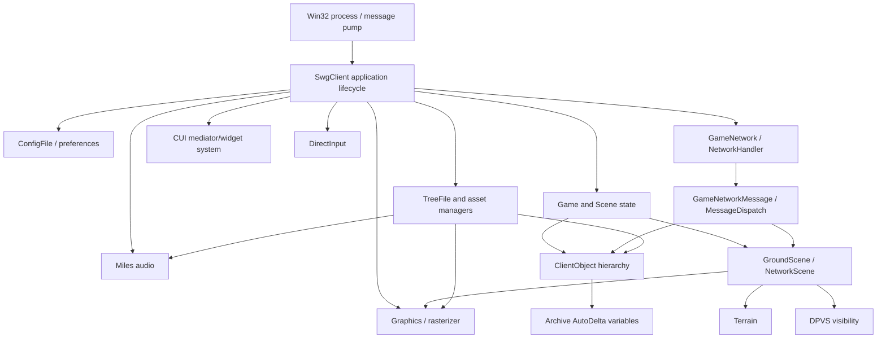
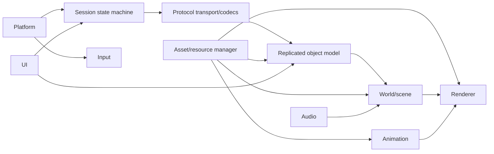

# Client Architecture

## Reconstructed high-level model

Arrows show observed or strongly inferred dependencies, not recovered ownership.

## Confirmed architectural elements

- Native C++ polymorphic class hierarchy with MSVC RTTI and vtables.
- Application-level install/remove conventions: strings include `SetupClientAudio::install/remove`, `SetupClientDirectInput::install`, `SetupClientGame::install/remove`, `GameNetwork::install/remove`, and many manager `install` methods.
- Internal publisher/subscriber bus named `MessageDispatch`, with `Emitter`, `Sender`, `Receiver`, `Listener`, `Callback`, `Transceiver`, and `OwnedTransceiver` types.
- Network messages represented by `GameNetworkMessage`, plus typed messages and `Archive::AutoVariable`/`AutoDeltaVariable` families.
- Client object hierarchy includes `ClientObject`, `CreatureObject`, `PlayerObject`, `CellObject`, `IntangibleObject`, and shared object-template types.
- Scene types include `Scene`, `NetworkScene`, and `GroundScene`; strings demonstrate scene cleanup/change and terrain validation.
- Visibility is delegated to DPVS cells, physical portals, object models, regions of influence, and camera visibility resolution.

## Strong inferences

The architecture is modular but statically linked into one very large executable, with middleware DLL boundaries for DPVS, Miles, DirectInput and renderer/raster modules. `qt-mt305.dll` is present in the directory but is not imported by Stardust.exe and has no proven CUI load path, so it is not treated as an in-game UI dependency. Subsystems follow explicit `install`/`remove` lifecycle registration rather than RAII-centric composition.

Network updates appear to enter typed `GameNetworkMessage` instances, pass through `GameNetwork::Listener`/`MessageDispatch`, and mutate networked fields represented by `Archive::AutoDelta*` wrappers. Creature field wrappers expose named callbacks such as `ServerPostureChanged`, `VisualPostureChanged`, `StatesChanged`, `SkillsChanged`, and `GroupChanged`, providing a valuable path from wire baselines/deltas to gameplay state.

## Replacement architecture

The replacement should preserve boundaries, not implementation detail:

- Platform: window, clock, threads, sockets, filesystem, crash/log plumbing.
- Protocol: SOE transport framing/reliability plus immutable SWG message codecs.
- Session: login/cluster/zone/character state machines.
- Replication: 64-bit internal object handles and explicit fixed-width wire codecs.
- Assets: TRE/IFF virtual filesystem and typed loaders behind versioned interfaces.
- Renderer: modern API, render graph, resource lifetime, shader translation/replacement.
- World: spatial scene, cells/portals, terrain, streaming.
- Animation/audio/input/UI: redesigned internally, behaviorally compatible at boundaries.

## Reuse versus redesign

Conceptually reusable: message names and state-machine ordering; object-template/CRC identities; baseline/delta schemas; scene-cell-containment model; asset virtual paths; terrain/appearance/shader concepts; animation state/appearance semantics.

Redesign: memory managers/pools, thread primitives, platform loop, rendering API and resource ownership, UI implementation, diagnostics, async I/O/job system, and internal pointer-based object graphs. DPVS concepts may be retained, but the proprietary implementation should not be assumed reusable.

## Accepted mixed presentation boundary - Round15

[Core consumer](SCENE_WORLD_OBJECT_PRESENTATION_CONTRACT.md) owns bounded actor
bookkeeping, exact publication/incarnation checks and acknowledged change delivery.
The [Godot factory](SCENE_WORLD_OBJECT_VISUAL_CONTRACT.md) owns recipe visuals and
GPU lifetimes through ISceneWorldObjectPresentation; Core contains no Godot types.
World registry, state, resource scheduler and close drain remain authoritative and
externally owned. Callers pump publications/current batches and tick adapters.
Application is serialized/retryable, with exact current applied-batch acknowledgment;
no presentation rollback transaction or separate state registry is introduced.

## Continuous scene host accepted - October2,2026

[Round16](../research/sessions/PARALLEL_DEVELOPMENT_ROUND_16_2026-10-02.md)
joins the bounded [pump](SCENE_WORLD_PRESENTATION_PUMP_CONTRACT.md),
[Godot host](SCENE_WORLD_PRESENTATION_HOST_CONTRACT.md) and logical
[resource accounting](SCENE_OBJECT_RESOURCE_ACCOUNTING_CONTRACT.md).
Independent peer and original headless/GPU/cancellation checks pass; the human
retains its resource identity during state updates and terminal-only recreation.
These are synthetic offline messages with explicit original asset recipes and
modern queue/timing policy. Movement/interior integration and live contact remain
separate. Research scores and protocol/name denominators are unchanged.

## Native motion join - October2,2026

[Round17](../research/sessions/PARALLEL_DEVELOPMENT_ROUND_17_2026-10-02.md)
joins [compact codecs](COMPACT_SCENE_TRANSFORM_CONTRACT.md),
[native poses](SCENE_WORLD_OBJECT_MOTION_CONTRACT.md),
[body envelopes](SCENE_CREATURE_BODY_ENVELOPE_CONTRACT.md) and
[Godot motion](SCENE_WORLD_OBJECT_MOTION_VISUAL_CONTRACT.md).
Continuous original headless/GPU/cancel and independent/native/shared gates pass.
Height applies once; immutable create/resource identity survives wrap/stale and
clear/local resume. Diagnostic zero yaw/immediate pose is modern policy, not
recovered interpolation. Parent resolution, physical speed interpretation, unified
world ingress, locomotion and interior traversal remain open.

## Round18 local input and offline motion ingress

[Round18](../research/sessions/PARALLEL_DEVELOPMENT_ROUND_18_2026-10-02.md)
joins [local driver](SCENE_WORLD_LOCAL_MOTION_CONTRACT.md),
[input and locomotion](SCENE_WORLD_LOCAL_INPUT_CONTRACT.md) and
[motion ingress](SCENE_WORLD_MOTION_INGRESS_CONTRACT.md) through the continuous
bounded pump. Original headless/GPU/cancel and independent nine-stage time/pose/
clip/resource proofs pass. Modern correction/pause/free planar movement is
explicit; original yaw, interpolation, prediction and parent-world conversion
remain unclaimed. [Head-material diagnosis](SCENE_HUMAN_HEAD_MATERIAL_GAP.md)
requires an explicit generated-face route next. Research/function/protocol
denominators are unchanged. Workers remain Low; successive rounds are authorized
under the overnight instruction.

## Round19 explicit generated face route

[Round19](../research/sessions/PARALLEL_DEVELOPMENT_ROUND_19_2026-10-02.md)
joins [owned face resources](SCENE_CREATURE_FACE_RESOURCE_CONTRACT.md),
[completion/accounting](SCENE_CREATURE_FACE_COMPLETION_CONTRACT.md) and
[actual GPU MAIN inspection](SCENE_CREATURE_FACE_INSPECTION_CONTRACT.md).
Opt-in supplied values survive async option copying;76-source original closure,
five-layer output, scoped face pixels, movement retention and malformed/canceled/
lost-incarnation cleanup pass. Default route and metrics retain their meanings.
[Wire/packed ingress](CREATURE_APPEARANCE_CUSTOMIZATION_INGRESS.md) identifies the
next typed setter/field4 revision boundary; actual player values remain unknown.

## Round20 integration

[Accepted integration evidence](../research/checkpoints/IMPLEMENTATION_CHECKPOINT_2026-10-03_R20_CUSTOMIZATION_INTEGRATION.md) records owned CIDM/raw packed decoding, supplied current-creature appearance revisions and bounded presentation/world drain. Original-resource, native/headless/GPU, latest/failure/retirement and real pending-close gates pass. This is explicit supplied inspection state; rawfield4 state translation is next. Four Low workers stopped; overnight authorization permits the next round after acceptance. Known certificate/shader initialization diagnostics persist and are counted, while actual upload/readback/pixels pass.

## Round21 integrated boundary

Round21 joins owned field4 codec, ordered raw sidecar, explicit typed-range projection and retained presentation source. Compatibility boundaries remain engine-neutral; the Godot adapter observes LastFailure and fails closed. Mixed field dispatch and live mount/default context remain next. [Evidence and reproduction](../research/checkpoints/IMPLEMENTATION_CHECKPOINT_2026-10-03_R21_WIRE_CUSTOMIZATION_INTEGRATION.md).

## Round22 integrated boundary

Round22 stages raw customization, scalar replication and world change journal together before callback-free commit. Engine-neutral codecs/context remain separate from presentation. ACST descriptions are owned; live mounts/player values remain open. [Evidence/reproduction](../research/checkpoints/IMPLEMENTATION_CHECKPOINT_2026-10-03_R22_CUSTOMIZATION_SCALAR_INTEGRATION.md).

## Round23 integrated boundary

The supported CREO:3 union4/5/11–17 now stages raw customization, scalars, components, wounds and pending world state together. Original selected ACST/CIDM context supplies exact ranges and authored defaults through five already owned palettes. Main independent native, headless/GPU, motion and held-container gates pass. Broader fields/views, live mounts/player seeds and graphical attachment/wound behavior remain open. [Evidence and reproduction](../research/checkpoints/IMPLEMENTATION_CHECKPOINT_2026-10-03_R23_FULL_CREATURE_INTEGRATION.md).

## Round24 integrated boundary

Supported CREO3 fixed common fields0/3/6–10 join the existing union. Current common state survives older ingress; visibility uses that overlay while hidden appearance work commits. Actual delta headless/GPU/motion and separate held-baseline visibility proofs pass. Names1/2, TANO, gameplay meanings and live interoperability remain open. STF variant1 exact owned lookup passes two original tables; locale/cache/fallback is deferred. [Evidence and reproduction](../research/checkpoints/IMPLEMENTATION_CHECKPOINT_2026-10-03_R24_EXTENDED_CREATURE_INTEGRATION.md).

## Round25 named creature increment

The supported ordered CREO3 union now covers indices0–17, including raw StringId/custom names. Current name overlays and variable charge survive older ingress. Bounded original STF1 resolution drives an optional caption; actual delta headless/GPU and separate held-baseline name proofs pass. Explicit modern name precedence/directory/display policies do not establish original UI/locale behavior. Other families/views and live interoperability remain open. [Evidence and reproduction](../research/checkpoints/IMPLEMENTATION_CHECKPOINT_2026-10-03_R25_NAMED_CREATURE_INTEGRATION.md).

## Round26 tangible stages

Complete owned TANO3 baseline and ordered0–10 delta codecs, standalone current tangible store and bounded original STF preload pass independent native oracles. Static supplied-projection caption/visibility passes original terminal GPU and lifecycle checks. Lead codec-store-preload join passes; atomic typed SceneWorld publication is next. [Evidence](../research/checkpoints/IMPLEMENTATION_CHECKPOINT_2026-10-03_R26_TANGIBLE_STAGE_INTEGRATION.md).

## Round27 typed tangible publication

Optional complete TANO3 world state commits with its journal after private preparation. Static typed token gates actual original terminal caption/raw visibility beside supported CREO ingress; five headless/GPU states, retained resources and teardown pass independent oracles. Default opaque behavior remains. Authored template names and local SWTS selector semantics are separately documented; outer clock and live interoperability remain open. [Evidence](../research/checkpoints/IMPLEMENTATION_CHECKPOINT_2026-10-03_R27_TANGIBLE_WORLD_INTEGRATION.md).

## Round29 accepted behavior

Original mission terminal all-frame loading and mixed-world playback pass headless/GPU:34 unique sources,15 retained images/126mips/2490372decoded bytes,3969782pending weight;8 cached GPU frame uploads,13 independently checked states and deterministic retirement. Initializer policy-copy omission was caught in the main-host gate and fixed before acceptance. Typed TANO3 captions/visibility and prior CREO3 regressions pass. Standalone object clock passes390checks/36cases/157independentoperations; direct TANO6 state audit109anchors/twoRTTI/16models. Modern numeric/time policy and absent live interoperability remain explicit. [Combined acceptance](../research/checkpoints/IMPLEMENTATION_CHECKPOINT_2026-10-03_R29_SWITCH_FRAME_INTEGRATION.md).

## Round30 clock and defender increment

Owned TANO6 state passes21 sequences/23 transitions,700 negatives,315 budget and114 ownership checks with an independent wire/state/event/work oracle. Clock-to-cursor147 checks/14 cases/79 reference operations and resource-option20 projections/seven completions pass. Actual main headless/GPU fourteen-state clock delivery and prior supplied-time mode retain original terminal geometry/captions and drain caches/clock without update I/O. First-visible-frame uncertainty and absent live interoperability remain explicit. [Combined evidence](../research/checkpoints/IMPLEMENTATION_CHECKPOINT_2026-10-03_R30_CLOCK_AND_DEFENDER_STAGES.md).

## Round31 outdoor and view6 prerequisites

Owned direct-version terrain masks and all nine exact terrain patch patterns pass independent original-byte/table and native oracles. Current-incarnation TANO6 publication and historical-event ownership pass143 checks/23 transitions/38 events. CREO6 prefix/extension structure passes109 anchors/18 registrations/16RTTI; complete codec/world routing remain next. Actual headless/GPU consumed-time failure retires the clock and cached presentation without retry. [Combined evidence](../research/checkpoints/IMPLEMENTATION_CHECKPOINT_2026-10-03_R31_TERRAIN_AND_REPLICATION_STAGES.md).
