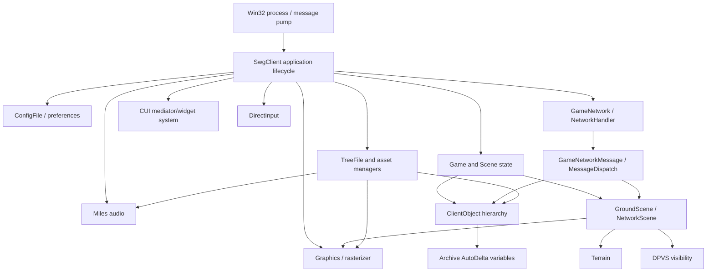
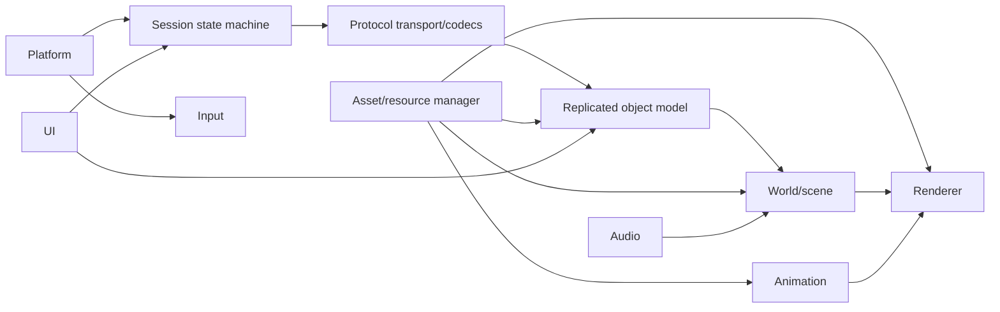

# Client Architecture

## Reconstructed high-level model

Arrows show observed or strongly inferred dependencies, not recovered ownership.

## Confirmed architectural elements

- Native C++ polymorphic class hierarchy with MSVC RTTI and vtables.
- Application-level install/remove conventions: strings include `SetupClientAudio::install/remove`, `SetupClientDirectInput::install`, `SetupClientGame::install/remove`, `GameNetwork::install/remove`, and many manager `install` methods.
- Internal publisher/subscriber bus named `MessageDispatch`, with `Emitter`, `Sender`, `Receiver`, `Listener`, `Callback`, `Transceiver`, and `OwnedTransceiver` types.
- Network messages represented by `GameNetworkMessage`, plus typed messages and `Archive::AutoVariable`/`AutoDeltaVariable` families.
- Client object hierarchy includes `ClientObject`, `CreatureObject`, `PlayerObject`, `CellObject`, `IntangibleObject`, and shared object-template types.
- Scene types include `Scene`, `NetworkScene`, and `GroundScene`; strings demonstrate scene cleanup/change and terrain validation.
- Visibility is delegated to DPVS cells, physical portals, object models, regions of influence, and camera visibility resolution.

## Strong inferences

The architecture is modular but statically linked into one very large executable, with middleware DLL boundaries for DPVS, Miles, DirectInput and renderer/raster modules. `qt-mt305.dll` is present in the directory but is not imported by Stardust.exe and has no proven CUI load path, so it is not treated as an in-game UI dependency. Subsystems follow explicit `install`/`remove` lifecycle registration rather than RAII-centric composition.

Network updates appear to enter typed `GameNetworkMessage` instances, pass through `GameNetwork::Listener`/`MessageDispatch`, and mutate networked fields represented by `Archive::AutoDelta*` wrappers. Creature field wrappers expose named callbacks such as `ServerPostureChanged`, `VisualPostureChanged`, `StatesChanged`, `SkillsChanged`, and `GroupChanged`, providing a valuable path from wire baselines/deltas to gameplay state.

## Replacement architecture

The replacement should preserve boundaries, not implementation detail:

- Platform: window, clock, threads, sockets, filesystem, crash/log plumbing.
- Protocol: SOE transport framing/reliability plus immutable SWG message codecs.
- Session: login/cluster/zone/character state machines.
- Replication: 64-bit internal object handles and explicit fixed-width wire codecs.
- Assets: TRE/IFF virtual filesystem and typed loaders behind versioned interfaces.
- Renderer: modern API, render graph, resource lifetime, shader translation/replacement.
- World: spatial scene, cells/portals, terrain, streaming.
- Animation/audio/input/UI: redesigned internally, behaviorally compatible at boundaries.

## Reuse versus redesign

Conceptually reusable: message names and state-machine ordering; object-template/CRC identities; baseline/delta schemas; scene-cell-containment model; asset virtual paths; terrain/appearance/shader concepts; animation state/appearance semantics.

Redesign: memory managers/pools, thread primitives, platform loop, rendering API and resource ownership, UI implementation, diagnostics, async I/O/job system, and internal pointer-based object graphs. DPVS concepts may be retained, but the proprietary implementation should not be assumed reusable.
