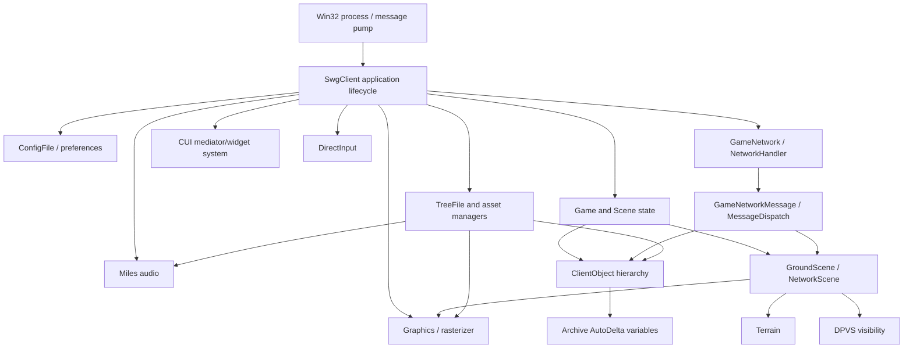
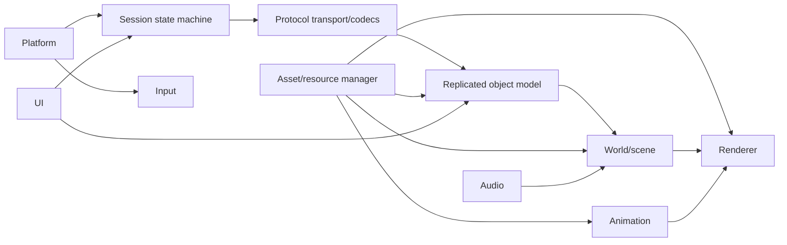

# Client Architecture

## Received observer-state boundary

The [partial CREO4 kernel](CREATURE_VIEW4_PARTIAL_STATE_CONTRACT.md) preserves
received scalar availability and provenance without inventing a complete private
baseline. Its [literal join](../research/checkpoints/IMPLEMENTATION_CHECKPOINT_2026-10-03_R44_OBSERVER_STATE_AND_TERRAIN_PREREQUISITES.md)
confirms the server-shaped1/5/10 update and distinguishes absent fields from
received zero. Current-incarnation storage and pending-baseline world admission
are implemented by the explicit received-only partial policy; existing opt-in full4 remains seeded
and finalized. [Template initialization](CREATURE_VIEW4_INITIALIZATION_CONTRACT.md)
constrains defaults separately and does not supply a complete effective model.

## Reconstructed high-level model

Arrows show observed or strongly inferred dependencies, not recovered ownership.

## Confirmed architectural elements

- Native C++ polymorphic class hierarchy with MSVC RTTI and vtables.
- Application-level install/remove conventions: strings include `SetupClientAudio::install/remove`, `SetupClientDirectInput::install`, `SetupClientGame::install/remove`, `GameNetwork::install/remove`, and many manager `install` methods.
- Internal publisher/subscriber bus named `MessageDispatch`, with `Emitter`, `Sender`, `Receiver`, `Listener`, `Callback`, `Transceiver`, and `OwnedTransceiver` types.
- Network messages represented by `GameNetworkMessage`, plus typed messages and `Archive::AutoVariable`/`AutoDeltaVariable` families.
- Client object hierarchy includes `ClientObject`, `CreatureObject`, `PlayerObject`, `CellObject`, `IntangibleObject`, and shared object-template types.
- Scene types include `Scene`, `NetworkScene`, and `GroundScene`; strings demonstrate scene cleanup/change and terrain validation.
- Visibility is delegated to DPVS cells, physical portals, object models, regions of influence, and camera visibility resolution.

## Strong inferences

The architecture is modular but statically linked into one very large executable, with middleware DLL boundaries for DPVS, Miles, DirectInput and renderer/raster modules. `qt-mt305.dll` is present in the directory but is not imported by Stardust.exe and has no proven CUI load path, so it is not treated as an in-game UI dependency. Subsystems follow explicit `install`/`remove` lifecycle registration rather than RAII-centric composition.

Network updates appear to enter typed `GameNetworkMessage` instances, pass through `GameNetwork::Listener`/`MessageDispatch`, and mutate networked fields represented by `Archive::AutoDelta*` wrappers. Creature field wrappers expose named callbacks such as `ServerPostureChanged`, `VisualPostureChanged`, `StatesChanged`, `SkillsChanged`, and `GroupChanged`, providing a valuable path from wire baselines/deltas to gameplay state.

## Replacement architecture

The replacement should preserve boundaries, not implementation detail:

- Platform: window, clock, threads, sockets, filesystem, crash/log plumbing.
- Protocol: SOE transport framing/reliability plus immutable SWG message codecs.
- Session: login/cluster/zone/character state machines.
- Replication: 64-bit internal object handles and explicit fixed-width wire codecs.
- Assets: TRE/IFF virtual filesystem and typed loaders behind versioned interfaces.
- Renderer: modern API, render graph, resource lifetime, shader translation/replacement.
- World: spatial scene, cells/portals, terrain, streaming.
- Animation/audio/input/UI: redesigned internally, behaviorally compatible at boundaries.

## Reuse versus redesign

Conceptually reusable: message names and state-machine ordering; object-template/CRC identities; baseline/delta schemas; scene-cell-containment model; asset virtual paths; terrain/appearance/shader concepts; animation state/appearance semantics.

Redesign: memory managers/pools, thread primitives, platform loop, rendering API and resource ownership, UI implementation, diagnostics, async I/O/job system, and internal pointer-based object graphs. DPVS concepts may be retained, but the proprietary implementation should not be assumed reusable.

## Accepted mixed presentation boundary - Round15

[Core consumer](SCENE_WORLD_OBJECT_PRESENTATION_CONTRACT.md) owns bounded actor
bookkeeping, exact publication/incarnation checks and acknowledged change delivery.
The [prototype host factory](SCENE_WORLD_OBJECT_VISUAL_CONTRACT.md) owns recipe visuals and
GPU lifetimes through ISceneWorldObjectPresentation; Core contains no prototype host types.
World registry, state, resource scheduler and close drain remain authoritative and
externally owned. Callers pump publications/current batches and tick adapters.
Application is serialized/retryable, with exact current applied-batch acknowledgment;
no presentation rollback transaction or separate state registry is introduced.

## Continuous scene host accepted - October2,2026

[Round16](../research/sessions/PARALLEL_DEVELOPMENT_ROUND_16_2026-10-02.md)
joins the bounded [pump](SCENE_WORLD_PRESENTATION_PUMP_CONTRACT.md),
[prototype host host](SCENE_WORLD_PRESENTATION_HOST_CONTRACT.md) and logical
[resource accounting](SCENE_OBJECT_RESOURCE_ACCOUNTING_CONTRACT.md).
Independent peer and original headless/GPU/cancellation checks pass; the human
retains its resource identity during state updates and terminal-only recreation.
These are synthetic offline messages with explicit original asset recipes and
modern queue/timing policy. Movement/interior integration and live contact remain
separate. Research scores and protocol/name denominators are unchanged.

## Native motion join - October2,2026

[Round17](../research/sessions/PARALLEL_DEVELOPMENT_ROUND_17_2026-10-02.md)
joins [compact codecs](COMPACT_SCENE_TRANSFORM_CONTRACT.md),
[native poses](SCENE_WORLD_OBJECT_MOTION_CONTRACT.md),
[body envelopes](SCENE_CREATURE_BODY_ENVELOPE_CONTRACT.md) and
[prototype host motion](SCENE_WORLD_OBJECT_MOTION_VISUAL_CONTRACT.md).
Continuous original headless/GPU/cancel and independent/native/shared gates pass.
Height applies once; immutable create/resource identity survives wrap/stale and
clear/local resume. Diagnostic zero yaw/immediate pose is modern policy, not
recovered interpolation. Parent resolution, physical speed interpretation, unified
world ingress, locomotion and interior traversal remain open.

## Round18 local input and offline motion ingress

[Round18](../research/sessions/PARALLEL_DEVELOPMENT_ROUND_18_2026-10-02.md)
joins [local driver](SCENE_WORLD_LOCAL_MOTION_CONTRACT.md),
[input and locomotion](SCENE_WORLD_LOCAL_INPUT_CONTRACT.md) and
[motion ingress](SCENE_WORLD_MOTION_INGRESS_CONTRACT.md) through the continuous
bounded pump. Original headless/GPU/cancel and independent nine-stage time/pose/
clip/resource proofs pass. Modern correction/pause/free planar movement is
explicit; original yaw, interpolation, prediction and parent-world conversion
remain unclaimed. [Head-material diagnosis](SCENE_HUMAN_HEAD_MATERIAL_GAP.md)
requires an explicit generated-face route next. Research/function/protocol
denominators are unchanged. Workers remain Low; successive rounds are authorized
under the overnight instruction.

## Round19 explicit generated face route

[Round19](../research/sessions/PARALLEL_DEVELOPMENT_ROUND_19_2026-10-02.md)
joins [owned face resources](SCENE_CREATURE_FACE_RESOURCE_CONTRACT.md),
[completion/accounting](SCENE_CREATURE_FACE_COMPLETION_CONTRACT.md) and
[actual GPU MAIN inspection](SCENE_CREATURE_FACE_INSPECTION_CONTRACT.md).
Opt-in supplied values survive async option copying;76-source original closure,
five-layer output, scoped face pixels, movement retention and malformed/canceled/
lost-incarnation cleanup pass. Default route and metrics retain their meanings.
[Wire/packed ingress](CREATURE_APPEARANCE_CUSTOMIZATION_INGRESS.md) identifies the
next typed setter/field4 revision boundary; actual player values remain unknown.

## Round20 integration

[Accepted integration evidence](../research/checkpoints/IMPLEMENTATION_CHECKPOINT_2026-10-03_R20_CUSTOMIZATION_INTEGRATION.md) records owned CIDM/raw packed decoding, supplied current-creature appearance revisions and bounded presentation/world drain. Original-resource, native/headless/GPU, latest/failure/retirement and real pending-close gates pass. This is explicit supplied inspection state; rawfield4 state translation is next. Four Low workers stopped; overnight authorization permits the next round after acceptance. Known certificate/shader initialization diagnostics persist and are counted, while actual upload/readback/pixels pass.

## Round21 integrated boundary

Round21 joins owned field4 codec, ordered raw sidecar, explicit typed-range projection and retained presentation source. Compatibility boundaries remain engine-neutral; the prototype host adapter observes LastFailure and fails closed. Mixed field dispatch and live mount/default context remain next. [Evidence and reproduction](../research/checkpoints/IMPLEMENTATION_CHECKPOINT_2026-10-03_R21_WIRE_CUSTOMIZATION_INTEGRATION.md).

## Round22 integrated boundary

Round22 stages raw customization, scalar replication and world change journal together before callback-free commit. Engine-neutral codecs/context remain separate from presentation. ACST descriptions are owned; live mounts/player values remain open. [Evidence/reproduction](../research/checkpoints/IMPLEMENTATION_CHECKPOINT_2026-10-03_R22_CUSTOMIZATION_SCALAR_INTEGRATION.md).

## Round23 integrated boundary

The supported CREO:3 union4/5/11–17 now stages raw customization, scalars, components, wounds and pending world state together. Original selected ACST/CIDM context supplies exact ranges and authored defaults through five already owned palettes. Main independent native, headless/GPU, motion and held-container gates pass. Broader fields/views, live mounts/player seeds and graphical attachment/wound behavior remain open. [Evidence and reproduction](../research/checkpoints/IMPLEMENTATION_CHECKPOINT_2026-10-03_R23_FULL_CREATURE_INTEGRATION.md).

## Round24 integrated boundary

Supported CREO3 fixed common fields0/3/6–10 join the existing union. Current common state survives older ingress; visibility uses that overlay while hidden appearance work commits. Actual delta headless/GPU/motion and separate held-baseline visibility proofs pass. Names1/2, TANO, gameplay meanings and live interoperability remain open. STF variant1 exact owned lookup passes two original tables; locale/cache/fallback is deferred. [Evidence and reproduction](../research/checkpoints/IMPLEMENTATION_CHECKPOINT_2026-10-03_R24_EXTENDED_CREATURE_INTEGRATION.md).

## Round25 named creature increment

The supported ordered CREO3 union now covers indices0–17, including raw StringId/custom names. Current name overlays and variable charge survive older ingress. Bounded original STF1 resolution drives an optional caption; actual delta headless/GPU and separate held-baseline name proofs pass. Explicit modern name precedence/directory/display policies do not establish original UI/locale behavior. Other families/views and live interoperability remain open. [Evidence and reproduction](../research/checkpoints/IMPLEMENTATION_CHECKPOINT_2026-10-03_R25_NAMED_CREATURE_INTEGRATION.md).

## Round26 tangible stages

Complete owned TANO3 baseline and ordered0–10 delta codecs, standalone current tangible store and bounded original STF preload pass independent native oracles. Static supplied-projection caption/visibility passes original terminal GPU and lifecycle checks. Lead codec-store-preload join passes; atomic typed SceneWorld publication is next. [Evidence](../research/checkpoints/IMPLEMENTATION_CHECKPOINT_2026-10-03_R26_TANGIBLE_STAGE_INTEGRATION.md).

## Round27 typed tangible publication

Optional complete TANO3 world state commits with its journal after private preparation. Static typed token gates actual original terminal caption/raw visibility beside supported CREO ingress; five headless/GPU states, retained resources and teardown pass independent oracles. Default opaque behavior remains. Authored template names and local SWTS selector semantics are separately documented; outer clock and live interoperability remain open. [Evidence](../research/checkpoints/IMPLEMENTATION_CHECKPOINT_2026-10-03_R27_TANGIBLE_WORLD_INTEGRATION.md).

## Round29 accepted behavior

Original mission terminal all-frame loading and mixed-world playback pass headless/GPU:34 unique sources,15 retained images/126mips/2490372decoded bytes,3969782pending weight;8 cached GPU frame uploads,13 independently checked states and deterministic retirement. Initializer policy-copy omission was caught in the main-host gate and fixed before acceptance. Typed TANO3 captions/visibility and prior CREO3 regressions pass. Standalone object clock passes390checks/36cases/157independentoperations; direct TANO6 state audit109anchors/twoRTTI/16models. Modern numeric/time policy and absent live interoperability remain explicit. [Combined acceptance](../research/checkpoints/IMPLEMENTATION_CHECKPOINT_2026-10-03_R29_SWITCH_FRAME_INTEGRATION.md).

## Round30 clock and defender increment

Owned TANO6 state passes21 sequences/23 transitions,700 negatives,315 budget and114 ownership checks with an independent wire/state/event/work oracle. Clock-to-cursor147 checks/14 cases/79 reference operations and resource-option20 projections/seven completions pass. Actual main headless/GPU fourteen-state clock delivery and prior supplied-time mode retain original terminal geometry/captions and drain caches/clock without update I/O. First-visible-frame uncertainty and absent live interoperability remain explicit. [Combined evidence](../research/checkpoints/IMPLEMENTATION_CHECKPOINT_2026-10-03_R30_CLOCK_AND_DEFENDER_STAGES.md).

## Round31 outdoor and view6 prerequisites

Owned direct-version terrain masks and all nine exact terrain patch patterns pass independent original-byte/table and native oracles. Current-incarnation TANO6 publication and historical-event ownership pass143 checks/23 transitions/38 events. CREO6 prefix/extension structure passes109 anchors/18 registrations/16RTTI; complete codec/world routing remain next. Actual headless/GPU consumed-time failure retires the clock and cached presentation without retry. [Combined evidence](../research/checkpoints/IMPLEMENTATION_CHECKPOINT_2026-10-03_R31_TERRAIN_AND_REPLICATION_STAGES.md).

## Round32 accepted world and terrain inputs

Optional typed TANO6 world publication uses prebuilt store/world candidates and guarded historical event ownership. Main headless and GPU joins pass six literal full-width/wrap/assignment states, eight current events, exact acknowledgment, retained accounting and original human/terminal visuals; prior fourteen-state animation/name/customization gates also pass. Complete18-field CREO6 baselines and the explicit scalar/string/pair delta subset pass independent byte/model/budget oracles. Owned PTAT0013/0014 DATA/TGEN inputs and supplied terrain geometry/UV/color adapters pass original-byte/static/native/headless/GPU checks. Complete TGEN generation, CREO6 vector deltas/state, terrain seam/sample mapping, gameplay and live interoperability remain open. Research89%/readiness94%,2626 names and345 packet-source rows are unchanged. [Combined evidence](../research/checkpoints/IMPLEMENTATION_CHECKPOINT_2026-10-03_R32_WORLD_AND_TERRAIN_INPUTS.md).

## Round33 terrain structure and creature state

Owned TGEN inputs expose 257 layers and 87 AHCN records in the same pinned Tatooine file while retaining unsupported rules. Exact nine-sample terrain assembly and seam branch priority pass independent static/native checks. Complete current CREO6 scalar/string/pair models now have bounded incarnation-owned publication and a prepared commit seam. Separately, the exact HAM/max-HAM vector codec and mutation kernel pass independent wire/state/counter/work oracles. These remain separate partitions, not a composed full CREO6 world update. Original mixed-world headless and combined Core regressions pass. Height evaluation, group semantics, vector composition, original owner side effects and live interoperability remain open. Research89%/readiness94%,2626 names and345 packet-source rows remain unchanged. [Combined evidence](../research/checkpoints/IMPLEMENTATION_CHECKPOINT_2026-10-03_R33_TERRAIN_AND_CREATURE_STATE.md).

## Round34 creature world and terrain arithmetic

The optional CREO6 world partition reuses genuine prepared store/world candidates. A separate ordered scalar/HAM kernel returns one complete current model and outer revision; its current-incarnation publication remains next. Terrain arithmetic stays engine-neutral and requires explicit unresolved producer/precision inputs. [Combined evidence](../research/checkpoints/IMPLEMENTATION_CHECKPOINT_2026-10-03_R34_CREATURE_AND_TERRAIN_KERNELS.md).

## Round35 terrain and composite publication prerequisites

[Composite prepared store](SCENE_CREATURE_VIEW6_COMPOSITE_STORE_CONTRACT.md) owns complete current models and a24-byte logical event journal over a borrowed serialized registry. Genuine prepared/check/assignment-only commit/release joins remain next. Wearable projection remains separate until full-union accounting is accepted. [Evidence](../research/checkpoints/IMPLEMENTATION_CHECKPOINT_2026-10-03_R35_TERRAIN_AND_COMPOSITE_PREREQUISITES.md).

## Round36 composite world and terrain boundaries

[Composite CREO6 world](SCENE_WORLD_CREATURE_VIEW6_COMPOSITE_CONTRACT.md) joins prepared store and world publication, guards current event delivery, and preserves earlier valid state after later exact active rejection. Scalar and composite policies are mutually exclusive; default/scalar/TANO6 paths remain accepted. Full-vector composition is a later partition. [Evidence](../research/checkpoints/IMPLEMENTATION_CHECKPOINT_2026-10-03_R36_COMPOSITE_WORLD_AND_TERRAIN_BOUNDARIES.md).

## Round37 complete creature kernel and supplied terrain

The new complete CREO6 wire/state kernel composes frozen scalar/HAM/defender/wearable components without changing the existing scalar/HAM world API. Supplied terrain geometry/query objects remain engine-neutral, while [prototype host inspection](TERRAIN_CIRCLE_HEIGHT_PATCH_CONTRACT.md) owns rendering resources. Full current-incarnation storage and optional world ingress are the next integration seam. [Evidence](../research/checkpoints/IMPLEMENTATION_CHECKPOINT_2026-10-03_R37_COMPLETE_CREATURE_AND_SUPPLIED_TERRAIN.md).

## Round38 full creature publication and terrain inputs

The optional [full CREO6 world partition](SCENE_WORLD_CREATURE_VIEW6_FULL_CONTRACT.md) owns complete state/current incarnation and guarded historical journals. It coexists with CREO3/TANO3/TANO6 and is exclusive with earlier CREO6 policies. Callback attempt stamps precede preparation; assignment-only store/world publication follows. CREO4 is currently an engine-neutral immutable snapshot/scalar component. [Evidence](../research/checkpoints/IMPLEMENTATION_CHECKPOINT_2026-10-03_R38_FULL_CREATURE_PUBLICATION_AND_TERRAIN_INPUTS.md).

## Round39 supplied terrain grounding and CREO4 prerequisites

The optional supplied-terrain driver implements the existing local-input interface with native Y grounding, first-source query ties and last-valid-tick retention. Original actors retain their resource publications. Complete CREO4 state/world composition remains separate. [Evidence](../research/checkpoints/IMPLEMENTATION_CHECKPOINT_2026-10-03_R39_TERRAIN_GROUNDING_AND_PRIVATE_VIEW.md).
## Round40 layer and CREO4 composition

Fresh BPOL influence, supplied layer combination, restricted CREO4 scalar/encumbrance composition and the separate byte-key skill-map kernel pass independent main replays. The supplied layer/AHCN/coordinate/patch/query join passes nine profiles/3600 samples/144 patches/576 queries. ADTA version-to-runtime inversion mapping is verified separately; unknown flag/cache roles remain explicit. Original-resource headless regressions and combined/default builds pass. Full CREO4 publication, original terrain generation, owner gameplay and live interoperability remain open. Research89%/readiness94%,2626 names and345 packet-source rows remain separate and unchanged. [Evidence](../research/checkpoints/IMPLEMENTATION_CHECKPOINT_2026-10-03_R40_LAYER_AND_CREATURE4_COMPOSITION.md).
## Round41 supplied height execution and CREO4 fields

Open-polyline influence, ordered supplied height execution, scalar/encumbrance/skill-map CREO4 composition and the separate mission-set kernel pass independent main replay. The native terrain join passes3600 samples/144 patches/576 queries across nine profiles. Actual computed-height original-actor headless/GPU joins pass400 samples/16 patches/nine grounded states and exact disposal; late malformed fourth-chunk input drains12 partial visuals. Static layer preparation closes enabled counts/local bounds/cache stride conditionally. Full14-field CREO4 composition/publication, real height filters, original complete terrain, gameplay and live interoperability remain open. Research89%/readiness94%,2626 names and345 packet-source rows remain separate and unchanged. [Evidence](../research/checkpoints/IMPLEMENTATION_CHECKPOINT_2026-10-03_R41_SUPPLIED_HEIGHT_AND_CREO4_FIELDS.md).
## Round42 complete private state and supplied terrain sequence

Complete14-field CREO4 codec/state and full prepared storage pass122 independent full-model sequences/2439 events. Separate supported storage passes122 sequences/924 events and40 prepared-seam checks. Ordered supplied layer sequences and a two-layer geometry/query join pass15456 plans and3600 joined samples/144 patches/576 queries. Direct FHGT evidence establishes current-height reads before this layer's affectors; the raw/query implementation passes375 raw cases/13959 queries. World routing, query-time filter composition, original recursive terrain, gameplay and live interoperability remain next. Research89%/readiness94%,2626 names and345 packet-source rows remain separate and unchanged. [Evidence](../research/checkpoints/IMPLEMENTATION_CHECKPOINT_2026-10-03_R42_PRIVATE_CREATURE_AND_TERRAIN_SEQUENCE.md).

## Round43 private world and current-height filters

Optional complete CREO4 world publication and original-resource headless/GPU joins pass independent full-model, ordered-event, variable-journal and cleanup checks. Query-time FHGT supplied execution and its two-layer geometry/query join pass independently. FSLP raw structure is implemented; initializer timing/x87 sine preprocessing remains unresolved. Server observer CREO4 deltas can arrive before end-baselines without a full view4 baseline; original default/template initialization and modern admission for that path remain the next compatibility milestone. The current seeded finalized private route does not yet cover it. Original recursive terrain, gameplay and live interoperability remain open. Research89%/readiness94%,2626 names/zero duplicates and345 packet-source rows remain separate and unchanged. [Evidence](../research/checkpoints/IMPLEMENTATION_CHECKPOINT_2026-10-03_R43_PRIVATE_WORLD_AND_HEIGHT_FILTERS.md).

## Round45 accepted compatibility increment

The [Round45 report](../research/sessions/PARALLEL_DEVELOPMENT_ROUND_45_2026-10-04.md) records independently reviewed/replayed supplied
AHFR/FFRA consumers, an incarnation-bound received-only partial CREO4 store,
one human movement-template input chain and the actual current-height FHGT/AHCN
Prototype host preview. The store accepts pending/finalized objects without default seeds
but has no world/router admission yet. Original fractal generation/cache lifetime,
floating controls, complete terrain and later creature writers remain unknown.
Research scores and canonical name/packet denominators remain unchanged.

## Round46 accepted compatibility increment

The [Round46 report](../research/sessions/PARALLEL_DEVELOPMENT_ROUND_46_2026-10-04.md) records received-only CREO4 world/router admission and its original-resource headless/GPU preview, an owned authored movement profile, and static family-map/sampler prerequisites. Partial/full4 policies are mutually exclusive; no default seed is fabricated. Fractal cache misses can return retained wide values while hits reload F32, so supplied-F32 consumer acceptance is not original sampler parity. Research scores,2626 canonical names and345 packet-source rows are unchanged.

## Round47 compatibility increment

[Received movement receipts](SCENE_WORLD_RECEIVED_CREATURE_MOVEMENT_INPUT_CONTRACT.md) and [authored selection](SHARED_CREATURE_AUTHORED_MOVEMENT_INPUT_CONTRACT.md) have separate immutable origins. The72-case source join and actual headless/GPU host preserve unknown fields; no effective arbitration or motion formula is inferred. The existing direct supplied-velocity motion drivers remain unchanged.

## Round48 compatibility increment

[Conditional seeded noise](TERRAIN_SEEDED_NOISE_KERNEL_CONTRACT.md) reaches retained AHFR/FFRA/layer consumers in864 independent actual joins. [Explicit sourced movement](SCENE_WORLD_EXPLICIT_MOVEMENT_ADMISSION_CONTRACT.md) owns the actual current-incarnation driver and passes144 original-authored/synthetic-state joins. Host caller/resource integration and full sampler/cache composition remain next.

## Round49 compatibility increment

[Original-resource sourced preview](SCENE_WORLD_SOURCED_MOVEMENT_RESOURCE_PREVIEW_CONTRACT.md) passes authored/received headless and authored GPU joins through the actual original recipe closure with zero extra movement reads. [Current raw inputs](SCENE_WORLD_CREATURE_MOVEMENT_CURRENT_INPUT_CONTRACT.md) retain explicit constructor provenance and exact received overrides without store seeding; [explicit stop and sourced input](SCENE_WORLD_SOURCED_INPUT_HOST_CONTRACT.md) own the modern direction/clock lifecycle. Original full arbitration, modifier/vehicle semantics and units remain separate.

## Round50 accepted boundary

The [owned family/sampler join](TERRAIN_FRACTAL_FAMILY_SAMPLER_JOIN_CONTRACT.md), [current resource movement host](SCENE_WORLD_CURRENT_MOVEMENT_RESOURCE_PREVIEW_CONTRACT.md), and [controller input chain](CREATURE_CONTROLLER_SPEED_INPUT_CONTRACT.md) extend the prior accepted slice. Exact conditional compositions and modern movement/source ownership are independently checked; original terrain/controls/full movement parity remain Unknown. See [Round50](../research/sessions/PARALLEL_DEVELOPMENT_ROUND_50_2026-10-04.md) for assembled acceptance and next probes.

## Round51 bounded boundary

[Generator-to-family height routing](TERRAIN_GENERATOR_FAMILY_HEIGHT_JOIN_CONTRACT.md) passes486 actual joins under explicit fresh-call controls. [Run-default preference](PLAYER_CONTROLLER_RUN_FLAG_CONTRACT.md) and [acceleration helper](CREATURE_ACCELERATION_HELPER_CONTRACT.md) have bounded static evidence; message timing, getter sampling and units remain open. The shared original-resource host remains the separately accepted Round50 slice. [Round51 record](../research/sessions/PARALLEL_DEVELOPMENT_ROUND_51_2026-10-04.md).

## Round52 accepted boundary

[Computed family-height terrain](SCENE_WORLD_FAMILY_HEIGHT_TERRAIN_PREVIEW_CONTRACT.md) reaches headless/GPU surface and grounding checks under explicit synthetic rules/controls. [Acceleration getter](CREATURE_ACCELERATION_TEMPLATE_GETTER_CONTRACT.md) and [run-input producer](PLAYER_CONTROLLER_RUN_INPUT_PRODUCER_CONTRACT.md) have bounded original evidence; update units, active queue binding and full terrain/controller parity remain open. [Round52](../research/sessions/PARALLEL_DEVELOPMENT_ROUND_52_2026-10-04.md) records independent acceptance gates.
