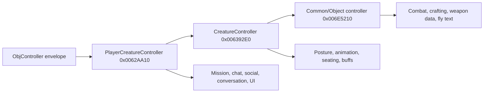

# Client Object-Controller Effects

Baseline: `C:\Stardust-DEV\Stardust.exe`, SHA-256 `E782BF1C49B3DA730F66B54BC558947C46493F7133F672EED1D8E0C56A6B6150`; server correlation uses the local Stardust-3 tree as of 2026-09-11.

## Dispatcher hierarchy

Incoming controller messages do not use one flat switch. After envelope parsing and object lookup, the local-player path enters `player_creature_controller_message_dispatch_VA_0062AA10`; unhandled cases delegate to `creature_controller_message_dispatch_VA_006392E0`, then to `object_controller_common_dispatch_VA_006E5210`.

The replacement should decode the wire payload independently, then route typed domain events through object-role handlers with an explicit fallback chain. The legacy inheritance and vtable layout are not protocol requirements.

## Confirmed representative effects

| Inner type | Executable route | Client-side effect | Confidence |
|---:|---|---|---|
| `0xCC` CombatAction | `0x006E5210` -> `combat_action_apply_VA_006E4950` -> `0x0069E9A0` | resolves attacker, weapon and optional defender, then submits animation/hit data to combat presentation | Confirmed |
| `0xF2` Animation | `0x006392E0` -> `animation_message_apply_VA_007D78F0` | if the controller is active and the object has an appearance, resolves the animation name and plays it across appearance animation targets | Confirmed broad behavior |
| `0xF4` SpatialChat | `0x0062AA10` -> `spatial_chat_apply_VA_0091BA10` | resolves sender/target, applies ignore/language/channel filters, formats text or StringId content, optionally drives animation, then publishes chat events/UI text | Confirmed broad behavior; individual flag names partly inferred |
| `0x131` Posture | `0x006392E0` -> `posture_transition_prepare_VA_00469410` -> `creature_posture_apply_VA_004328D0` | prepares dependent appearance/controller state, applies posture and notifies creature animation/state machinery | Confirmed core effect; subordinate details Strong |
| `0x134` CombatSpam | `0x0062AA10` -> `combat_spam_format_and_publish_VA_008C94D0` | resolves attacker/defender/item, constructs localized grammar or fallback text, selects viewpoint/color category and publishes combat-spam UI output | Confirmed |
| `0x13B` SitOnObject | `0x006392E0` -> `seat_target_resolve_VA_0063EA20` -> `0x005F4E20` | resolves a seat/parent target for supplied coordinates, marks pending seated state and schedules attachment; falls back to posture 8 if none is resolved | Confirmed flow; posture-8 public label not asserted |
| `0x140` WeaponRanges | `0x006E5210` -> weapon-ID lookup -> direct state writes | replaces ideal/max range plus three accuracy values on the resolved weapon | Confirmed |
| `0x166` Flourish | `0x006392E0` -> `flourish_apply_VA_005DCA90` | finds the controlled creature in the performer collection and applies the flourish identifier | Strong |
| `0x229` / `0x22A` Buff add/remove | `0x006392E0` -> `0x00943670` / `0x00943700` | insert/update a buff CRC with duration or remove it and refresh dependent presentation | Confirmed state mutation; refresh name Strong |

## CombatAction multi-target constraint

`combat_action_apply_VA_006E4950` computes the decoded vector length of 0x18-byte legacy defender records:

- zero defenders submits attacker-only combat animation;
- one defender resolves and submits defender posture/hit/effect data;
- more than one logs `Ignoring combat action, currently only support one defender, got %d` and returns without presentation.

This is **Confirmed by executable code**. Stardust's server `CombatAction` class can append up to 20 multi-target records. A replacement may support that form, but it is a deliberate improvement above a preserved wire codec and needs compatibility fixtures.

## State boundary

These messages are primarily transient commands/events. Durable properties may also arrive through baselines/deltas. The replacement should separate parsed DTO, authoritative replicated state, transient presentation request and UI event publication so animation or chat code never owns durable object state.

## Remaining questions

- Decode the exact client labels for the two multi-target-only defender bytes.
- Determine which current server combat paths invoke the multi-target constructor.
- Name all posture-transition and seat-selection subordinate policies.
- Trace final subscribers for buff and weapon-range changes.
- Continue through the remaining server-emitted controller types required by a playable scene.
