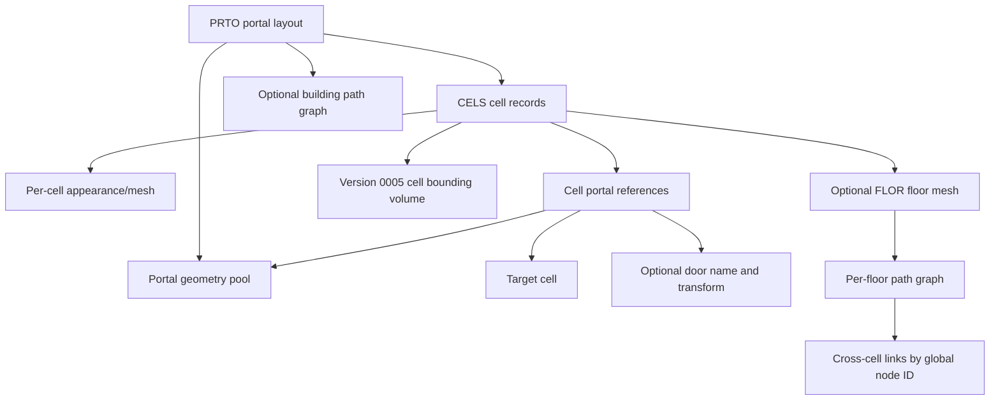

# Interior, Cell and Portal Architecture

## Scope and evidence

This model correlates installed `PRTO`/`.pob` and `FLOR`/`.flr` assets, Stardust.exe RTTI (`CellProperty`, `PortalProperty`, floor/collision and RenderWorld/DPVS families), and the Stardust server readers in `templates/appearance/PortalLayout.cpp`, `CellProperty.cpp` and `FloorMesh.cpp`. Binary factory/visibility call paths are not yet fully named, so file layouts below are **Confirmed by server source**, while precise client runtime scheduling is **Strongly inferred** unless stated otherwise.

## Portalized object structure

`PRTO` supports at least versions `0001`, `0003` and `0004` in the server reader. Its logical model is:

The top-level `DATA` chunk stores portal and cell counts. In versions `0001`/`0003`, `PRTS` contains repeated `PRTL` chunks, each holding a vertex count and float XYZ vertices; the server triangulates each polygon as a fan. Version `0004` instead uses `IDTL/0000` with a `VERT` array of 12-byte positions and an `INDX` array of integer-index triples. `CELS` contains repeated `CELL` forms. Later versions can include a top-level `PGRF` and a `CRC ` chunk.

Portal adjacency is reconstructed by matching geometry indices referenced from different cells. This is a graph, not merely a hierarchy: a cell owns appearance/collision data, while its portals connect it to peers and may represent doors or the exterior.

## Cell records and portal references

The server accepts `CELL/0004` and `CELL/0005`. `DATA` contains:

1. portal count;
2. one currently unknown byte;
3. cell name string;
4. appearance/mesh virtual path string;
5. presence flag and optional floor-file virtual path.

Version `0005` additionally loads a bounding-volume object after `DATA`, commonly a collision-mesh form. Repeated `PRTL` forms define cell-side portal references:

| Version | Fields |
|---|---|
| `0002` | solid byte, geometry index, winding byte, target-cell index |
| `0004` | `0002` fields plus door-name string, transform-present byte and 12 transform floats |
| `0005` | an additional leading unknown byte, then the `0004` layout |

The server identifies a world/exterior portal when the target-cell index is `<= 1`. Exact index conventions need validation against representative assets before being copied into a new loader.

## Floor mesh and navigation data

The server supports `FLOR/0003`, `0005` and `0006`; installed sampling also found `0004`. Versions `0003`/`0005` use 60-byte logical triangle records containing three vertex indices, a triangle ID, three neighboring-triangle indices, a float normal, three edge flags, a non-solid byte, a tag and three portal IDs. Edge flags distinguish uncrossable, connected and blocking edges.

Version `0005` adds bounding-tree (`BTRE`), boundary-edge (`BEDG`) and optional path-graph (`PGRF`) data. Version `0006` carries explicit vertex/triangle counts and then the same auxiliary families. The server reconstructs triangle neighbor links and an AABB tree, and exposes collision plus path-graph behavior. `PortalLayout` connects floor path graphs across cells by equal global path-node IDs.

Mechanical inspection closes the `0004` structural gap: 354 installed records were found. `FLOR/0004` contains raw `VERT` (12-byte records) and `TRIS` (60-byte records) followed by `PNOD` and `PEDG` chunks, which were zero-length in both a small bridge sample and the largest installed v4 cave sample. The largest sample contains 507 vertices and 898 triangles. Exact nonempty `PNOD`/`PEDG` layouts remain unobserved, but the deployed corpus does not require them for these samples.

## Replacement-client model

The clean client should preserve four separate representations:

- an immutable decoded portal-layout resource;
- runtime cell instances and portal adjacency/door state;
- render visibility state (engine-native occlusion/portal policy);
- collision/navigation meshes and cross-cell graph links.

Object replication must refer to logical cells independently of render-node identity. Loading and visibility may be redesigned, but cell containment, portal target semantics, door transforms, collision boundaries and file-coordinate conversion must remain compatible.

## Representative installed chain

The reusable read-only probe `tools/tre_probe.py` resolved the highest-priority installed `appearance/yt1300.pob` from `stardust_3_00.tre`. It is `PRTO/0004`, contains eight indexed portal-geometry (`IDTL/0000`) groups and eight `CELL/0005` records (exterior plus seven interior cells). Cell data includes EXBX/CMSH or NULL bounds, repeated portal forms and per-cell `LGHT` chunks. The layout references one exterior APT plus seven cell meshes and seven floor meshes, then supplies a building-wide `PGRF/0001` (`META`, `PNOD`, `PEDG`, `ECNT`, `ESTR`) and CRC.

One referenced floor, `appearance/collision/yt1300_r1_hall1_collision_floor0.flr`, is `FLOR/0006`: `VERT` is 460 bytes (a count plus 38 12-byte vertices), `TRIS` is 2,164 bytes (a count plus 36 60-byte triangles), followed by `BTRE/0000/NODS`, `BEDG`, and `PGRF/0001`. This confirms the server-reader model in the deployed corpus, including bounds, lights, acceleration and both per-floor and building-wide path data.

## Engine evaluation requirement

Before choosing Godot versus a custom renderer, the engine spike must load one representative building end to end: `POB/PRTO`, all referenced cell appearances, portal polygons, at least one door transform and one `FLR`; then demonstrate exterior-to-cell transition, portal-based visibility, collision and cross-cell path continuity. A successful visual import alone is insufficient.

## Remaining unknowns

- Stardust.exe PRTO/CELL/FLOR factory VAs and exact lifecycle ownership.
- Nonempty legacy `FLOR/0004` `PNOD`/`PEDG` payloads, if any exist outside this corpus.
- Whether the client consumes stored BTRE data or rebuilds acceleration structures.
- DPVS portal/occlusion integration and fallback behavior.
- Door-object binding rules and replication events.
- Precise exterior-cell index conventions across all installed portal versions.
