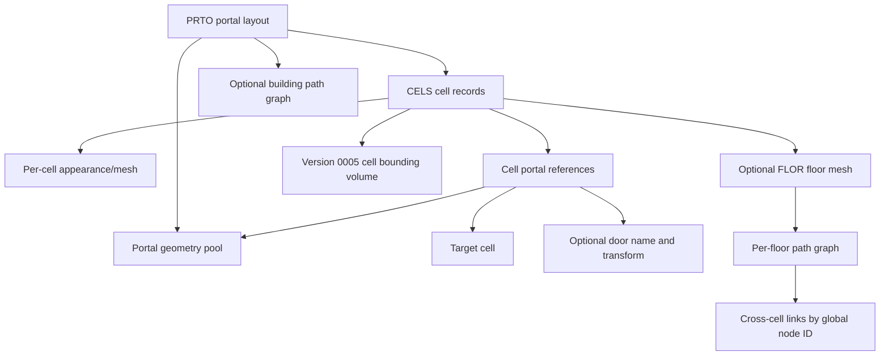

# Interior, Cell and Portal Architecture

## Scope and evidence

This model correlates installed `PRTO`/`.pob` and `FLOR`/`.flr` assets, Stardust.exe RTTI and versioned readers, and the Stardust server readers in `templates/appearance/PortalLayout.cpp`, `CellProperty.cpp` and `FloorMesh.cpp`. The [native portal contract](PORTAL_LAYOUT_DECODER_CONTRACT.md) now confirms deployed parsing through direct client readers and all 291 effective layouts. Rendering, collision and runtime scheduling remain separate boundaries.

## Portalized object structure

`PRTO` supports at least versions `0001`, `0003` and `0004` in the server reader. Its logical model is:

The top-level `DATA` chunk stores portal and cell counts. In versions `0001`/`0003`, `PRTS` contains repeated `PRTL` chunks, each holding a vertex count and float XYZ vertices; the server triangulates each polygon as a fan. Version `0004` instead uses `IDTL/0000` with a `VERT` array of 12-byte positions and an `INDX` array of integer-index triples. `CELS` contains repeated `CELL` forms. Later versions can include a top-level `PGRF` and a `CRC ` chunk.

Portal adjacency is reconstructed by matching geometry indices referenced from different cells. This is a graph, not merely a hierarchy: a cell owns appearance/collision data, while its portals connect it to peers and may represent doors or the exterior.

## Cell records and portal references

The server accepts `CELL/0004` and `CELL/0005`. `DATA` contains:

1. portal count;
2. one currently unknown byte;
3. cell name string;
4. appearance/mesh virtual path string;
5. presence flag and optional floor-file virtual path.

Version `0005` can additionally load a bounding-volume object after `DATA`, commonly a collision-mesh form. It is optional: the client factory leaves an unregistered next tag unconsumed. Repeated `PRTL` forms contain version **chunks** defining cell-side portal references:

| Version | Fields |
|---|---|
| `0002` | solid byte, geometry index, winding byte, target-cell index |
| `0004` | `0002` fields plus door-name string, transform-present byte and 12 transform floats |
| `0005` | an additional leading unknown byte, then the `0004` layout |

The server identifies a world/exterior portal when the target-cell index is `<= 1`; that server predicate is not the file index convention. All 7,642 current references use zero-based CELS ordinals and match their geometry's opposite side. Twelve transform floats are retained even when the transform-present byte is false. Original runtime post-load flag handling remains separate.

## Floor mesh and navigation data

The server supports `FLOR/0003`, `0005` and `0006`; installed sampling also found `0004`. Versions `0003`/`0005` use 60-byte logical triangle records containing three vertex indices, a triangle ID, three neighboring-triangle indices, a float normal, three edge flags, a non-solid byte, a tag and three portal IDs. Edge flags distinguish uncrossable, connected and blocking edges.

Version `0005` adds bounding-tree (`BTRE`), boundary-edge (`BEDG`) and optional path-graph (`PGRF`) data. Version `0006` carries explicit vertex/triangle counts and then the same auxiliary families. The server reconstructs triangle neighbor links and an AABB tree, and exposes collision plus path-graph behavior. `PortalLayout` connects floor path graphs across cells by equal global path-node IDs.

Mechanical inspection closes the `0004` structural gap: 354 installed records were found. `FLOR/0004` contains raw `VERT` (12-byte records) and `TRIS` (60-byte records) followed by `PNOD` and `PEDG` chunks, which were zero-length in both a small bridge sample and the largest installed v4 cave sample. The largest sample contains 507 vertices and 898 triangles. Exact nonempty `PNOD`/`PEDG` layouts remain unobserved, but the deployed corpus does not require them for these samples.

## Replacement-client model

The clean client should preserve four separate representations:

- an immutable decoded portal-layout resource;
- runtime cell instances and portal adjacency/door state;
- render visibility state (engine-native occlusion/portal policy);
- collision/navigation meshes and cross-cell graph links.

Object replication must refer to logical cells independently of render-node identity. Loading and visibility may be redesigned, but cell containment, portal target semantics, door transforms, collision boundaries and file-coordinate conversion must remain compatible.

## Interior furnishing layouts (`.ilf`)

`INLY/0000` is a separate client-local furnishing layer over a portalized building. It contains repeated `NODE` chunks, each holding an object-template path, a portal-cell name and twelve little-endian F32 transform values (inside the usual big-endian IFF chunk envelope). The configured overlay has 297 live effective layouts and 87,937 nodes with no parse failures; 411 is the raw archive-copy count.

`client_interior_layout_manager_apply_building_layout_VA_0059B7B0` resolves the authored cell name on the owning building, creates the named object template, attaches the result to that cell, copies the 3x4 transform, runs transform notification/world insertion, and releases the creation reference. A missing cell or failed object creation skips only that node. `client_interior_layout_manager_apply_pending_world_layouts_VA_0059B5A0` provides automatic lazy world scanning unless `ClientGame.disableLazyInteriorLayoutCreation` is set. `ClientGame.useInteriorLayoutFiles` is a distinct default-true feature option.

ILF nodes are therefore presentation objects, not substitutes for server-spawned gameplay objects. A replacement must keep them cell-relative and lifecycle-bound to their building while preventing duplicate materialization. See `../research/checkpoints/ANALYSIS_CHECKPOINT_2026-09-22_INTERIOR_LAYOUT_ILF_RUNTIME.md`.

## Representative installed chain

The reusable read-only probe `tools/tre_probe.py` resolved the highest-priority installed `appearance/yt1300.pob` from `stardust_3_00.tre`. It is `PRTO/0004`, contains eight indexed portal-geometry (`IDTL/0000`) groups and eight `CELL/0005` records (exterior plus seven interior cells). Cell data includes EXBX/CMSH or NULL bounds, repeated portal forms and per-cell `LGHT` chunks. The layout references one exterior APT plus seven cell meshes and seven floor meshes, then supplies a building-wide `PGRF/0001` (`META`, `PNOD`, `PEDG`, `ECNT`, `ESTR`) and CRC.

One referenced floor, `appearance/collision/yt1300_r1_hall1_collision_floor0.flr`, is `FLOR/0006`: `VERT` is 460 bytes (a count plus 38 12-byte vertices), `TRIS` is 2,164 bytes (a count plus 36 60-byte triangles), followed by `BTRE/0000/NODS`, `BEDG`, and `PGRF/0001`. This confirms the server-reader model in the deployed corpus, including bounds, lights, acceleration and both per-floor and building-wide path data.

## Engine evaluation requirement

Before choosing Godot versus a custom renderer, the engine spike must load one representative building end to end: `POB/PRTO`, all referenced cell appearances, portal polygons, at least one door transform and one `FLR`; then demonstrate exterior-to-cell transition, portal-based visibility, collision and cross-cell path continuity. A successful visual import alone is insufficient.

## Remaining unknowns

- Exact runtime visibility/lazy lifecycle ownership beyond the established PRTO/CELL/FLOR version dispatch and loader VAs.
- Nonempty legacy `FLOR/0004` `PNOD`/`PEDG` payloads, if any exist outside this corpus.
- Whether the client consumes stored BTRE data or rebuilds acceleration structures.
- DPVS portal/occlusion integration and fallback behavior.
- Door-object binding rules and replication events.
- Original post-load flag transformations and complete dynamic exterior/cell membership policy. Current serialized adjacency indices are closed by corpus agreement.

## Owned floor reader — 2026-09-30

The [FLOR checkpoint](../research/checkpoints/IMPLEMENTATION_CHECKPOINT_2026-09-30_FLOOR_MESH_READER.md) verifies all 4,730 deployed floors: 414,301 vertices, 604,429 triangles and 189,927 boundary records. Owned adjacency, authored normals/raw flags and optional payload hashes agree independently. Negative and ownership fixtures pass. Floor navigation/movement remains separate; metrics and registry counts are unchanged.

## Floor surface inspection — 2026-09-30

The [query checkpoint](../research/checkpoints/IMPLEMENTATION_CHECKPOINT_2026-09-30_FLOOR_SURFACE_INSPECTION.md) closes a modern owned deterministic BVH surface inspector: 32,918 exhaustive independent probes across 4,730 floors agree. The original scene now includes seven floors/149 triangles under 21 shared sources; headless/GPU geometry and reflected picking pass. Native analytic/negative/ownership cases pass. Original adjacency path walking, permission and portal transitions remain unimplemented. Metrics and registry counts are unchanged.

## Owned path graph — 2026-09-30

The [PGRF checkpoint](../research/checkpoints/IMPLEMENTATION_CHECKPOINT_2026-09-30_PATH_GRAPH_READER.md) closes deployed graph field decoding against all 3,914 graphs, 39,647 nodes and 86,964 directed edges. Raw positions/keys/types, width floats and ECNT/ESTR ranges agree independently. Empty zero-count/start-minus-one entries are preserved. Native malformed/ownership gates pass. Original navigation cost, cross-cell mapping and dynamic permission remain separate; metrics and registry counts are unchanged.

## Directed route inspection — 2026-09-30

The [route checkpoint](../research/checkpoints/IMPLEMENTATION_CHECKPOINT_2026-09-30_DIRECTED_ROUTE_INSPECTOR.md) closes modern owned Euclidean/Dijkstra inspection against 25,847 independent Bellman–Ford probes, with exact edge-chain validation. Eight original floor/layout graphs upload and route-display in Godot; hidden GPU capture passes. Original client cost, cross-cell association and dynamic permission remain distinct. Metrics and registry counts are unchanged.

## Portal/floor association audit — 2026-09-30

The [association checkpoint](../research/checkpoints/IMPLEMENTATION_CHECKPOINT_2026-09-30_PORTAL_PATH_ASSOCIATIONS.md) rejects floor-key-as-layout-ordinal and verifies conservative geometry-key bindings for all 291 layouts: 14,783 valid bindings, 3,581 paired candidates, 977 multi-node groups and 14 incomplete groups. Thirty-one bunker contradictions and 13 missing police-station floors remain explicit. Candidates do not establish legal movement. Shared cache failure accounting/pin guards pass; headless MultiMesh readback limits are reported accurately. Metrics and registry counts are unchanged.

## Bounded single-cell movement — 2026-09-30

The [movement contract](SINGLE_CELL_FLOOR_MOVEMENT_CONTRACT.md) now separates original edge predicate/caller observations from a modern owned horizontal walker. Godot floor inspection exposes two-pick attained-contact/status visualization. Missing-neighbor portal/open-floor exits and special collision edges stop explicitly; cross-cell ownership/entry permission and full original collision remain open.

## 2026-09-30 portal transfer follow-up

The [bounded transfer contract](PORTAL_FLOOR_TRANSFER_CONTRACT.md) adds one owner transfer and remaining motion with current offline entry/barrier policy. Floor portal IDs index the owning cell reference vector; they are distinct from global geometry/PGRF keys. The prior tentative 0126AA80 owner-transfer interpretation is corrected: it preserves the same floor wrapper; 012670E0 / 00B2B3F0 perform cell continuation. Fourteen original directed links, 56 independent probes and 28 Godot adapter probes pass. Full actor collision, door lifecycle and exterior continuation remain open.

## 2026-09-30 permission barrier follow-up

The [barrier contract](PORTAL_BARRIER_COLLISION_CONTRACT.md) adds normal-controller primitives and bounded source-cell actor-box contact before transfer. Runtime fields are LeadingByte exclusion, SolidByte support and separate WindingByte; B43E80 inversion is specific to PRTO/0002. Current permission, mutable portal state and physical door-leaf clearance remain distinct. Independent 291-layout / 21,693-probe agreement and 12-link Godot actor contact gates pass; nonlevel requests stop explicitly. Physical leaf collision and global actor solver ordering remain next.

## 2026-09-30 original single-leaf follow-up

The [single-leaf contract](SINGLE_LEAF_DOOR_CONTRACT.md) refines trigger input, 1.5-times-radius retention and authored power/cosine motion, with a standalone original-style runtime and Godot inspector. Conservative primary-box clearance passes independent checks; original narrow-phase collision and global actor ordering remain Unknown. Next: compose one named POB door instance with cell ownership and integrate its current leaf clearance before one portal transfer.

## 2026-09-30 named doorway movement

The [movement contract](INTERIOR_DOOR_MOVEMENT_CONTRACT.md) closes one original cantina/private-room instance connection. Authored door/cell transforms, conservative physical leaf snapshots and current permission feed a source-owned contact or one floor transfer. Both directions and two supplied owner poses match independent probes; headless/GPU inspection passes. Next: persistent actor ownership and repeated movement rather than fixed crossing replays.

## 2026-09-30 persistent doorway ownership

The [persistent actor follow-up](PERSISTENT_DOOR_ACTOR_CONTRACT.md) consumes source/target locators on every step and shares one modern normal leaf between matching incident references. Retained contact, retreat, reset and repeated bidirectional ownership pass original/synthetic/host gates. Fixed-step scheduling and live input remain next.

## Modern continuous actor timing

The [fixed-step host](FIXED_STEP_ACTOR_CONTRACT.md) separates rendering from the persistent doorway actor, with bounded catch-up, pause/focus suspension and continuous W/S input. This is replacement policy and does not close original timer or collision-order unknowns.

## Timestamped movement events

The [input timeline](ACTOR_INPUT_TIMELINE_CONTRACT.md) applies ordered physical-key/permission changes at tick starts and bounds pending history. Equal tick inputs now survive nonaligned render changes. Original input semantics remain separate.

## Planar doorway actor

The [planar input contract](PLANAR_DOORWAY_ACTOR_CONTRACT.md) extends timestamped movement to normalized lateral/diagonal axes. Floor navigation is still a feet query; full world actor collision is outside this gate.
