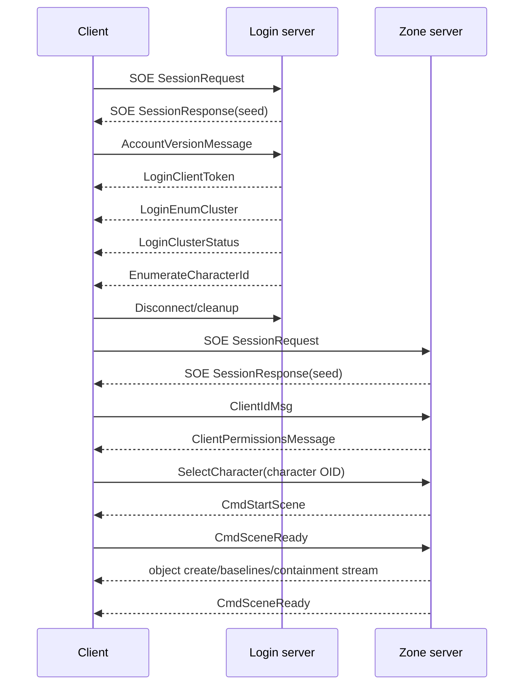
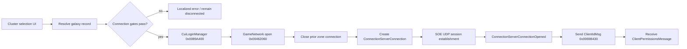
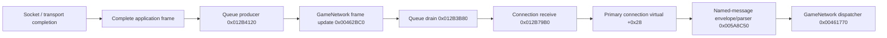
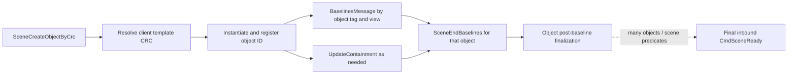

# Login and Zone State Machine

Status: executable-and-source checkpoint 2026-09-11. Application fields below are little-endian unless the SOE transport specification says otherwise.

## Login request

`LoginClientId` in `Stardust.exe` / `AccountVersionMessage` in the server, operand count 4, opcode `0x41131F96`:

1. ASCII16 username
2. ASCII16 password
3. ASCII16 client version; executable default `20260817-SD:01`

The executable constructor at `0x00ACA1B0` registers exactly three archive strings in this order: username, password, version. The send path at `0x0069BC30` supplies the two credential strings from the GameNetwork singleton and uses `20260817-SD:01` as the default version, subject to the retained `SharedNetworkMessages/version` override. The server parser reads precisely those three ASCII16 values. Its convenience constructor appends a `STRING_HASHCODE("SWGEmu")` field, but that fourth field is neither present in the executable class nor consumed by the server login parser and is not part of the replacement-client minimum message.

## Login success set

The test client expects these in order and considers login complete after all four masks clear. It warns on a different arrival order but dispatches by operand count and opcode.

| Order | Message | Operand count | Parsed fields | Client state effect |
|---:|---|---:|---|---|
| 1 | `LoginClientToken` | 4 | `uint32 sessionLength`; opaque `sessionLength` bytes containing token plus embedded account ID; `uint32 stationID`; ASCII16 username | preserves credential blob for zone authentication and stores station ID/username |
| 2 | `LoginEnumCluster` | 2 | LE32 count; repeated LE32 galaxy ID, ASCII16 name, LE32 flags; LE32 footer | creates/names galaxy entries |
| 3 | `LoginClusterStatus` | 3 | LE32 count; repeated LE32 ID, ASCII16 hostname, LE16 zone port, LE16 ping port, five LE32 status/display values, one byte | fills endpoint/status data and associates hostname+zone port with galaxy ID |
| 4 | `EnumerateCharacterId` | 2 | LE32 count; repeated Unicode32 name, LE32 race CRC, LE64 object ID, LE32 galaxy ID, LE32 character type | populates character list and galaxy associations |

`ErrorMessage` (operand count 3, opcode `0xB5ABF91A`) parses two ASCII16 strings followed by a fatal byte. Executable branch `0x00461B58` uses typed parser `0x00AC90A0`; a nonzero fatal byte gates its immediate reporting path.

`Unicode32` is a little-endian 32-bit UTF-16 code-unit count followed by that many little-endian UTF-16 units. The client record objects are not wire structs: their observed 0x14, 0x2C and 0x20 strides contain string/vector objects and must never be copied directly into an x64 implementation.

For the current server, each `LoginEnumCluster` record ends with `0xFFFF8F80` and the message footer is 8. Each status record currently supplies population 100, capacity `0xCB2`, category/distance 8, status 2, auxiliary `0xFFFF8F80`, and trailing byte 0. Those values are confirmed; not all historical UI semantics are.

## Zone authentication

Galaxy selection resolves a cluster record and applies availability, loading/lock, address-present, and population/capacity checks before opening a connection. Stardust.exe then follows this confirmed path:

The exact endpoint handoff is resolved-address object + 16-bit zone port; the ping port is not used for the game connection. Opening a new zone connection first tears down any existing connection-server object, so login and zone transports are distinct lifecycles.

After a fresh SOE transport connection, `ClientIdMsg` has operand count 3 and fields:

1. `uint32 gameBits = 0xFE`
2. `uint32 dataLen = sessionTokenLength + 4`
3. raw credential bytes retained from `LoginClientToken` (session token plus embedded `uint32 accountID`)
4. ASCII client version; Stardust.exe defaults this field to `20260817-SD:01`, while the repository's convenience constructor still contains the historical `20050408-18:00`

The server response `ClientPermissionsMessage` is operand count 4 and the current server writes four boolean bytes: login, regular-character creation, Jedi-character creation, and tutorial skipping. Stardust.exe's parser at `0x00AEC5B0` registers and consumes only the first three; its handler at `0x00899340` ignores the trailing tutorial byte. A replacement client should parse all four for server compatibility but must tolerate three-byte historical variants if encountered.

The original client intentionally retains the `LoginClientToken` length-delimited token-plus-account-ID region as one opaque byte array. A replacement may decode the trailing account ID for diagnostics, but it must preserve the exact blob used by the subsequent zone-authentication message.

The executable credential path is direct: `LoginClientToken` handler `0x00462DD0` copies the complete blob to GameNetwork singleton member `+0x10` and stores its length at `+0x50`; getters `0x004636D0` and `0x004636E0` feed those exact values to the connection-open sender `0x0069B430` and `ClientIdMsg` constructor `0x00AE4090`.

After the zone connection publishes its opened event, GameNetwork performs connection-open bookkeeping and the connection-server listener sends `ClientIdMsg`. This means the replacement must not send application authentication merely after calling UDP `connect`; it must wait until the SOE session is established and the equivalent connection-open state is reached.

## Transport-to-session dispatch boundary

The receive-to-handler threading boundary is now directly confirmed in `Stardust.exe`:

`0x012B4120` copies the complete payload into a 32-byte queue record and retains the connection reference. It does not run a typed parser. The only consumer of the queue globals is `network_received_message_dispatch_loop_VA_012B3B80`, called by `game_network_dispatch_update_VA_00462BC0` during the frame update. The consumer performs traffic accounting and calls `connection_received_message_VA_012B79B0`; that method finally invokes connection vtable slot `+0x28`, which reaches the already documented named-message construction and opcode dispatch.

This is **Confirmed by code** for both transport implementations at their shared complete-frame boundary. The replacement should preserve the semantic ownership boundary: network I/O may assemble and enqueue immutable frames, but login, zone, object and scene state must mutate on a serialized session/game update executor. The legacy queue's block layout and raw pointers are implementation details and should not be copied into x64 code.

TCP establishment confirms the same application lifecycle callback. Completion routine `0x012BE7C0` marks the stream connected, posts its first receive, flushes queued output and invokes callback slot `+0x14`. The base connection open routine `0x012B76A0` installs the transport, then invokes its own primary virtual `+0x14`; the Login and ConnectionServer derived implementations publish `LoginConnectionOpened` or `ConnectionServerConnectionOpened`. Thus the application-open event follows transport establishment, not socket allocation.

Closure is intentionally asynchronous at the application level. TCP close completion `0x012BE7A0` clears its connected flag and enters `NetworkHandler::onTerminate` through `0x012B4410`. Base connection close `0x012B7520` notifies an optional connection monitor, applies the configured fatal-on-close policy, and invokes the derived close virtual. ConnectionServer close publisher `0x0069B3D0` emits `ConnectionServerConnectionClosed`; the `GameNetwork` dispatcher then clears the cluster name and connection pointer and broadcasts `ConnectionServerConnectionChanged(false)` at `0x004630C0`. Login close similarly clears its live pointer and broadcasts `LoginServerConnectionChanged(false)` at `0x00463350`. Exact ordering between all lower-layer destruction helpers remains **Tentatively inferred**, but the externally visible state effects are confirmed.

The ConnectionServer-open continuation at `0x00462D10` copies the selected cluster name into active GameNetwork state, clears the pending cluster name, performs two connection-transition notifications, and broadcasts a true cluster-connection state. The separate listener at `0x0069B430` sends `ClientIdMsg` and publishes the opened event. This yields a required replacement invariant: authentication submission and UI/session notification are consequences of the established connection event; neither should be tied directly to `connect()` return.

## Scene entry boundary

The automation client sends `SelectCharacter(uint64 oid)` and waits for final scene readiness. `CmdStartScene` (operand count 9) is parsed as:

- byte, currently unnamed;
- `uint64` selected/player object ID;
- ASCII terrain path;
- `float x`, `float z`, `float y`;
- ASCII player race/template path;
- `uint64` galactic time.

It rejects a scene start whose object ID differs from the selected character, sends `CmdSceneReady`, and marks the scene started. A later server `CmdSceneReady` marks it ready and releases the zone-in action.

Round89 source clarification: current server SelectCharacter resets movement counter/client stamp0 and sets teleporting true; CmdSceneReadyCallback calls PlayerObject.notifySceneReady, which clears teleporting/load-screen/forced-transform before replying. This supports a modern origin0 policy after a verified fresh selection/readiness path, without a blanket0x13F ACK. Database validated-position refresh is an ordered task; readiness alone does not prove its completion/current-floor equality. [Teleport lifecycle contract](REPLACEMENT_TELEPORT_ACK_LIFECYCLE.md) separates normal scene readiness, received full-transform ACK triggers and the remaining final ACK wire-packing question.

Between those signals the server may stream object creation, baselines, containment, controller, chat, and related messages. This stream belongs to Phase 2/3, not the narrow Phase 1 login POC.

Direct Stardust.exe analysis now confirms the boundary more precisely:

1. Avatar-selection code constructs `SelectCharacter` at `0x00AE4B60` and sends it at `0x00C62BCA`.
2. The executable message contains only the LE64 object ID after the standard header. The repository helper's trailing `SWGEmu` hash is legacy and unnecessary for Stardust compatibility.
3. `CmdStartScene` dispatches through `0x00461A82` to parser `0x00AC9E20` and handler `0x00462E60`.
4. The handler begins asynchronous scene/resource setup through `0x00462AE0`; it does not acknowledge immediately.
5. Scene lifecycle code calls `0x00462790` only after readiness predicates pass. That routine sends header-only `CmdSceneReady` and a one-shot flag prevents duplicate acknowledgement for the transition.
6. A later inbound `CmdSceneReady` branch at `0x0051C206` notifies scene subsystems and marks final readiness.

Therefore a headless protocol harness may send `CmdSceneReady` immediately after parsing `CmdStartScene`, but a future rendering client must tie it to completion of the minimum scene reset/terrain initialization barrier. Sending it directly from the network parser would not reproduce Stardust's lifecycle and may permit the server to stream objects too early.

Current Stardust server code independently documents a real race at this boundary: hyperspace and space-zone paths delay object delivery after `CmdStartScene` because same-frame creates can reach the legacy client while asynchronous scene initialization is incomplete. This is **Confirmed server behavior** and validates the executable's deferred acknowledgement design. A replacement must implement a transition generation ID, cancel/join old scene jobs, create the new terrain/cell provider, and only then open its replication-commit barrier. Packets arriving before that barrier should be staged in protocol order, not applied to the old scene.

Server `CmdStartScene` construction fixes the coordinate/time contract: one leading byte, player OID, `terrain/<zone>.trn`, floats X/Z/Y, player client-template path and 64-bit galactic time. The server sequence around login is `unkByteFlag`, `CmdStartScene`, `ParametersMessage`, guild baselines, then root/player and close-object creates/baselines. After the client's header-only `CmdSceneReady`, the server replies with its own header-only `CmdSceneReady` and performs post-load state such as PvP mask, buffs, friends/ignore, chat rooms and weather. This separates minimum scene construction from post-ready social/gameplay synchronization.

### Replicated-object stream after scene start

The first object lifecycle is now executable-backed rather than inferred only from Core3:

`SceneCreateObjectByCrc` carries LE64 ID, quaternion X/Y/Z/W, position X/Z/Y, template CRC and a hyperspace byte. Baselines carry LE64 ID, four-character object tag, view byte, payload size, variable count and payload. Containment carries child ID, parent ID and arrangement/type. `SceneEndBaselines` carries only the object ID.

This stream is explicitly outside the first headless login POC. A later replication POC should first use a registry of `(object tag, view) -> parser` and retain unknown view payloads for diagnostics; it should not require rendering.

## Confirmed minimal POC cutoff

The smallest useful independent x64 milestone ends after parsing the login success set (or initially one known response), emitting a redacted structured result, and cleanly closing the login transport. It does not need a zone connection. Zone authentication is the immediate next milestone because all required credential and endpoint fields are then available.
