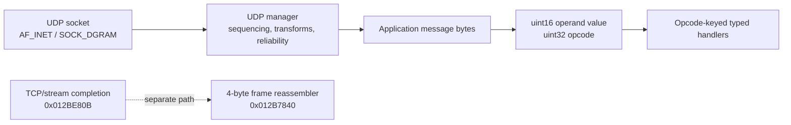
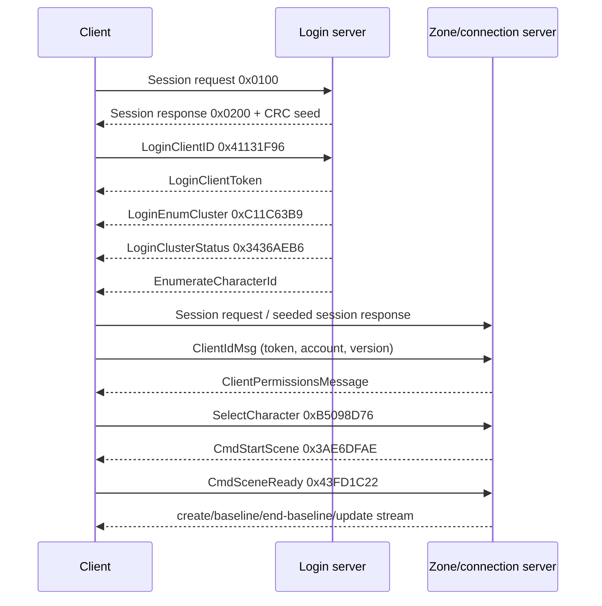

# Network Architecture

## What is confirmed

The client uses Winsock and imports asynchronous/event-oriented APIs (`WSAEventSelect`, `WSAEnumNetworkEvents`, `WSACreateEvent`) plus send/receive/connect socket calls. It also uses threads and IO completion ports elsewhere in the process. Direct constructor and send/receive call graphs now confirm that the live SOE game path uses the multithreaded UDP manager; a separate overlapped TCP implementation exists but is not the authenticated game transport.

Runtime strings expose `Connection`, `GameNetworkConnection`, `GameNetwork`, `NetworkHandler`, `LoginConnectionOpened/Closed`, `ConnectionServerConnectionOpened/Closed`, configurable timeouts, pending-byte overflow protection, reliable-overflow terminology, traffic counters, queue throttling, and connection statistics. A layered SOE transport beneath named game messages is **strongly inferred** in the client and fully implemented on the server in `BaseProtocol`, `BaseClient`, and `BasePacketHandler`.

The source-derived lower-layer wire specification is now recorded in [SOE_TRANSPORT_PROTOCOL.md](SOE_TRANSPORT_PROTOCOL.md). Core framing, handshake, transform, CRC, compression, sequencing, ACK, fragmentation, and multipacket behavior are no longer architectural unknowns; they remain implementation and compatibility-validation work.

Two distinct socket implementations are now separated by direct executable evidence:

- The `0x012BE...` implementation creates `AF_INET`, `SOCK_STREAM`, overlapped sockets and connects with `WSAConnect`; `0x012BE540` calls `WSASend` and `0x012BE870` calls `WSARecv`. This is a TCP subsystem. No direct call chain currently connects it to `GameNetworkConnection` authentication traffic.
- The game `Connection` layer constructed at `0x012B3930` allocates a `UdpManagerHandlerMT` adapter through `0x012BCF50`/`0x012BD480`. The UDP engine creates `socket(AF_INET, SOCK_DGRAM, 0)` at `0x012C124B`, receives with `recvfrom` at `0x012C1D02`, and sends with `sendto` at `0x012C20ED`. This is the leading and strongly supported Stardust SOE/game transport path.

`0x012B7840` implements four-byte length-prefixed logical-message reassembly and sends complete messages to `0x012B4120`. Its sole direct caller is `0x012BE80B`, the completion path adjacent to overlapped `WSARecv` routine `0x012BE870`. It is therefore a **Confirmed TCP/stream framing path**, not part of the SOE UDP game transport. Earlier notes that placed it above UDP were incorrect and are superseded by this call-graph proof.

`0x012B4120` copies a complete frame and referenced connection into a block-backed queue whose records are 0x20 bytes; named SWG message decoding occurs later in the consumer. Direct global xrefs show that the queue has exactly one producer (`0x012B4120`) and one drain (`0x012B3B80`). `game_network_dispatch_update_VA_00462BC0` calls that drain from the game/frame update path. This confirms the receive architecture separates socket completion, frame assembly, queued processing, and state-mutating GameNetwork dispatch.

Connection callback-table analysis now separates overflow events from ordinary named-message delivery. On the primary connection vtables, slot `+0x18` routes through `connection_overflow_event_VA_005A8BF0`, which constructs the literal `ConnectionOverflowing` event and publishes it through `connection_event_dispatch_VA_00AC2AB0`. It is not a packet-data callback. Vtable addresses `0x015E1144` and `0x015E11B8` belong to a secondary interface at object offset `+0xC8`; the primary ConnectionServer and Login tables are `0x015E114C` and `0x015E11C0` respectively.

The ConnectionServer primary table's slot `+0x28`, `connection_server_named_message_VA_0069B510`, consumes an already formed named-message object. It directly recognizes `LagRequest`, `GameServerLagResponse`, and `ConnectionServerLagResponse`, updates lag timers/state, and forwards the message to the generic connection dispatcher at `0x005A8C50`. The corresponding Login table points directly to `0x005A8C50`.

The consumer path is now directly connected: worker `0x012B3B80` calls `connection_received_message_VA_012B79B0`, which performs receive accounting and finally calls the connection's primary vtable slot `+0x28` with the message object.

Connection open and close follow the same abstraction for UDP and TCP. TCP completion `0x012BE7C0` marks the stream established, posts receive, flushes pending sends and invokes the NetworkHandler open callback. Base connection routine `0x012B76A0` installs that transport and invokes primary vtable slot `+0x14`, which reaches the Login or ConnectionServer open publisher. TCP completion `0x012BE7A0` clears its connected flag and calls the NetworkHandler terminate path at `0x012B4410`; base close routine `0x012B7520` then invokes the derived close publisher and optional fatal-on-close/logging policy. The application therefore observes established/closed events independently of socket construction/destruction.

That construction boundary has now been located at `game_network_message_from_stream_VA_00ACB790`, called by `0x005A8C50`. It wraps the received reference-counted byte stream in an archive/read iterator, deserializes a two-byte header value and one registered 32-bit value, publishes the 32-bit value as the embedded message key, and leaves the iterator positioned for typed message parsers. `0x00ACB9E0` returns that remaining archive to the typed parser.

Correlated with the server constructors and downstream string-hash comparisons, the directly observed envelope is:

```text
little-endian uint16 operand/field count
little-endian uint32 message opcode/hash
message-specific serialized fields
```

This means packet interception is not required to rediscover the fundamental application envelope: both its widths and its client-side extraction path are now address-backed.

## Direct Stardust transport layering



The UDP socket calls, handler-adapter ownership, application-envelope extraction, session negotiation, transform installation, reliable-channel routing, ACK ownership, and fragmentation paths all have direct Stardust address-level evidence. The separately identified four-byte reassembler belongs to TCP/stream transport. Remaining work is concentrated in naming several stripped helpers, proving transform-provider identities independently, and validating edge cases against deterministic fixtures.

The installed Stardust client configuration supplies login endpoint `live.stardust-swg.com:44453` in `C:\Stardust-DEV\swgemu_login.cfg`. The login-screen Finish path at `0x00C8D5D0` confirms executable consumption of indexed `loginServerAddress%i` / `loginServerPort%i`, selection among valid candidates, and connection construction through `0x00462290`; see [login-screen checkpoint](../research/checkpoints/ANALYSIS_CHECKPOINT_2026-09-24_LOGIN_SCREEN_UI_TO_CONNECTION.md). If no valid indexed entry exists, it uses the unindexed `[ClientGame] loginServerAddress`/`loginServerPort` getters, whose executable defaults are `localhost:44453`; see [fallback checkpoint](../research/checkpoints/ANALYSIS_CHECKPOINT_2026-09-24_LOGIN_CANCEL_FALLBACK_ENDPOINT.md). This is static code-path proof, not authorization to contact the live service. `swgemu_live.cfg` also enables `SharedNetwork.networkHandlerDispatchThrottle=true`.

## Session state machine



The transport handshake, login request, server replies, and ordering through selection/start-scene are **confirmed in repository server and Core3 test-client source**. This confirms compatible behavior but not the original `Stardust.exe` handler addresses or internal implementation.

## Application message framing

Server packet constructors consistently start messages with:

1. little-endian `uint16` operand/field count;
2. little-endian `uint32` message opcode (often an SWG string hash);
3. message-specific fields using engine encoders (`insertByte/Short/Int/Long/Float/Ascii/Unicode`).

This is **confirmed** in server source. It is application-message framing carried inside a separate transport protocol; it is not by itself sufficient to connect a POC client.

## Login field recovery

Client to login server, opcode `0x41131F96`, serialized header operand value 4:

- ASCII username
- ASCII password/session credential
- ASCII client version

Direct Stardust construction and the active server parser both stop after these three strings. The header's operand value is not evidence of four trailing fields. A fourth historical `STRING_HASHCODE("SWGEmu")` field is not emitted by this executable and must not be included in a compatibility implementation.

Login server success replies in this order:

- `LoginClientToken`: byte token block with embedded account ID, station ID, ASCII username.
- `LoginEnumCluster`: galaxy IDs/names and flags.
- `LoginClusterStatus`: galaxy ID, address, zone/ping ports, population/status fields.
- `EnumerateCharacterId`: Unicode name, template/race CRC, `uint64` object ID, galaxy ID, character type.

All field orders above are **confirmed in repository source**. Whether the deployed server uses `WITH_SWGREALMS_API` changes credential validation, but not these success-message constructors.

## Zone authentication

`ClientIdMsg` has operand count 3 and fields: game bits `0xFE`, byte-block length including a four-byte account ID, session bytes, `uint32 accountID`, and ASCII client version. The server validates session/account/IP and version, then emits `ClientPermissionsMessage` with four booleans. **Confirmed in source.**

Important deployed-build discrepancy: server helper `ClientIdMessage` and the Core3 client default write `20050408-18:00`, while direct Stardust xrefs strongly associate global `20260817-SD:01` with both `LoginClientId` and `ClientIdMsg` construction. The effective deployed requirement remains **Unknown**, but `20260817-SD:01` is now the leading Stardust-compatible POC value and must remain configurable pending a controlled transcript.

## Replicated object flow

Confirmed server opcodes:

- `SceneObjectCreateMessage` `0xFE89DDEA`: `uint64` object ID, quaternion, XYZ (wire order X/Z/Y), template CRC, hyperspace byte.
- `BaselinesMessage` `0x68A75F0C`: object ID, four-character object tag/CRC, view/type number, payload length, variable count, compressed payload.
- `DeltasMessage` `0x12862153`: object ID, object tag, view/type, payload length, update count, indexed updates, compressed payload.
- `SceneObjectDestroyMessage` `0x4D45D504`: object ID and hyperspace byte.
- `UpdateContainmentMessage` `0x56CBDE9E` and transform messages provide parent/spatial changes.

Client strings and RTTI confirm corresponding classes (`SceneCreateObjectByCrc`, `SceneDestroyObject`, `SceneEndBaselines`, `BaselinesMessage`, `DeltasMessage`, `UpdateTransformMessage`) and `Archive::AutoDelta*` replicated variables. Direct executable paths are known for create (`0x0051E1B3` / parser `0x00AD51B0`), baselines (`0x0051C6BE` / parser `0x00ADBC80` / view dispatch `0x00554CF0`), deltas (`0x0051C76D` / parser `0x00ADB2D0` / view dispatch `0x00554E90` / indexed decoder `0x0118AA00`), containment (`0x0051BEEC` / parser `0x00ADC6D0`), and end-baselines (`0x0051C314` / parser `0x00AD58D0` / finalizer `0x0051F9B0`). Common, Tangible, Creature and several Player field schemas are now ordered in `REPLICATION_SCHEMA_MAP.md`; remaining work is concentrated in specialized derived-object and historical Player fields rather than the outer protocol.

## Path to handler recovery

1. Locate RTTI complete-object locators/vtables for `GameNetwork::Listener`, `GameNetworkMessage`, and named message classes.
2. Xref message-name strings and constructors to registrations/factory tables.
3. Identify CRC/hash comparisons or maps near listener receive methods.
4. Confirm parser field order against server constructors.
5. Record `opcode -> parser VA -> handler VA -> state callback` in the handler map.
6. Only then use packet capture as validation, not primary discovery.
# Outbound layering confirmed in Stardust.exe

For the analyzed executable hash, the outbound game path is:

```text
SWG message serialization
    -> connection submission (boolean maps to delivery mode 0 or 4)
    -> UDP adapter / established SOE connection
    -> delivery-mode and channel dispatch
    -> sequencing, batching, or fragmentation
    -> up to two negotiated transforms
    -> seeded 1-4 byte checksum trailer
    -> UDP manager -> sendto
```

The four-byte-length reassembler at `0x012B7840` belongs to a distinct stream/message-consumer path and is not inserted by the UDP submission routine. On the confirmed game UDP path, `0x012B7F60` forwards the original serialized application bytes with numeric delivery mode 4. The SOE checksum is appended only after transforms, and the SOE opcode prefix is deliberately excluded from the transform callbacks while remaining included in the checksum input. Reliable retransmission state owns prepared transport entries until cumulative ACK processing. These boundaries should be mirrored as separate modules in the x64 proof of concept; no native pointer or container representation crosses a wire boundary.

Reliability control has two distinct release forms and a separate resend clock. `00 15`-`00 18` cumulatively release retained sends through the received sequence. `00 11`-`00 14` selectively release only the named future sequence; they do not directly request a resend in the executable. Missing lower entries remain retained and are resent when `reliable_resend_check_VA_012C7530` marks their timers expired. Stardust's source dispatches `00 11` to `resendPackets(seq)`, but that overload is currently disabled by an unconditional return, so executable behavior is the stronger compatibility specification here.

## Confirmed login-to-zone endpoint handoff

The executable does not reuse the login connection for a selected galaxy. `LoginClusterStatus` populates a cluster record with a resolved address object, zone port, ping port, status flags, population, and capacity. The cluster-selection mediator validates that record and calls `cui_login_manager_open_cluster_VA_0089A400`. That routine supplies only the resolved address and zone port to `game_network_open_connection_server_VA_00462060`; the ping port remains part of the separate cluster-latency subsystem.

The status record is exactly 44 bytes after vector decoding. Client handler `0x00898C70` proves that record `+0x24` is the cluster status enum: zero suppresses a record, while values 1 and 3 set separate state flags. The final byte at `+0x28` is copied into the cluster model as a recommendation flag. The DWORD at `+0x20` is copied as metadata; Stardust emits `0xFFFF8F80`, which is strongly consistent with a signed time-zone offset, but the historical label is not yet code-confirmed. Record `+0x1C` is explicitly replaced with zero in the client model and is behaviorally ignored by this build. Consequently the server source comments naming these positions should not be treated as authoritative protocol documentation.

`LoginEnumCluster` has two separately registered archive fields: a vector of 20-byte ID/name/metadata records and a trailing LE32. Vector decoder `0x00AEDE30` consumes only the repeated records; the generic archive layer consumes the separate footer. Handler `0x00898AC0` reads only the vector and never consults that footer. The current server's value `8` must still be emitted/consumed for wire alignment, but its historical semantic name is not required for compatible behavior in this executable.

`game_network_open_connection_server_VA_00462060` closes an existing connection-server object, constructs a fresh `ConnectionServerConnection` at `0x0069B2F0`, and retains the selected cluster name and galaxy ID. The `ConnectionServerConnectionOpened` event is emitted only after the underlying SOE connection reaches its opened state. The listener then sends `ClientIdMsg`.

```text
LoginClusterStatus endpoint
    -> cluster availability/capacity checks
    -> GameNetwork close prior zone connection
    -> new ConnectionServerConnection(address, zonePort)
    -> SOE SessionRequest / SessionResponse
    -> ConnectionServerConnectionOpened
    -> ClientIdMsg
    -> ClientPermissionsMessage
```

The x64 protocol/session layer should model `Connecting`, `TransportEstablished`, `Authenticating`, `Permitted`, `Closing`, and `Closed` as distinct states. In particular, `ClientIdMsg` must be triggered by `TransportEstablished`, not merely by successful socket creation. Transport-level establishment retry is confirmed: the state-0 connection pump periodically retransmits the 14-byte session request until a configured timeout, then closes with reason 5. Application authentication retry/backoff remains a separate unknown and should initially be explicit and bounded in the POC.

Timeout domains are now explicitly separated. `[ClientGame] connectionTimeout` defaults to IEEE-754 `600.0` seconds and is consumed by the avatar-selection mediator at `0x00C62970`: after it submits `SelectCharacterMessage`, it accumulates frame delta time and abandons the wait when the value exceeds 600 seconds. It is not the UDP establishment timeout. SharedNetwork integer options use the lower transport's clock domain and include `oldestUnacknowledgedTimeout=90000`, `noDataTimeout=46000`, `keepAliveDelay=15000`, and `stallReportDelay=30000`; direct configuration names and their transport-option slots are confirmed, while the final propagation of every slot into each live UDP connection remains partly unresolved.

### Character selection to scene readiness

The exact original request is `U16(2) | U32(0xB5098D76) | U64(characterId)`. The current server helper appends a legacy `SWGEmu` hash that Stardust.exe does not send and the current callback does not parse. After reliable submission the client enters a separate selection wait state governed by `[ClientGame] connectionTimeout`.

Server admission validates authenticated-session ownership for the current galaxy, server state/cap/lock, optional external approval, zone availability and per-account online limits before binding session and creature. Reconnects disconnect an older session through the player's ordered task queue. Placement restoration selects ship/POB, interior cell, vehicle, ground terrain or orphaned-space recovery before `sendToOwner` starts the scene stream.

The operational sequence is `SelectCharacter -> CmdStartScene -> guild/player/root/nearby baselines -> client CmdSceneReady -> server CmdSceneReady echo -> post-ready PvP/buffs/social/weather`. For a headless networking proof, parsing `CmdStartScene` is the safe first boundary. It should not send ready until it can drain the expanded post-ready traffic.

### SHIP view-3 replication boundary

`SHIP:3` is a public 22-field view: the eleven inherited tangible fields are
followed by slip, current/maximum chassis health, chassis CRC, five packed
component maps, and maximum front/rear shields. The current server's packed
maps frame both baseline fields and delta-field updates as count/counter plus
ADD entries. `DeltaAutoPackedMap` uses ADD/DROP/SET only to mutate server-side
state, then transmits the complete resulting map; DROP and SET are not emitted
by these setters. Keys are always U32 component slots; indices 15-18 carry F32
values and index 19 carries U32 option flags.

The generic delta engine must validate the complete update before committing.
View-3 condition/option maps do not directly own attachment reconstruction.
The legacy attachment refresh and `ComponentsChanged` callbacks belong to the
correlated SHIP:6[15] component-CRC map. The new client should preserve that
semantic boundary without reproducing the legacy 32-bit member layout.

SHIP also inherits the proven TANO field-5 width defect: Stardust.exe expects
eight-byte visible-component entries while the current server emits four-byte
integers. The replacement protocol layer should deliberately accept the
server's four-byte representation and keep this behavior under a fixture,
rather than accidentally copying the legacy decoder mismatch.

### SHIP view-1 authorization and engineering state

`SHIP:1` is the private engineering view. Stardust sends its baseline only to
the owner or a creature contained under the ship; aggregated deltas go to the
owner and ship members. Its 38 fields contain two zero compatibility slots,
fifteen component maps, chassis/shield/capacitor/engine/reactor/booster
parameters, droid command speed and a U64 droid control-device ID.

All fifteen component maps are packed replacements. Their values are F32 for
performance/weapon statistics, Unicode for component names, U64 for creator
IDs, S32 for ammunition counts and U32 for ammunition class. The server has no
current producer for creator IDs, but the field remains part of the accepted
wire schema. Map mutations, specialized component scalars and public
health/appearance state are often emitted across SHIP views 1, 3, 4 and 6;
protocol parsing should remain per-message atomic while the object layer
coalesces downstream notifications around the resulting semantic transaction.

Index 37 has a confirmed client-specific consequence: decoder/callback code
publishes `DroidPcdChanged`. The value is a protocol object ID and must not be
stored as or widened into a native pointer.

### SHIP view-4 live-resource boundary

`SHIP:4` is a second private owner/crew view with five fields: current installed
mass, chassis speed scalar, current capacitor energy, current booster energy
and a packed U32-to-F32 refire-efficiency map. The first four are F32; the map
is a complete count/counter/ADD-entry replacement in both baselines and
deltas.

Index 1 must not be modeled as instantaneous velocity. Stardust loads it from
the ship template and multiplies it into calculated maximum speed. Actual
current speed is a separate transient server member updated by ship transform
traffic. Current mass and energies are live authoritative simulation values:
component changes recalculate mass, projectile fire spends capacitor energy,
and recovery/boost/damage/repair paths update energy. Refire efficiency is
replicated but has no server-side consumer in the current tree, making its
final client weapon-timing arithmetic a bounded remaining detail.

### SHIP view-6 public flight and presentation boundary

`SHIP:6` is the public 23-field observer view. It combines inherited flags and
defenders with a U16 runtime ship ID, nine effective flight-limit F32 values,
selected target U64 and component slot, a full-snapshot targetability bit
array, an incremental U32→U32 component appearance-CRC map, four ASCII
identity fields, current front/rear shields and owner guild ID.

Its two containers require different decoders. Targetability transmits U32
byte count, U32 counter and the complete byte vector. Component CRCs use true
ADD/DROP/SET operation deltas; these callbacks own attachment refresh and
`ComponentsChanged`. This corrects the earlier imprecise association with
SHIP:3 condition maps.

Target/slot changes have address-backed callbacks that update selection state
and publish `LookAtTargetChanged` / `LookAtTargetSlotChanged`. Effective flight
values are server-derived control limits, not transforms. Wing name is empty,
player-ship type is hidden in the baseline, and guild ID is derived from the
owner only during baseline construction; the current guild delta setter has
no producer.

The ConnectionServer lag-control exchange is confirmed end to end. `0x0069B8D0` sends a zero-field `LagRequest` after the configured `[ClientGame] lagRequestDelay` (default 600000 ms), records the send tick and waits for both named responses. `0x0069B510` independently recognizes `ConnectionServerLagResponse` and `GameServerLagResponse`, stores each elapsed measurement, then `0x0069B690` sends `LagReport` containing connection-server lag followed by game-server lag as two 32-bit integers. Stardust registers `LagRequest` CRC `0x31805EE0` and `LagReport` CRC `0xC5ED2F85`; its callback emits both response messages and parses the report fields in the same order. `[ClientGame] lagReportThreshold` defaults to 10000 ms and controls diagnostic warning output, not packet generation.

`ParametersMessage` is decoded by `0x00AC8D70` as one U32 AutoVariable and consumed by `game_network_parameters_store_VA_004630B0`, which copies it into `GameNetwork +0x60`. Current Stardust sends `0x384` (900). A disassembly-confirmed getter exists at `game_network_parameters_get_VA_00463750`, but it has no static callers in this executable. The value is therefore retained but dormant in this build; its historical unit/purpose remains **Unknown** and is not a proof-of-concept dependency.

`ConnectPlayerResponseMessage` is not a zone-login prerequisite. It is registered by the customer-service manager listener, decoded at `0x00AFB0F0`, converted to a boolean result in `0x00A19580`, broadcast through `CuiCSManagerListener::Messages::ConnectPlayerResponse`, and passed to the customer-service manager consumer at `0x005CA600`. Current Stardust sends U32 zero. This closes the earlier ambiguous row as a support/connectivity-test response rather than part of authentication.

The `ConnectionServerConnection` primary vtable is fixed at `0x015E114C`. Application-specific virtuals publish close (`0x0069B3D0`), send `ClientIdMsg` and publish open (`0x0069B430`), forward overflow (`0x0069B500`), dispatch named messages with lag bookkeeping (`0x0069B510`), and submit outbound serialized messages (`0x005A8DF0`). The outbound method increments sent-byte accounting by the serialized buffer length, submits to the transport and clears its stalled marker. Base virtual `0x012B8530` logs `Connection stalled with %d bytes`; two slots at `0x012B7C40/0x012B7C50` are no-op returns and `0x012B8C60` returns false. This separates lifecycle/telemetry hooks from the named-message parser.
## Malformed application-message containment

Fixed-width Archive reads terminate at `byte_stream_read_checked_VA_0118B030`, which throws when a requested span exceeds the bounded stream. Replication delta dispatcher `autodelta_byte_stream_delta_decode_VA_0118AA00` does not validate a U16 field index before indexing its registry. An invalid index can therefore leave the bounded-read safety domain before the field decoder is even selected.

The exception path is now traced through the process boundary:

```text
field decoder / AutoDeltaByteStream
  -> GroundScene::receiveMessage 0x0051BD10
  -> keyed connection event fan-out 0x00AC2AB0
  -> connection message dispatch 0x005A8C50
  -> received-message service loop 0x012B3B80
       catch thunk 0x012B3D42: log "Unhandled Archive read error: %s", then rethrow
  -> GameNetwork update wrapper 0x00462BC0
  -> frame tick 0x004237C0
  -> game loop 0x00423780
  -> application bootstrap 0x00401050
  -> WinMain wrapper 0x00401810
  -> MSVC CRT entry 0x0131DC7A / standard frame handler
```

The service loop is the first and only application-specific catch found on this route. It obtains the Archive exception text, emits the exact diagnostic above, and rethrows a fresh Archive exception using throw metadata `0x0164239C`; it does not swallow the message, disconnect cleanly, or resume dispatch. Every higher client layer inspected has cleanup/unwind state only, and the CRT endpoint is the standard runtime handler rather than a recovery policy. A malformed inbound application payload can therefore terminate the legacy process after logging. Because replication containers mutate in place, an exception after an earlier valid field leaves those mutations present while skipping normal post-delta commit and connection traffic accounting. Deferred dirty-field entries are not committed on the exceptional route. The process then terminates, so it has no supported recovery/next-delta semantics to reproduce. A replacement must validate message envelopes, field indices, lengths, operation codes, counts, and allocation caps before committing any state; failure should reject the complete application message and apply an explicit diagnostic/disconnect policy without process termination.

The first `ClientIdMsg` U32 is resolved at its source. `ConfigClientGame::install` function `0x00503600` reads `[ClientGame] gameBitsToClear` with default `0` into global `0x019110EC`; sole getter `0x005035B0` has exactly one caller, zone-open sender `0x0069B430`, which supplies the message constructor's gameBits field. Current Stardust parses and logs this value but never branches on it. The networking POC should emit zero unless an explicit compatibility fixture exercises a configured alternative.

`ClientPermissionsMessage` now has a closed UI continuation. Handler `0x00899340` stores bytes 2 and 3, publishes byte 1 as `CuiLoginManager::Messages::ClusterConnection`, and clears the selected-cluster ID when byte 1 is false. Cluster-selection consumer `0x00C7B920` closes any progress box, reports failure for false, rejects unsolicited or wrong-cluster success, and on valid success activates avatar selection. It passes a Jedi-only mode only when the third byte is true and the effective regular-creation getter is false.

The effective regular-creation getter `0x0089A3D0` returns `serverRegularPermission || DAT_01908858`. The latter is set to one by `Game::install` `0x00422E80` and is broadly used as an installed-state guard, making the server regular-creation denial ineffective during the normal installed client lifetime. Combined getter `0x0089A3B0` reports regular-or-Jedi creation; `0x0089A3F0` returns the Jedi byte directly. This is a confirmed legacy gating quirk, not a policy to copy. A replacement should treat server permissions explicitly and define any development override separately.

Instruction-level tracing closes UDP establishment-timeout provenance. At `0x012B64A0`–`0x012B64AD`, the normal game connection pushes remote address, remote port and zero into wrapper `0x012BCDA0`; the value reaches `0x012C1990`, `0x012C2810` and live offset `+0xF8`. The state-0 timeout branch is disabled for normal game connections, although session-request retransmission remains active.

`SharedNetwork.useTcp` is a genuine constructor selector. False creates the UDP/SOE manager. True creates a stream object at `0x012BE1C0`, calls `WSASocketA(AF_INET, SOCK_STREAM, tcp)`, enables nonblocking mode and `TCP_NODELAY`, calls `WSAConnect`, selects `FD_CLOSE` and creates an I/O completion port. The executable default is true and the loose deployed CFG does not override it. Managed IL from the shipped `StardustLauncher.exe` further proves its play action starts `Stardust.exe` through `ProcessStartInfo(string)` without an argument string, so the ordinary installed launch path does not add a hidden command-line override. The distributed package therefore selects TCP. Stardust login and zone source instantiate `DatagramServiceThread`; no source-side stream front end for those services is present. An external gateway/deployment-only listener is suggested but remains unknown. A replacement must expose explicit direct-UDP/SOE and length-prefixed-TCP profiles, using UDP/SOE for the first developer-server POC. See `ANALYSIS_CHECKPOINT_2026-09-22_DEPLOYED_TRANSPORT_SELECTOR.md`.

UDP port remapping is implemented at `udp_manager_packet_dispatch_VA_012C2190`. For an unknown endpoint, opcode `0x001E` locates a connection by connection ID, requires the configured/source-address condition, validates the negotiated token at live connection `+0x11C`, removes the old endpoint hash entry, adopts the datagram source address/port and reinserts the connection. This is authenticated endpoint migration/NAT rebinding.

The TCP framing layer is now recovered. Outbound `tcp_frame_queue_VA_012BE8F0` writes native little-endian U32 payload length followed by raw application-message bytes. It buffers frames and flushes when queued bytes reach `tcpMinimumFrame` (default 1000) or during the shared periodic flush. Receive completion posts the next read first, then `tcp_receive_frame_reassembler_VA_012B7840` accumulates a four-byte length and exactly that many payload bytes before calling the same `received_frame_dispatch_VA_012B4120` used above the transport boundary. Multiple frames per receive are supported. No explicit maximum length check is visible before buffer growth.

`ServerTimeMessage` is not an epoch clock message. Stardust emits `LE64(Zone::galacticTime.miliDifference()/1000)` every 60 seconds, while `CmdStartScene` supplies the initial value. The client parser at `0x00ADC0F0` routes the full U64 through modulo by the current terrain's PTAT cycle duration and corrects GroundEnvironment normalized time. It also stores a separate compatibility offset using only the low 32 bits. The environment then advances locally by frame delta. Preserve the LE64 wire field, use full-width arithmetic internally, and regard later messages as authoritative corrections.

Configuration precedence is also confirmed. `app_entry_VA_00401050` selects `swgemu.cfg`, whose includes are processed immediately in listed order: login, live, preload, options, user. Repeated values are retained, and scalar getters select index `count-1`; later definitions therefore win. The command line is parsed after the root file and can append `section.key=value` overrides or load a later `@file`. This confirms that the installed loose files leave `useTcp` at its true default, while an unavailable launch argument could still override it.

All SOE transform selector behaviors are now closed. Selector 0 copies; selector 1
uses the zlib/copy provider and trailing flag; selector 2 calls a secondary provider
pair whose concrete methods both copy; selector 3 combines a deterministic pad with
ciphertext chaining on complete LE32 words; selector 4 uses the seed-only chain.
Selector 3 tail bytes use only the pad. Numeric dispatch, order, inverse order and
golden vectors are sufficient for compatibility despite missing historic labels.

## Ship transform control and prediction (2026-09-15)

Space flight uses bidirectional opcode `0x76026FB9`. The fixed 21-byte payload
after the application opcode carries a U16 short ID, I8 quaternion, I16 X/Z/Y
position, packed speed/unit direction, three I8 angular rates and a U32 stamp.
The executable's local controller sender is `0x0061C560`, serializer
`0x00AD6370`, and connection submission boundary `0x00462670`. The sender writes
short ID zero; Stardust intentionally resolves the ship from the session pilot
and does not validate this field.

The server accepts client motion inside lifecycle, timestamp and broad
displacement gates, then broadcasts a one-step extrapolated position. The
client dispatch at `0x0051D783` routes through parser `0x00AD6930` to either
`PlayerShipController::handleTransform` (`0x0061B230`) for reconciliation or
`RemoteShipController::handleTransform` (`0x00617F70`) for interpolation. The
related collision correction `0x763648D0` is implemented client-side but its
current Stardust producer is commented out. See
`ANALYSIS_CHECKPOINT_2026-09-15_SHIP_TRANSFORM_CONTROL.md`.

## Ship damage presentation boundary (2026-09-15)

Three active server messages bridge replicated damage state to presentation:
ObjectController subtype `0x432` (`OnShipHit`), `0x3871D784`
(`DestroyShipComponentMessage`) and `0x5C680884` (`DestroyShipMessage`). They
select hit effects/sounds, detach destroyed component appearances, and start
remote or local-player explosion sequences respectively. They are not
authoritative health containers; SHIP baselines/deltas remain authoritative.
The local whole-ship path enters a timed `SpaceDeath` presentation while the
server later relocates/restores/stores the ship. See
`ANALYSIS_CHECKPOINT_2026-09-15_SHIP_DAMAGE_DESTRUCTION.md`.

## Nebula lightning scheduling (2026-09-15)

Opcode `0x65F27987` schedules a presentation-only lightning segment using U16
event ID, S32 nebula row, recipient-domain start/end times and two F32 world
positions. Parser `0x00AD2D80` feeds the timed queue at `0x0052F640`.
Appearance/audio names come from the original zone table. Server collision,
damage, `OnShipHit` and SHIP deltas remain authoritative. See
`ANALYSIS_CHECKPOINT_2026-09-15_NEBULA_LIGHTNING.md`.

## Ordinary world-space full transforms (2026-09-15)

ObjectController inner `0x71` is the full-precision world-space movement and
correction channel. Its C->S outer scalar is the timestamp consumed by the
server transform parser; S->C uses a zero scalar and the nested client codec
starts at movement counter. The tail is quaternion x/y/z/w, position x/z/y and
speed. Server validation applies accepted motion and normally emits compact
observer transforms. Local client controllers apply `0x71` immediately,
including mount redirection; remote controllers reject stale counters and
install a world/cell interpolation target. See
`ANALYSIS_CHECKPOINT_2026-09-15_DATA_TRANSFORM.md`.

## Out-of-range group-member status (2026-09-15)

`ClientMfdStatusUpdateMessage` (`0x2D2D6EE1`) carries one group member's ASCII
zone, U64 object ID and F32 world x/z/y. The client routes the record by object
ID to `SwgCuiStatusGround`: same-zone state drives position/distance display;
cross-zone state drives a localized planet label and hides the local-position
indicator. It does not move the creature or define group membership. Current
Stardust source emits it only to group members outside the sender's close-object
set and, due to present control flow, only while the sender is ONFIRE in a
ground zone. See `ANALYSIS_CHECKPOINT_2026-09-15_CLIENT_MFD_STATUS_UPDATE.md`.

## Player-name existence lookup (2026-09-15)

`VerifyPlayerNameMessage` (`0xBB8CAD45`) sends a UTF-16 target name and the
requester's U64 object ID for the harassment/customer-service workflow. The
server calls `PlayerManager::existsName`; this is not character-creation name
validation. The expected `0xF4C498FD` response is U8 exists plus the echoed
UTF-16 name. Stardust currently writes U8 plus a declared Unicode length of one
but no UTF-16 code unit, a confirmed truncation relative to the executable
codec. See `ANALYSIS_CHECKPOINT_2026-09-15_VERIFY_PLAYER_NAME.md`.

## Planetary map snapshots (2026-09-15)

`GetMapLocationsMessage` (`0x1A7AB839`) carries ASCII planet plus three client
cache/revision tokens. Stardust ignores the tokens and returns a compressed
full `0x9F80464C` snapshot. The client supports three arrays of U64 ID, UTF-16
name, F32 x/y and category/subcategory/icon bytes plus three tokens; Stardust
populates only array 0. Server faction/facility filtering precedes transmission.
The client validates planet identity, replaces caches and depends on original
category/localization/map assets. See `ANALYSIS_CHECKPOINT_2026-09-15_MAP_LOCATIONS.md`.

`RequestCategoriesMessage` (`0xF898E25F`) carries the current ASCII language;
`RequestCategoriesResponseMessage` (`0x61148FD4`) carries an unknown U32 and a
counted recursive tree of UTF-16 names, U32 IDs, child vectors and two flag
bytes. The executable deep-copies this into customer-service manager state and
publishes a UI event. Current Stardust disables category loading and sends an
empty tree. See `ANALYSIS_CHECKPOINT_2026-09-15_REQUEST_CATEGORIES.md`.

`ResourceListForSurveyMessage` (`0x8A64B1D5`) is a full snapshot containing
counted ASCII-name/U64-ID/ASCII-type records, followed by ASCII survey type and
U64 player ID. Stardust filters the current zone's in-shift resources by tool
compatibility; the executable clears and rebuilds the active survey UI. See
`ANALYSIS_CHECKPOINT_2026-09-15_RESOURCE_LIST_FOR_SURVEY.md`.

`SurveyMessage` (`0x877F79AC`) is a counted grid of four-F32 records: world X,
reserved/currently-zero Z, world Y and density fraction. Stardust samples a
bounded square around the player; the executable computes plot extents and
rebuilds the survey density visualization. See
`ANALYSIS_CHECKPOINT_2026-09-15_SURVEY_RESULT.md`.

Vendor ownership uses C→Z `0x21B55A3B` with a U64 target and Z→C
`0xCE04173E` with U32 rights/error, U64 object ID, ASCII vendor UID and an
unknown U16 currently `0x64`. See
`ANALYSIS_CHECKPOINT_2026-09-15_VENDOR_OWNERSHIP.md`.

## Offline zone-scene codec implementation — 2026-10-01

[ZoneSceneProtocolCodec contract](ZONE_SCENE_PROTOCOL_CODEC_CONTRACT.md) records accepted SelectCharacter encoder/decoder and CmdStartScene decoder with immutable DTOs, hand-authored fixtures and independent wire audit. Raw flag, U64 values, ASCII16 strings and X/Z/Y order are preserved. Header/truncation/trailing/non-ASCII/non-finite failures are rejected. Zone connection, scene application and CmdSceneReady remain unfinished boundaries.
