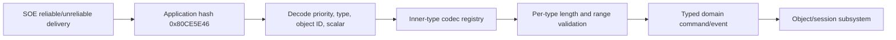

# Object Controller Protocol

Baseline: `C:\Stardust-DEV\Stardust.exe`, image base `0x00400000`, SHA-256 `E782BF1C49B3DA730F66B54BC558947C46493F7133F672EED1D8E0C56A6B6150`.

## Why this envelope matters

`ObjControllerMessage` / hash `0x80CE5E46` is a protocol-within-the-protocol. Movement, commands, targeting, trade initiation, object menus, crafting, image design, and much of Jump to Lightspeed use a shared outer message and a numeric inner type. Recovering this registry avoids treating each inner command as an unrelated packet.

## Confirmed wire envelope

Current server `ObjectControllerMessage.h` and the executable parser `obj_controller_message_parse_VA_00AC9660` agree on:

| Offset | Type | Meaning |
|---:|---|---|
| `0x00` | U16 LE | operand count `5` |
| `0x02` | U32 LE | outer hash `0x80CE5E46` |
| `0x06` | U32 LE | priority/flags word |
| `0x0A` | S32/U32 LE | inner controller type |
| `0x0E` | U64 LE | addressed object ID |
| `0x16` | 4-byte LE word | client outer storage/parser uses F32; current server CtoS movement parses U32 timestamp bits; StoC constructors write zero through `insertInt(0)` |
| `0x1A` | variable | inner-type-specific payload |

The executable proves the four outer fields through RTTI-backed archive wrappers:

- `AutoVariable<unsigned long>` at object `+0x3C`, value `+0x40`;
- `AutoVariable<long>` at `+0x44`, value `+0x48`;
- `AutoVariable<NetworkId>` at `+0x50`, U64 value beginning `+0x58`;
- `AutoVariable<float>` at `+0x60`, value `+0x64`.

After decoding the envelope, `0x00AC97A4` calls `obj_controller_inner_factory_VA_00B0D190(type, archive)` and stores the typed payload object at `+0x38`. Dispatch `obj_controller_dispatch_VA_00462F60` resolves the addressed object, finds its controller, and queues the inner type, payload, scalar, and normalized priority word through the controller message boundary `0x00B3D250`.

Unknown inner types fail the factory lookup, emit the exact diagnostic
`ControllerMessageFactory::unpack received a message %d which had no registered unpack function.`,
and return a null nested payload. The outer parser still records
`recv.ObjControllerMessage.%lu`. Dispatcher `0x00462F60` does not dereference the
null at its call site and performs no object mutation when no target controller is
available. A replacement should reject the complete message explicitly rather than
recreate a nullable queue contract, and should impose per-type payload size limits
before construction.

## Factory registry

`obj_controller_factory_register_VA_00B0CFC0` receives a numeric type, outbound factory, inbound factory, and a boolean capability flag. A deterministic static probe found **139 distinct direct-immediate registrations** in Stardust.exe. The boolean is retained in a third registry. Registration-value correlation strongly identifies it as a locally/client-originatable capability annotation: all current C→S types use one, checked S→C-only types use zero, and bidirectional types use one.

Accessor `obj_controller_policy_lookup_VA_00B0D200` is a complete leaf lookup returning false for an absent type. Executable-wide scans find neither a direct `E8` call nor an absolute function-pointer reference to that accessor. The third map therefore does not enforce inbound dispatch, outbound construction, reliability, or forwarding anywhere in this build. For replacement behavior, direction must be enforced by the replacement's explicit directional codec registry and server policy rather than by recreating this dormant metadata map. The original public member name remains archaeological-only uncertainty.

The reusable inventory tool is `tools/object_controller_catalog.py`. It records the call site and both factory VAs and can compare the result with the current server source.

## Active Stardust server intersection

The current `ZonePacketHandler::registerObjectControllerMessages()` registers 24 inner types. **All 24 occur in Stardust.exe's 139-entry registry** (100% numeric intersection). This proves availability, not that every client-side field decoder is already documented.

| Type | Server callback | Client registration site | Outbound factory | Inbound factory |
|---:|---|---:|---:|---:|
| `0x71` | `DataTransformCallback` | `0x00AD4763` | `0x00AD4810` | `0x00AD4860` |
| `0xED` | `EmptyHopperCallback` | `0x00AF62E6` | `0x00AF6320` | `0x00AF6340` |
| `0xF1` | `DataTransformWithParentCallback` | `0x00AD4226` | `0x00AD4360` | `0x00AD43B0` |
| `0xF5` | `MissionListRequestCallback` | `0x00AF4806` | `0x00AF4930` | `0x00AF4980` |
| `0xF9` | `MissionAcceptCallback` | `0x00AF4F26` | `0x00AF5190` | `0x00AF51B0` |
| `0x106` | `CraftingExperimentCallback` | `0x00AF5D26` | `0x00AF5DF0` | `0x00AF5E60` |
| `0x107` | `CraftingAddIngredientCallback` | `0x00AEC1A6` | `0x00AEC240` | `0x00AEC2A0` |
| `0x108` | `CraftingRemoveIngredientCallback` | `0x00AF5306` | `0x00AF5430` | `0x00AF5480` |
| `0x115` | `ItemDropTradeCallback` | `0x00AE2E06` | `0x00AE3010` | `0x00AE3060` |
| `0x116` | `CommandQueueEnqueueCallback` | `0x00AE3B26` | `0x00AE3E80` | `0x00AE3EF0` |
| `0x117` | `CommandQueueRemoveCallback` | `0x00AE36B6` | `0x00AE37E0` | `0x00AE3850` |
| `0x126` | `TargetUpdateCallback` | `0x00ADE3F8` | `0x00ADE500` | `0x00ADE520` |
| `0x13F` | `TeleportAckCallback` | `0x00AE3416` | `0x00AE34E0` | `0x00AE3500` |
| `0x142` | `MissionAbortCallback` | `0x00ADE3CC` | `0x00ADE500` | `0x00ADE520` |
| `0x146` | `ObjectMenuRequestCallback` | `0x00AF31E6` | `0x00AF3510` | `0x00AF35F0` |
| `0x15A` | `CraftingCustomizationCallback` | `0x00AF56B6` | `0x00AF57B0` | `0x00AF5860` |
| `0x238` | `ImageDesignChangeMessageCallback` | `0x00B0AE06` | `0x00B0B620` | `0x00B0B990` |
| `0x239` | `ImageDesignRejectMessageCallback` | `0x00AC892C` | `0x00B0B620` | `0x00B0B990` |
| `0x3FA` | `UpdateShipTargetSlotCallback` | `0x0119752A` | `0x01194EE0` | `0x01194F20` |
| `0x41C` | `JtlShipListRequestCallback` | `0x011975B4` | `0x01195850` | `0x01195890` |
| `0x435` | `DroidCommandProgrammingCallback` | `0x00B0F9E6` | `0x00B0FEF0` | `0x00B10020` |
| `0x436` | `GroupMemberSendSpaceInviteCallback` | `0x01197625` | `0x01195850` | `0x01195890` |
| `0x438` | `GroupMemberSpaceInviteResponseCallback` | `0x01197654` | `0x01196EB0` | `0x01196EE0` |
| `0x43F` | `LotteryWindowCallback` | `0x011976C5` | `0x01196FE0` | `0x01197040` |

The registration block containing the JTL/social tail is now bounded as `shared_controller_payload_registry_install_VA_01197250`. It installs 50 IDs and registers its own ExitChain teardown; its exact `0x3FA` row resolves to RTTI `MessageQueueGenericValueType<int>`.

Every intersection row's client capability flag is `1`. Conversely, a checked set of server-to-client-only types (`0xCC`, `0xDD`, `0xDE`, `0xDF`, `0xE0`, `0xF2`, `0xF4`, `0x131`, `0x134`, `0x140`, `0x229`, `0x22A`, `0x440`, `0x441`) all use `0`. Bidirectional types such as `0x116`, `0x117`, `0x238`, and `0x239` use `1`. This strongly identifies “locally/client-originatable” capability. The lookup accessor has no code or data references in the executable, so this flag has no active enforcement effect in Stardust.exe.

### Parent-relative movement (`0xF1`) directional grammar

`0xF1` is bidirectional but not structurally identical in both directions. On C→S, the outer word is a U32 timestamp in the current server parser: the server outer callback deliberately leaves it unread, and `Transform::parseDataTransformWithParent` consumes it before nested movement counter, parent U64, quaternion, x/z/y position and speed. On S→C, the outer parser has already consumed the server's zero scalar; executable unpacker `0x00AD43B0` starts with movement counter and then reads the same parent/transform/speed tail. Packer `0x00AD4360` and payload constructor `0x00AD4260` confirm the client object layout. Do not model this as one symmetric serialized struct.

`0x71` follows the same directional scalar rule without a parent ID. C→S `Transform::parseDataTransform` consumes U32 timestamp, U32 counter, quaternion x/y/z/w, position x/z/y and speed. S→C unpacker `0x00AD4860` starts at counter after the outer parser consumes Stardust's zero scalar. Dispatcher `0x00B4B000` calls virtual `+0x24`: player `0x0062C980` applies an immediate correction through `0x006E4E50`; remote `0x00637D30` filters freshness and installs an interpolation target through `0x00637270`.

The top-level compact `UpdateTransformWithParent` remains a separate observer-bandwidth path: U64 parent/object, three S16 eighth-unit coordinates, U32 counter and two S8 speed/heading values. Both feed the parent-relative controller family, but only `0xF1` retains full quaternion, F32 position and F32 speed.

The exact C→S field layouts and server-side effects for all 24 rows are consolidated in `ACTIVE_OBJECT_CONTROLLER_SCHEMAS.md`. A key result is that inner type alone is not a complete schema discriminator: `0x117` and `0x142` have direction-dependent payloads.

Mission lifecycle correlation closes three adjacent controller IDs. The client accept path constructs `MessageQueueMissionGenericResponse`'s request-side sibling at `0x00AF5030` from mission ID, retained terminal ID and an incrementing U8 terminal-list index, then submits inner `0xF9` with flags `0x83`. The current server returns `0xFA` as `{U64 missionId,U8 success,U8 terminalIndex}`. Dispatcher `0x0062AA10` casts that response and calls `0x00978B70`, which clears the matching pending sequence and publishes `CuiMissionManager::Messages::ResponseAccept`.

Abort routine `0x00979960` sends inner `0x142` with a `MessageQueueNetworkId` payload and also establishes a pending mission UI dialog. The same numeric type returns from the server with the mission ID; the direction-specific factory yields `MessageQueueNetworkId`, dispatcher `0x0062AA10` calls `0x00978E20`, and that handler clears pending state and publishes `CuiMissionManager::Messages::ResponseAbort`. This is direct evidence that the replacement registry must dispatch by direction as well as inner ID.

The mission-list request at `0x00979340` sends `0xF5` as `{U8 flags,U8 sequence,U64 terminalId}` after the outer scalar and clears nine retained result/list collections while showing a pending dialog. The current server does not send a dedicated controller response: it repopulates mission objects and advances their replicated refresh counters. Stardust.exe separately understands named `PopulateMissionBrowserMessage` (`0x88D9885C`) as `U32 count + repeated U64 missionId` and publishes `ReceiveList`, but the current server constructor has no call site. This indicates an unused historical list-completion mechanism alongside the deployed MISO delta path.

Details request `0xF7` is constructed by `0x00979660` as `{U64 missionId,U64 terminalId,U8 sequence}` and expects `0xF8` `MessageQueueMissionDetailsResponse`. Handler `0x009788B0` accepts only the current sequence, otherwise logs a stale-response warning. The current Stardust server registers neither a `0xF7` callback nor an `0xF8` emitter. Treat this as a confirmed client capability/current-server gap, not as required POC behavior.

## Trade initiation (`0x115`)

`trade_request_begin_VA_005E1760` allocates the registered `0x115` `MessageQueueSecureTrade` payload through `0x00AE2E40` and queues it on the local object controller with priority `0x23`. The typed codec at `0x00AE3010` proves the inner layout is U32 operation followed by two U64 NetworkIds. Because the callback cursor starts on the outer scalar, the server's 16-byte shift skips `{scalar, operation, first NetworkId}` and its following U64 is the target player. The server rejects self/combat/invalid/non-player/busy targets, opens paired `TradeSession` objects only when both players mutually target one another, and sends `BeginTradeMessage` to both clients.

The object-controller consumer `secure_trade_queue_dispatch_VA_0062CAC0` maps operations `1..5`: `1` publishes `Requested(firstId)`, `2` is a no-op, `3` publishes `RequestDenied(secondId)`, `4` publishes `RequestDeniedBusy(secondId)`, and `5` publishes `RequestDeniedUnreachable(secondId)`. The request path at `trade_request_target_VA_005E13F0` constructs operation `0`, first ID `NetworkId::cms_invalid`, and second ID equal to the selected target, then queues type `0x115` at priority `0x23`. Operation `0` falls through the local event projector because it is the server-directed request form.

Accordingly, the server-facing inner bytes are now **Confirmed** as `U32 0 | U64 0 | U64 targetId` after the outer scalar. The outer addressed object remains the local controlled player/parent as enforced by the server callback. The local controller-to-network forwarding boundary still merits an integration test, but no unknown payload bytes remain.

## Ship target component selection (`0x3FA`)

Client function `update_ship_target_slot_payload_send_VA_006189A0` allocates the registered integer payload, stores the selected component slot, and queues controller type `0x3FA` with flags/priority `0x83`. Its sole caller, `ship_set_and_send_target_slot_VA_00696480`, sends only when the object is the current local ship and has a controller, caches the selection, and then applies it locally through the target-slot AutoDelta field setter.

The current server `UpdateShipTargetSlotCallback` reads a U32 payload-size value and U32 target slot, rejects chassis/out-of-range slots, requires the player to be piloting and the root parent to be a ship, and ignores no-op selections. It then updates the authoritative ship field with delta emission. On return, SHIP:6 index 13 is decoded by `0x00545550/0x005455A0`; callback `0x00696760` publishes `ShipObject::Messages::LookAtTargetSlotChanged` and may reconcile an invalid/untargetable selection. This supplies a fully correlated chain:

```text
local targeting input/state
  -> 0x00696480
  -> ObjController 0x3FA / integer payload 0x006189A0
  -> Stardust UpdateShipTargetSlotCallback
  -> SHIP:6[13] delta
  -> 0x005455A0
  -> LookAtTargetSlotChanged / selection reconciliation
```

This flow confirms client-side prediction followed by server-authoritative echo. A replacement should keep the predicted and confirmed values conceptually distinct even if the first implementation displays them identically.

## Gameplay command enqueue (`0x116`)

The central client command path is `client_command_queue_enqueue_VA_0046D7A0`. After command lookup, local eligibility/queue processing and action-counter assignment, its normal networked branch calls `command_queue_enqueue_send_VA_0062CB50`. Exact call-site disassembly supplies four arguments: action counter, command CRC, target `NetworkId`, and Unicode argument string. The sender constructs `MessageQueueCommandQueueEnqueue` through `0x00AE3B60` and queues controller type `0x116` with priority/flags `0x23`.

Serializer `command_queue_enqueue_payload_serialize_VA_00AE3E80` writes U32 action counter, U32 command CRC, U64 target ID, then Unicode argument text. The server cursor first exposes its U32 typed-payload size, so current `CommandQueueEnqueueCallback` reads `size`, those four fields, applies per-session spam limits, resolves the command CRC to its `QueueCommand`, and invokes `CreatureObject::enqueueCommand` with the low 30 bits of the action counter as the sequence value. This is **Confirmed end-to-end**.

The client suppresses this network send in its explicit non-network/single-player path and when the caller requests local-only handling. A replacement should keep command definition/validation, local prediction/UI queuing, transport DTO construction, and authoritative server result handling as separate responsibilities.

## Gameplay command removal/result (`0x117`)

Executable codec `0x00AE37E0/0x00AE3850` always serializes/parses four typed fields after the outer scalar: U32 action count, F32 timer, U32 table/result value 1, and U32 table/result value 2. Local cancellation sender `command_queue_cancel_send_VA_0062CBD0` constructs `{actionCount, 0.0, 0, 0}` and queues type `0x117` with priority `0x23`. This corrects the earlier server-parser-only description of the C→S wire shape.

The current server C→S callback consumes the action count and the zero timer bits as its unused `actionCRC`, leaving the final two zero U32s unread, then deletes the queued action. In the S→C direction, server `CommandQueueRemove` fills all four typed values. Player controller dispatcher `player_creature_controller_message_dispatch_VA_0062AA10` recognizes `0x117`, extracts all four, and calls `client_command_queue_remove_apply_VA_0046E720`; that routine finds the queued action, publishes `ClientCommandQueue::Messages::Removing`, applies optional result/localization data and removes the queue entry. The final fields are confirmed as `resultCategory` and `resultDetail`: categories 0..6 select `cmd_err` success, locomotion, ability, target-type, target-range, state and god-level prose; detail supplies locomotion or state enum data for categories 1 and 5. The asymmetrical server consumption is therefore **Confirmed compatibility behavior**, not a reason to define two unrelated client payload classes.

## Player/ship target update (`0x126`)

`ship_target_acquisition_apply_VA_0053CB70` is the sole caller of `target_update_send_VA_00618930`. When the affected ship is the current controlled object and has a controller, it updates the client's target service and sends a `MessageQueueGenericValueType<NetworkId>` payload as controller `0x126` with priority/flags `0x83`. It then resets the selected component slot to `0x70`, resolves the target for the ship controller, refreshes acquisition timing/state, and conditionally publishes `ShipObject::Messages::TargetAcquisition`.

Stardust `TargetUpdateCallback` reads the outer scalar/size and U64 target ID, validates/resolves a nonzero target, changes the player's target field, and—while piloting—also changes the root ship's target field. Authoritative state returns through `CREO:6[9]` for the player and `SHIP:6[12]` for the ship; the latter's callback publishes `LookAtTargetChanged`. This is a second confirmed predicted/authoritative target chain adjacent to the `0x3FA` component-slot chain.

## Registry surface outside the current server

The executable's remaining 115 registered types include original-client crafting, mission, social, combat, movement, image-design, and JTL messages. Their numeric presence is useful compatibility evidence, but they are not automatically requirements for the first Stardust-compatible client. Implementation should be driven by:

1. the 24 active server callbacks;
2. server-to-client controller types actually emitted by the current tree;
3. captured deterministic integration tests;
4. only then original-client-only completeness.

The complementary S→C construction inventory is in `SERVER_OBJECT_CONTROLLER_EMISSIONS.md`: 51 constant types were found, 50 have client factory registrations, and custom quest timer `0x444` is the single investigated exception.

Field-level server-emitted layouts are split between `CORE_OBJECT_CONTROLLER_SCHEMAS.md` and `EXTENDED_OBJECT_CONTROLLER_SCHEMAS.md`; the latter records harvesting, JTL, loot, image-design, and crafting payloads, including nested crafting subcodes.

## Replacement boundary



The replacement should model the envelope as fixed-width wire DTOs and translate each inner payload into a typed domain command. It should not recreate the legacy `MessageQueue` object hierarchy or serialize native Godot/C++ object layouts.

## Remaining questions

- Historical public name of the dormant locally-originatable capability flag (behavior and correlation are already sufficient for replacement).
- Confirm the semantic meaning of priority normalization and the outer scalar beyond its observed cursor behavior.
- Trace client consumers for less common emitted messages to independently validate server-derived semantic labels.
- Resolve dynamic `ObjCtrlMessageQueueString(type)` call sites not included by the constant-constructor inventory.

## Round64 directional word implementation

[Full transform codec](OBJECT_CONTROLLER_TRANSFORM_CODEC_CONTRACT.md) implements exact62/70-byte frames with mandatory direction. Current server `MMOCoreORB/src/server/zone/packets/object/transform/Transform.h:15` declares U32 `timeStamp`; both parsers at48/58 use `parseInt` at outer0x16. This is Confirmed server interpretation, distinct from the executable outer AutoVariable<float> storage observation. All outbound timestamp bit patterns are retained, including words that would be nonfinite floats. Inbound outer scalar and transform float fields use explicit modern finite admission; no quaternion normalization or speed-sign policy is imposed. No timestamp unit, original sender conversion, live dispatch or world application parity is established by this codec.

## Round65 modern full-root application

The [explicit-direction application router](SCENE_WORLD_FULL_TRANSFORM_APPLICATION_CONTRACT.md) now consumes the existing full0x71 schema into the current typed authoritative motion store under explicit modern immediate-correction/zero-quaternion policy. Parent0xF1, contained, stale or ineligible targets decline; unsigned counters preserve prior issued rows on duplicates. Independent pose/serial/lifecycle tests and direct offline host correction pass. This adds no recovered schema, original interpolation/queued-ingress proof or live contact. Canonical packet-source345-row matrix and coverage counts remain unchanged.

## Round66 modern queued motion ingress

The [combined router](SCENE_WORLD_COMBINED_MOTION_INGRESS_CONTRACT.md) selects accepted compact opcodes, explicit inbound full-root/parent codecs or existing world fallback. Recognized malformed full packets propagate errors; unsigned duplicate/wrap behavior remains in existing children. Actual queued host correction and duplicate are processed before subsequent grounded steering; malformed61-byte root drains the actual world/presentation/controller prefix. No wire schema, original interpolation claim, live contact or345-row packet-matrix change follows.

## Round67 modern outbound local root construction

[Current-local builder](SCENE_WORLD_CLIENT_ROOT_MOTION_CONTRACT.md) constructs the existing62-byte ClientToServer root grammar from exact current store-issued local typed motion. Flags, counter and timestamp bits are explicit caller inputs; native matrix conversion preserves XYZ and wire X/Z/Y without engine reflection. Nine cases/93 checks/eight exact whole-frame fixtures and sign-equivalent near180 basis checks pass. No queue/send/cadence or original sender policy is established. Wire schema and345-row matrix remain unchanged; malformed numerical guards unreachable through store admission are source-inspected rather than claimed as dynamically exercised.

## Round68 modern root FIFO ownership

[Offline queue](SCENE_WORLD_CLIENT_ROOT_MOTION_QUEUE_CONTRACT.md) owns builder-produced root arrays and essential generation/incarnation metadata. Capacity is checked before build; eligible take drops stale prefixes then transfers a same-incarnation historical frame. Typed/motion/containment refresh does not authorize current send or stale already-built bytes. Three exact frames/70 checks/six lifecycle gates and nine joined FIFO frames pass. No transport send, schema or345-row matrix change; sender cadence/units/gameplay policy remain Unknown.

## Round69 offline root queue-to-SOE admission

[Transport bridge](SCENE_WORLD_ROOT_MOTION_TRANSPORT_BRIDGE_CONTRACT.md) adopts historical root FIFO bytes and lets existing SOE copy to reliable channel0. Whole-transport pending backpressure is checked before take. Bridge owns no socket/pump/send and preserves borrowed queue/transport on disposal. Three exact application frames/five exact datagrams/five ACKs/80 component checks and nine joined transfers/ACK releases pass. Layered joined framing uses independently validated application fields/basis; rare post-take fault is source-inspected. No schema/345-row matrix change or original sender cadence/timestamp/gameplay inference.

## Round70 offline SOE application ingress

[Ingress contract](SCENE_WORLD_SOE_APPLICATION_INGRESS_CONTRACT.md) borrows current world/pump/transport, copies transport-owned applications to pump and transfers caller-owned unsent controls. Reliability may be consumed before count/byte/capacity failure; four actual failure prefixes are explicit. Five exact controls/73 component checks, two joined correction/duplicate messages and20-update later malformed-application cleanup pass. No schema/345-row matrix change, socket/send or live zone legality inference.

## Round71 peer-disconnect lifecycle proof

[Disconnect ownership](SCENE_WORLD_PEER_DISCONNECT_CONTRACT.md) uses actual frozen codec/ingress/bridge/FIFO/pump. Matching ID closes transport without closing borrowed scene; caller drains pending scene/root owners and canceled resources.39 component checks and109-update joined closure/wrong-ID failure pass. Reason bytes remain uninterpreted; no schema or345-row matrix change, socket/send/live phase claim.
