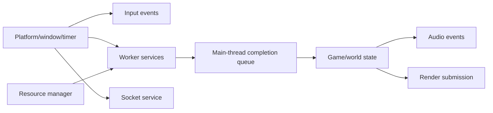

# Platform, Input, Audio, Threading and Memory

## Confirmed platform boundaries

Stardust.exe is a 32-bit PE (`IMAGE_FILE_MACHINE_I386`) at image base `0x00400000`, with entry VA `0x0131DC7A`. Its Win32 imports establish the legacy platform surface: USER32 window creation/message pumping, high-resolution timing, clipboard and cursor APIs; KERNEL32 threads, events, semaphores, mutexes, critical sections, TLS, virtual memory and heap APIs; WINMM timer-period control; and Winsock networking.

This is evidence of available primitives, not proof that every imported function participates in the main game path. The replacement platform layer should expose window/events, monotonic timing, thread naming/coordination, cursor/clipboard and sockets without leaking Win32 types into game systems.

## Input

`DINPUT8.dll!DirectInput8Create` is statically imported. RTTI and diagnostics confirm concrete keyboard, mouse and joystick devices under `DirectInputNamespace`, plus force-feedback objects. Device setup reports separate failures for creation, data formats, joystick capabilities, axis ranges, dead zones and saturation. Config keys include `ClientDirectInput`, `keyboardTranslationTable`, `useMouse`, `useJoystick`/`useJoysticks`, mouse sensitivity/inversion and joystick dead-zone/sensitivity/inversion.

The UI/game layer adds an action-map abstraction above raw devices. Evidence includes `InputMap::SparseMap` loaders for keyboard, mouse buttons, joystick buttons, axes, POVs and sliders; action tokens such as `toggle_mouse_mode`; and Cui messages for keyboard toggling and mouse-edge hits. Ground and space have distinct mouse-mode defaults, while space adds cockpit/virtual-joystick behavior.

Text composition is a distinct platform boundary. IMM32 is **dynamically**, not statically, loaded from the Windows system directory at `0x009B5540`; named Unicode composition and candidate APIs are resolved with `GetProcAddress`. `0x009B5FF0` copies `ImmGetCompositionStringW` output into local UTF-16 state and `0x009B6310` enumerates `ImmGetCandidateListW` offset-addressed UTF-16 candidates. A separate `SwgCuiIMEInput` mediator binds `listCandidate` and positions a candidate overlay. The exact service-vector→widget edge and commit/cancel semantics remain open. See the [platform bridge](../research/checkpoints/ANALYSIS_CHECKPOINT_2026-09-24_DYNAMIC_IMM32_TEXT_COMPOSITION.md) and [mediator](../research/checkpoints/ANALYSIS_CHECKPOINT_2026-09-24_IME_INPUT_MEDIATOR_BOUNDARY.md) checkpoints.

**Architectural conclusion:** preserve action names, bindings, modifier semantics and ground/space mode behavior; replace DirectInput acquisition with modern Windows raw/gamepad input or an engine input facade. DirectInput device objects themselves should not be reproduced.

## Audio

Audio is implemented through RAD Miles Sound System (`mss32.dll`), not DirectSound directly. Confirmed imports cover Miles startup/shutdown, digital-driver and 3D-provider enumeration/open/close, listener position/orientation/rolloff, 2D samples, 3D samples, streamed audio, loop regions/counts, playback rate, volume, reverb, obstruction/occlusion, end callbacks and CPU/latency queries.

RTTI confirms `SoundTemplate`, `Sound2dTemplate`, `Sound3dTemplate`, `Sound2d` and `Sound3d`. Embedded initialization diagnostics and configuration keys establish `SetupClientAudio`, `ClientAudio`, `disableMiles`, `soundProvider`, `soundEffectVolume`, driver/provider failure fallback and a fully disabled mode. Installed asset counts include `.snd`, `.wav` and `.mp3`; `.snd` is therefore a behavioral descriptor over waveform/stream assets rather than an audio payload alone.

`sound2d_template_load_VA_0041CFD0` opens form `SD2D`, dispatches versions `0000` through `0003` to dedicated readers, normalizes category/priority fields and validates distance/volume-related values. A deployed `SD2D/0003` music descriptor references one MP3; a deployed `SD3D` descriptor wraps `SD2D/0003`, references five alternate WAV samples and adds a `0001` 3D tail. This confirms sample-set randomization plus a shared 2D base and 3D extension. Full field labels remain bounded for the engine spike because the replacement intermediate resource already requires sample set, category/priority, gain/pitch variation, looping and 3D attenuation/occlusion fields; exact values will be verified per version during importer implementation.

**Architectural conclusion:** decode `.snd` into an engine-neutral sound-event resource carrying source file, 2D/3D mode, distance/attenuation, looping, playback variation and category routing. Replace Miles with the chosen engine/audio backend. Preserve event names and attachment semantics, not the Miles API.

### State-driven music and server events

`scene/game_music_manager.iff` is a compact `GMUS/0000` policy asset. Loader `0x006C8920` reads repeated ENTR, EXIT, DETH, INCP, SENT and SEXI sound-path chunks plus singleton WATR. Planet `datatables/environment/<planet>.iff` tables add named Day Ambient Sound 1/2, Night Ambient Sound 1/2, First Music, Sunrise Music, and Sunset Music columns. Update `0x006C9450` maps ground combat transitions, incapacitation/death posture, space-combat transitions, and day/night transitions to these paths while maintaining two independent ambient layers. Space entry (`SENT`) randomly chooses and retains an index; exit (`SEXI`) uses the corresponding index, with element-zero fallback when the arrays mismatch. The WATR singleton is released by `0x006C8FC0` but has no other reference in this executable, so GMUS WATR is inactive legacy configuration in this build.

Music is layered rather than globally singular. The manager holds a principal state-driven AudioId and at least two environmental AudioIds. `PlayMusicMessage` selector zero temporarily replaces the principal track and suppresses automatic selection until that sound finishes; selector nonzero uses a distinct server-event holder. The current Stardust server always emits its constructor default selector `1`. This behavior should become explicit `GameMusicManager` state and named audio buses/voices in the replacement, not global AudioId objects.

`PlayMusicMessage` wire order and use are now known: ASCII16 path, U64 target, 32-bit selector and trailing byte. This client listener uses path and the selector's zero/nonzero distinction; it parses but ignores target and the trailing byte. Existing channel audio is faded/stopped with scalar `1.0`, then the new `.snd` is resolved through the ordinary template path.

Interior ambience is supplied by the executable-named `InteriorEnvironmentBlockManager`, which loads `datatables/interior/interior.iff`. Records are selected by exact `PobName_CellName`, then `PobName_default`, then `default_default`; they provide day/night ambient layer 1, first music, surface type, fog, environment map and room type. `ServerWeatherMessage` does not directly play audio: it updates wind and the terrain weather index, which changes the current environment-family row. GameMusicManager observes that row and cross-fades only changed ambient paths. Indoors, the interior block replaces layer 1 and suppresses outdoor layer 2.

An overlay-wide direct-reference audit found category-13 dialogue only in two `musicOnActivate` fields of a `.qst` editor/source artifact, with no corresponding compiled NPE `datatables/questtask/*.iff` input. This does not prove category 13 unreachable, especially for dynamic server paths, but it means the new client should assign it a safe explicit legacy-dialogue gain rather than reproducing the original 13-entry table's out-of-bounds lookup. Two additional effective `taan_*` descriptors actually parse as category 2048 and 524288 because their scalar words are shifted; they have no direct effective-asset references, but a replacement must bound every category index. See the 2026-09-23 sound-descriptor outlier checkpoint.

## Threading and streaming

Imports include `CreateThread`, events, semaphores, mutexes, critical sections, TLS, IO completion ports and thread priority/control calls. RTTI exposes `Thread`, `MainThread`, `FuncPtrThreadZero` and `MemberFunctionThreadZero<ClientProceduralTerrainAppearance>`. Diagnostics confirm a `FileStreamerThread` with queued read requests and a dedicated terrain worker family.

These observations support at least three roles: main-frame ownership, asynchronous file reads and terrain chunk preparation. The file service is now confirmed as one dedicated worker, three mutex-protected strict-priority FIFO queues (2, then 1, then 0), a wake primitive, 128 KiB read slicing/requeue, per-request completion signaling, and a terminal-request/join shutdown. Terrain independently uses one dedicated worker, one ordered request container, one completion vector and main-thread commit. They do not form a general modern job system. The replacement should use bounded worker queues, cancellation tokens and explicit main-thread/GPU commit stages; it should not imitate legacy suspend/resume/terminate behavior.

## Memory ownership

Stardust.exe imports process heaps, a separately created heap, `VirtualAlloc`/`VirtualFree`, TLS and interlocked operations. Exported C++ names and diagnostics confirm pervasive fixed-size `MemoryBlockManager` pools, including object-, renderer-, animation-, projectile- and message-specific pools. Configuration supports forcing non-shared pools and allocation reporting.

This is a legacy allocation/performance strategy, not a wire contract. The x64 client may use arenas/pools where profiling justifies them, but protocol/file structures must be decoded into fixed-width types before conversion to native containers. Stable handles should replace assumptions that a pointer is 32 bits or that object identity equals an address.

## Replacement lifecycle

Shutdown should reverse dependency order: stop accepting scene/network work, cancel and join workers, detach replicated/world objects, stop audio, release GPU resources/window, then remove allocators/logging. Exact Stardust.exe remove-chain ordering remains only partly named, though repeated ExitChain registrations are confirmed.

## Confidence and gaps

- DirectInput and Miles API choice: **Confirmed** by imports and RTTI.
- Action-map and ground/space input modes: **Strong**, based on diagnostics/config/UI message names.
- File and terrain worker roles, queues and shutdown ownership: **Confirmed**; see the file-streamer and terrain-chunk checkpoints.
- Custom fixed-block allocators: **Confirmed**; individual allocation-site coverage is incomplete.
- The effective SD2D/SD3D descriptor corpus, major scalar distributions, playback bridge, category gain path, game-music policy and spatial coordinate adapter are reconstructed. Listener position uses transform X/Y/Z, forward uses K and up uses J; sources pass X/Y/Z directly to Miles. Individual scalar labels and category-13 intended gain remain incomplete.

## Round50 accepted boundary

The [owned family/sampler join](TERRAIN_FRACTAL_FAMILY_SAMPLER_JOIN_CONTRACT.md), [current resource movement host](SCENE_WORLD_CURRENT_MOVEMENT_RESOURCE_PREVIEW_CONTRACT.md), and [controller input chain](CREATURE_CONTROLLER_SPEED_INPUT_CONTRACT.md) extend the prior accepted slice. Exact conditional compositions and modern movement/source ownership are independently checked; original terrain/controls/full movement parity remain Unknown. See [Round50](../research/sessions/PARALLEL_DEVELOPMENT_ROUND_50_2026-10-04.md) for assembled acceptance and next probes.

## Round51 bounded boundary

[Generator-to-family height routing](TERRAIN_GENERATOR_FAMILY_HEIGHT_JOIN_CONTRACT.md) passes486 actual joins under explicit fresh-call controls. [Run-default preference](PLAYER_CONTROLLER_RUN_FLAG_CONTRACT.md) and [acceleration helper](CREATURE_ACCELERATION_HELPER_CONTRACT.md) have bounded static evidence; message timing, getter sampling and units remain open. The shared original-resource host remains the separately accepted Round50 slice. [Round51 record](../research/sessions/PARALLEL_DEVELOPMENT_ROUND_51_2026-10-04.md).
