# Secure Trade Client Protocol

Baseline: `C:\Stardust-DEV\Stardust.exe`, SHA-256 `E782BF1C49B3DA730F66B54BC558947C46493F7133F672EED1D8E0C56A6B6150`.

## Listener boundary

The listener at `trade_message_listener_VA_005E2A20` is a bounded state-machine adapter. It performs literal name-hash comparisons, constructs typed archive decoders only for messages carrying values, and forwards values to `ClientSecureTradeManager` state/event functions in the `0x005E38xx`–`0x005E4Fxx` region. RTTI in the same module names the internal notifications (`AddItem`, `GiveMoney`, `Accept`, `RequestVerify`, `Complete`, `AbortTrade`, and request-denial variants), so these are not guesses derived only from UI behavior.

| Message | Branch | Parser | Parsed value | State call | Confidence |
|---|---:|---:|---|---:|---|
| `BeginTradeMessage` | `0x005E2A43` | `0x00AE1330` | U64 counterparty object ID | `0x005E3810` | Confirmed |
| `AbortTradeMessage` | `0x005E2A9F` | none | none | `0x005E4CE0` | Confirmed |
| `AddItemMessage` | `0x005E2ACA` | `0x00AE17D0` | U64 item object ID | `0x005E3B50` | Confirmed |
| `RemoveItemMessage` | `0x005E2B29` | `0x00AE1D50` | U64 item object ID | `0x005E3CB0` | Confirmed client; server class absent in current tree |
| `GiveMoneyMessage` | `0x005E2B88` | `0x00AE2010` | U32 amount | `0x005E3E80` | Confirmed |
| `TradeCompleteMessage` | `0x005E2BE7` | none | none | `0x005E4A40` | Confirmed |
| `AcceptTransactionMessage` | `0x005E2C12` | none | none | `0x005E4120(true)` | Confirmed |
| `UnAcceptTransactionMessage` | `0x005E2C42` | none | none | `0x005E4120(false)` | Confirmed |
| `VerifyTradeMessage` | `0x005E2C72` | none | none | `0x005E4790` | Confirmed client; server callback supplies peer behavior |
| `DenyTradeMessage` | `0x005E2C9D` | none | none | `0x005E47A0` | Confirmed |
| `BeginVerificationMessage` | `0x005E2CC8` | none | none | `0x005E4500` | Confirmed client; current server has no identically named packet class |
| `AddItemFailedMessage` | `0x005E2CF3` | `0x00AE1A90` | U64 item object ID | `0x005E4F80` | Confirmed client; current server has no identically named packet class |

The value types are confirmed from the parser's registered `Archive::AutoVariable` specialization and correlated server constructors: the ID-bearing parsers share the same 64-bit NetworkId wrapper, while `GiveMoneyMessage` uses the 32-bit scalar wrapper. No pointer-sized value is present on the wire.

## Outbound client messages

All of the following constructors feed the common serialized-message send boundary `0x00462670` with delivery flag `true`, which the transport analysis maps to reliable channel 0. The server callback registry supplies the hash values. Inner application framing is the server's normal `BaseMessage` framing: little-endian U16 operand count, little-endian U32 message hash, then the fields below.

| Client action | Request function | Typed message constructor | Wire body after hash | Hash | Server receiver | Confidence |
|---|---:|---:|---|---:|---|---|
| initiate trade | `0x005E1760` | generic object-controller command builder `0x00AE2E40` | controller command `0x0115`, subcommand `0x23`; selected target is obtained from the player/controller context | envelope, not a named trade message | object-controller trade request path | Strong; exact nested payload still incomplete |
| add item | `0x005E17F0` | `0x00AE1690` (`AddItemMessage`) | U64 item ID | `0x1E8D1356` | `AddItemMessageCallback` | Confirmed |
| give money | `0x005E1B20` | `0x00AE1EE0` (`GiveMoneyMessage`) | U32 amount | `0xD1527EE8` | `GiveMoneyMessageCallback` | Confirmed |
| accept offer | `0x005E1E00` | `0x00AE2340` (`AcceptTransactionMessage`) | none | `0xB131CA17` | `AcceptTransactionMessageCallback` | Confirmed |
| withdraw acceptance | `0x005E20F0` | `0x00AE2510` (`UnAcceptTransactionMessage`) | none | `0xE81E4382` | `UnAcceptTransactionMessageCallback` | Confirmed |
| verify/commit | `0x005E23F0` | `0x00AE26E0` (`VerifyTradeMessage`) | none | `0x9AE247EE` | `VerifyTradeMessageCallback` | Confirmed |
| deny request/offer | `0x005E2450` | `0x00AE28B0` (`DenyTradeMessage`) | none | `0x6EC28670` | `DenyTradeMessageCallback` | Confirmed |
| abort open trade | `0x005E2740` | `0x00AE14C0` (`AbortTradeMessage`) | none | server header confirms named packet; callback route still to be catalogued | abort callback path | Confirmed client construction and reliable send |

No client-side sender for `RemoveItemMessage` was found in the bounded request-function region. Its typed decoder and inbound state mutation are present, while the current server tree has no `RemoveItemMessageCallback`. This is a real protocol/source asymmetry, not evidence that removal is impossible: it may be expressed through an object-controller subcommand, implemented outside the bounded module, or unused by this server revision. It remains **Unknown** until the trade UI call site and server object-controller command are correlated.

## State variables and transition behavior

- `0x019161F0` is the remote/peer accepted flag: inbound `AcceptTransactionMessage` and `UnAcceptTransactionMessage` call `0x005E4120(true/false)`, which stores the value and emits the typed `Accept` notification.
- `0x019161F1` is the local accepted flag: outbound accept sets it; outbound unaccept clears it. If both acceptance flags are set when local unaccept runs, `0x005E20F0` first invokes the deny/reset sender at `0x005E2450`.
- `0x019161F2` is the active/open trade flag. Begin sets it; complete and abort clear it.
- Inbound `BeginVerificationMessage` at `0x005E4500` emits `RequestVerify(true)`. It does not itself transfer items or money.
- Inbound `VerifyTradeMessage` reaches `0x005E4790`, which is a one-instruction `ret` in this executable. The operative verify message is client-to-server; the server marks that participant verified and commits only after both trade sessions report verified.
- Inbound `DenyTradeMessage` at `0x005E47A0` clears both acceptance flags and emits `Accept(false)`/denial-facing state.
- Inbound `TradeCompleteMessage` at `0x005E4A40` clears the active flag and emits `Complete(true)`.
- Inbound `AbortTradeMessage` at `0x005E4CE0` clears the active flag and emits `AbortTrade(true)`.
- `AddItemFailedMessage` at `0x005E4F80` resolves the failed item, builds a localized/UI notification, removes the pending offer entry, and publishes the associated item-state update. The exact localization key remains unlabeled.

The current server is authoritative at commit: `handleVerifyTradeMessage()` validates paired sessions, target IDs, item ownership/tradeability, receiving-container capacity, offered cash, and distance. It performs transfers and currency changes only after both sides have verified, then sends `TradeCompleteMessage` to both clients and clears both sessions.

## Conceptual state machine

```mermaid
stateDiagram-v2
    [*] --> Idle
    Idle --> Open: BeginTrade(counterparty)
    Open --> Open: AddItem / RemoveItem / GiveMoney
    Open --> LocallyAccepted: Accept
    LocallyAccepted --> Open: UnAccept or offer mutation
    Open --> Verifying: BeginVerification requests local Verify
    LocallyAccepted --> Verifying: BeginVerification requests local Verify
    Verifying --> Verifying: client sends Verify; server records participant
    Verifying --> Complete: TradeComplete
    Idle --> Denied: Deny
    Open --> Aborted: Abort / Deny
    LocallyAccepted --> Aborted: Abort / Deny
    Complete --> Idle
    Aborted --> Idle
    Denied --> Idle
```

The diagram is a replacement-oriented conceptual model. The individual routes and the direction of `VerifyTradeMessage` are confirmed. The legacy manager primarily publishes state through `MessageDispatch`; server-side code owns the legality and atomic commit checks.

## Replacement requirements

- Treat all peer offers as an immutable revisioned snapshot during verification.
- Any item/money mutation must clear acceptance locally, regardless of whether the legacy UI did so implicitly.
- Resolve U64 IDs through the domain object registry, never through engine node pointers.
- Use checked U32 currency arithmetic and server authority for final ownership/money transfer.
- Keep trade UI as a projection of a protocol state machine; closing a window is not itself protocol completion.
- Log state transitions and non-secret IDs, but never serialize native object layouts.

## Remaining bounded questions

1. Find the client-to-server remove-item path and determine whether it is a named message or object-controller subcommand.
2. Correlate `AddItemFailedMessage` and `BeginVerificationMessage` with the current server callback paths despite class-name asymmetry.
3. Recover the exact begin-trade object-controller payload and the current server handler for subcommand `0x23`.
4. Determine whether offer revisioning is purely implicit (acceptance invalidation) or has an additional counter/version field elsewhere.
