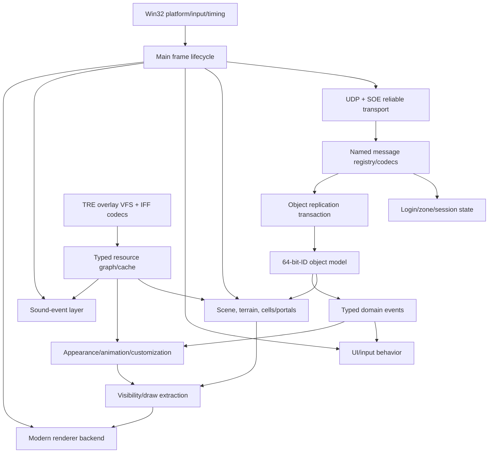

# 75% Pre-Build Analysis Checkpoint

Date: 2026-09-10  
Primary binary: `C:\Stardust-DEV\Stardust.exe`  
SHA-256: `E782BF1C49B3DA730F66B54BC558947C46493F7133F672EED1D8E0C56A6B6150`

## Meaning of 75%

This is an evidence-weighted estimate of analysis needed to constrain the replacement architecture before implementation. It is not 75% of the executable's functions and does not imply feature completeness. The principal architectural boundaries, login/transport path, initial object replication, representative asset chains, renderer boundary, world/cell model and platform dependencies are now known. The remaining quarter is concentrated in breadth and difficult implementation details: more replicated schemas/handlers, animation runtime behavior, exhaustive asset versions, device/resource semantics, lifecycle race closure and engine prototypes.

## Findings and confidence

### Confirmed by Stardust.exe

- 32-bit MSVC-era PE, fixed analysis image base `0x00400000`, entry `0x0131DC7A`, extensive RTTI/export/diagnostic retention.
- WinMain/application install-run-remove shape; persistent loop at `0x00423780` and frame tick at `0x004237C0`.
- Winsock UDP/SOE transport path, session response, negotiated transforms/CRC/datagram size, four reliable channels, fragmentation, cumulative ACK, resend, multipayload and length codec.
- Login message construction/parsing and the concrete login-token -> cluster endpoint -> zone connection -> `ClientIdMsg` authentication chain.
- Selected-character and scene-start boundary, deferred client `CmdSceneReady`, final server `CmdSceneReady`.
- Create-by-CRC, baseline/delta wrapper and view dispatch, containment, end-baselines, destroy and compressed world/parent transform dispatch paths.
- D3D is hidden behind a dynamically loaded raster module. `graphics_install_VA_007548A0` loads `.\\s2%02d_r.dll`, resolves `GetApi`, verifies and installs its API table. Installed `s205_r.dll` exports `GetApi` and imports `Direct3DCreate9`.
- Higher rendering concepts remain in the executable: materials, SHT/EFT implementations and passes, textures/buffers, semantic sort phases, appearances and DPVS visibility/cells/portals.
- DirectInput keyboard/mouse/joystick/force-feedback stack; Miles 2D/3D/streaming audio; custom fixed-block memory managers; file-streaming and terrain worker threads.
- Typed customization directories/variables/shader operations, skeletal/mesh/animation graph class families, and wearable remapping installation.

### Confirmed by deployed assets plus server-source correlation

- All 58 configured TRE archives use TREE/0005 in the observed corpus: 312,860 records and 203,676 unique paths with overlay duplication.
- Representative static, skeletal, animation, terrain, shader/effect, UI, audio-reference and portal/floor dependency chains.
- `appearance/yt1300.pob` is `PRTO/0004`, with eight indexed portal geometry groups, an exterior appearance and seven cell mesh/floor pairs.
- A referenced floor is `FLOR/0006` with 38 vertices, 36 fixed 60-byte triangles, bounding tree, boundary edges and path graph.
- Server PRTO/CELL/FLOR readers recover portal adjacency, cell appearances, optional floor/bounds, door transforms, collision, triangle adjacency and cross-cell path linking.
- Customization v1 byte grammar, escaping, signed values, variable-ID mapping and terminator are directly recoverable without packet interception.
- Server scene sequencing corroborates the executable's async readiness barrier and explicitly documents a same-frame `CmdStartScene`/object-create race in the old client.

### Strongly inferred

- Network messages are decoded/queued across transport infrastructure and applied through the main client dispatch/lifecycle boundary; exact thread handoff for every path remains incomplete.
- Transform handlers enqueue controller commands for interpolation/order rather than directly replacing render transforms.
- Portalized interiors use DPVS cells/physical portals/scissor visibility with game `CellProperty`/`PortalProperty` state layered above.
- Animation execution is a state/selector/blend/priority graph driven by replicated posture/mood/movement and logical animation tables.
- Legacy object-specific memory pools and pointer-heavy layouts are performance implementation choices, not compatibility contracts.

## Reconstructed architecture

The replacement should preserve boundary behavior while redesigning internals. Fixed-width protocol/file codecs, an engine-neutral resource graph, transactional replication, stable object handles and semantic render queues must not be buried inside engine nodes or a graphics API.

## Answers to the project questions

1. **How much architecture can be reconstructed?** The major subsystem topology and critical lifecycle boundaries are now high-confidence. Detailed implementation coverage varies; this checkpoint estimates 75% of pre-build architectural analysis, not total reverse engineering.
2. **How much protocol is directly recoverable?** The transport and login/early-zone path are largely recoverable from executable plus server source. Hundreds of gameplay messages exist, so exhaustive semantic coverage is not complete; however the server constructors/callbacks and client RTTI/dispatch strings make packet interception a validation tool rather than the only discovery method.
3. **What depends heavily on original assets?** Terrain, buildings/cells, collision/navigation, object templates, skeletal appearance/customization, animation graphs, materials/shaders, effects, UI layout/localization and sound events. The networking POC does not.
4. **Reuse conceptually versus redesign?** Preserve wire formats, network IDs, session sequencing, CRC/template identity, baseline views/deltas, containment/cells, virtual paths and semantic material/animation behavior. Redesign platform, renderer, jobs, allocation, ownership, UI implementation, audio backend and GPU resources.
5. **Major unknowns/blockers?** Exhaustive baseline schemas and gameplay handlers; exact animation evaluation/attachment lifecycle; remaining asset versions (notably installed FLOR/0004); full raster API/resource-state contract; DPVS replacement policy; scene-job cancellation; legal redistribution/provenance of legacy assets and middleware; and controlled live-server validation.
6. **DX12 or Vulkan?** For a custom Windows-first renderer, DX12 remains the leading option because tooling, deployment and HLSL/DXC fit the target. Vulkan only becomes the better initial custom backend if native non-Windows delivery becomes a near-term requirement. This is provisional until the required Godot/custom-engine spike after analysis.
7. **Smallest viable x64 POC?** A headless-capable native x64 executable/library that loads redacted config/logging, establishes the SOE UDP session, sends exact `LoginClientId`, validates/decompresses one reply (preferably `LoginClientToken`), logs typed non-secret results, closes sockets/threads and exits deterministically. No engine, assets, UI or renderer.

## Major risks

- Treating server source as proof of client-side resulting behavior where only wire layout is confirmed.
- Applying creates/baselines to the old world during asynchronous scene transition.
- Copying legacy in-memory padding/pointers into x64 types or widening wire fields.
- Converting assets directly into engine scenes without preserving virtual identity, overlays and dependency invalidation.
- Assuming static-mesh import demonstrates character customization, terrain or portal-building feasibility.
- Coupling the SOE protocol to an engine main loop, making deterministic tests and headless operation difficult.
- Reproducing D3D9 state calls instead of translating SHT/EFT semantics to modern pipeline/material descriptions.

## Remaining analysis to 100% pre-build gate

1. Increase baseline/delta field coverage for selected player, creature, tangible, ship and common world objects; finish handler-to-subscriber effects.
2. Trace scene-transition teardown, generation/cancellation and worker completion ownership in Stardust.exe.
3. Recover animation-controller update and wearable attach/detach call paths; decode customization manager tables and broader animation format versions.
4. Complete representative SHT/EFT render-state/constant binding and raster API resource/device/reset mapping.
5. Expand terrain chunk/LOD/water/flora and DPVS cell/portal runtime tracing; decode FLOR/0004.
6. Decode `.snd` descriptors and input binding-table formats; finish UI mediator/event lifecycle mapping.
7. Produce the final pre-build engine matrix and run narrow Godot versus custom DX12/Vulkan feasibility spikes. No wholesale client build before that decision.

## Phase recommendation

Continue Phase 0 analysis to the explicit pre-build gate. Then evaluate engines with four bounded artifacts: headless protocol harness integration, one static material chain, one customizable human plus wearable/animation transition, and one terrain/portal-building scene. Only after that report should Phase 1 implementation be authorized. The existing `64BIT_PORT_PLAN.md` remains the concrete networking POC specification.
