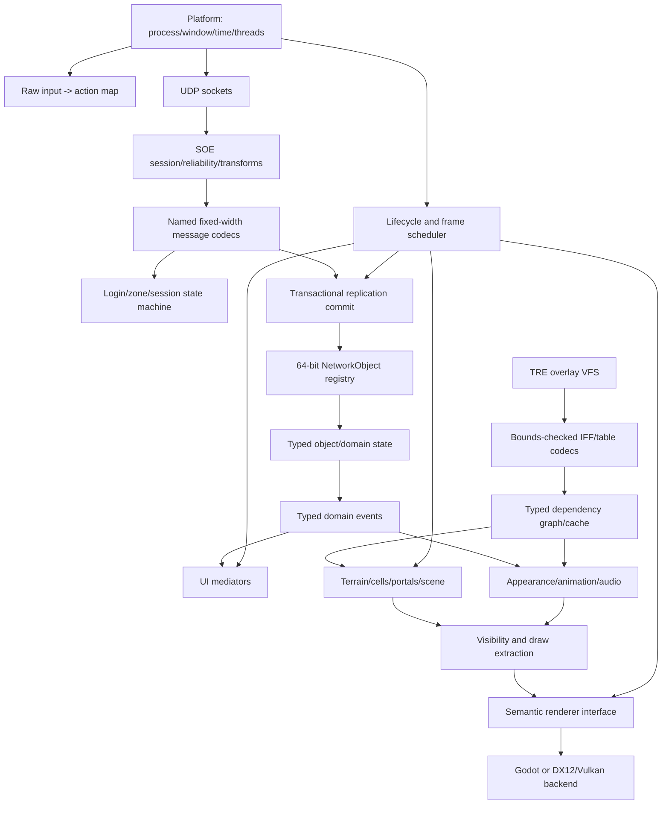

# Final Pre-Build Client Analysis Report

Date: 2026-09-10  
Scope completion: **100% of the defined pre-build engine/build-decision analysis**  
Individual-function reconstruction: **not exhaustive; likely under 5% of compiled functions carry stable documented semantics**

## Baseline and scope

The sole client baseline is `C:\Stardust-DEV\Stardust.exe`, SHA-256 `E782BF1C49B3DA730F66B54BC558947C46493F7133F672EED1D8E0C56A6B6150`, size 22,069,248 bytes. No SWGEmu executable was used as a substitute. The Stardust-3 repository was read only to correlate current server wire construction, callbacks, terrain/portal readers and customization behavior. Research artifacts remain exclusively under `D:\Development\Experimental-Client` and are not intended for GitHub.

“Complete” in this report means every question capable of changing the engine choice or initial client architecture has sufficient evidence or an explicit containment strategy. It does not mean every gameplay feature, message, asset version or machine-code function has been reconstructed.

## Executive findings

1. Stardust is a native 32-bit MSVC C++ client with unusually useful RTTI, diagnostics, class names and modular middleware boundaries.
2. Its essential architecture is recoverable without translating it line for line: Win32 lifecycle, UDP/SOE transport, named application messages, session state, view-based replication, template-created objects, scene/terrain/cell resources, semantic render queues, graph-based animation, declarative UI, DirectInput and Miles audio.
3. The Stardust server source removes most uncertainty from valid wire layouts and server sequencing. Stardust.exe is still required to prove client routing and resulting behavior.
4. The rendering implementation is cleanly separated. Stardust.exe owns render concepts; a versioned raster DLL owns D3D9 device/resources/state. This strongly favors a new semantic renderer boundary rather than D3D9 emulation.
5. SWG assets are not peripheral. Terrain, portal buildings, collision/pathing, characters, customization, animation, shaders/effects, UI, localization and sound events all depend on the original TRE/IFF resource graph.
6. A headless, engine-neutral x64 networking POC remains the smallest first build. It should precede any world renderer after the engine decision is approved.

## Evidence and confidence summary

### Confirmed by Stardust.exe

- PE32/x86 image, base `0x00400000`, entry `0x0131DC7A`, CRT/WinMain/application chain.
- Main loop `game_loop_VA_00423780`, frame tick `frame_tick_VA_004237C0`, cleanup callback `game_cleanup_scene_VA_00423700`.
- Winsock UDP manager and SOE receive/send transforms, session response, seeded CRC, zlib, four reliable channels, fragmentation, multipayload, ACK/resend and variable-length block sizes.
- Application message parse/serialize boundary and concrete login, zone-authentication, character-selection and scene-readiness paths.
- Scene create/destroy, containment, baseline/delta view dispatch, end-baseline finalization, and compressed world/parent transform controller dispatch.
- Scene replacement through `scene_transition_begin_VA_00462AE0`, `ground_scene_ctor_VA_00519C40` and `game_set_scene_VA_00424220`.
- Dynamic raster loader `graphics_install_VA_007548A0`; configured `s207_r.dll` exports a two-entry bootstrap and publishes a large raster API after installation.
- D3D9, adapter/device/reset/present, resource/state and shader implementation reside in the raster module; Stardust.exe retains material/effect/appearance/sort/visibility concepts.
- DPVS cells, physical portals, camera/frustum/scissor and visibility resolution.
- DirectInput raw devices and force feedback; process-lifetime CUI manager/mediators; Miles sample/3D/stream APIs.
- Skeletal appearance, animation graph, customization and wearable attachment/removal/rebuild paths.
- Specialist file/terrain threads and pervasive fixed-size memory pools.

### Confirmed by deployed assets

- 58 TREE/0005 archives, 312,860 records, 203,676 unique virtual paths and overlay duplicates.
- Representative object-template inheritance; static mesh/material/effect/texture; human SAT/skeleton/mesh-generator/logical-animation/client-data; PTAT/TGEN terrain; declarative UI; sound descriptors; portal building and floor graphs.
- `appearance/yt1300.pob`: PRTO/0004, eight portal geometry groups, eight cells, bounds/lights/portals, exterior plus seven interior render/floor references, global path graph and CRC.
- FLOR/0006 sample with vertices, fixed triangles, bounding tree, boundary edges and path graph.
- 354 FLOR/0004 records structurally containing raw 12-byte vertices, 60-byte triangles and PNOD/PEDG placeholders.
- SD2D/0003 single/multi-sample descriptors and SD3D wrapping a shared 2D base with a 3D extension.

### Confirmed by current server source

- Login/zone/application message opcodes, operand counts, field order and fixed-width types.
- Scene-start X/Z/Y order, player/template/terrain/time fields and server readiness response.
- Baseline/delta envelopes and representative TANO/CREO/PLAY/SHIP/SCLT schemas.
- TRE records; PTAT/TGEN behavior; PRTO/CELL/FLOR geometry, adjacency, collision and graph semantics.
- Customization version-1 escape grammar and variable-ID lookup.
- Same-frame scene-start/create race requiring an initialization barrier.

### Strongly inferred and intentionally bounded

- Exact main-thread handoff of every network work item: replacement requires a single transactional commit owner regardless.
- Exact legacy animation evaluation order: candidate engines must demonstrate recovered selector/blend/mask/state behavior in a spike.
- Names of all scene-readiness predicates: replacement requires generation-scoped cancellation and a declared minimum-ready barrier.
- DPVS heuristics: cell/portal semantics are preserved while visibility implementation may be engine-native.
- Long-tail gameplay handler semantics: isolated behind typed codec/command/event extension points and added by vertical slice.

## Reconstructed client architecture

### Required ownership rules

- Wire/file decoders never expose native pointers, `size_t`, host `long` or compiler-packed structs.
- `NetworkObjectId` is always the wire-defined U64; opcodes/CRCs/account IDs/counts retain their defined widths.
- Replication is decoded, validated and committed transactionally before subscribers run.
- Engine scene nodes are projections of domain objects, never the authoritative network registry.
- Every scene transition has a generation token; stale worker/network/GPU completions cannot mutate the new scene.
- TRE overlay order and virtual path identity survive conversion/import.
- Renderer inputs are semantic materials/draw packets, not legacy D3D state calls.

## Network and protocol conclusion

The minimum compatibility stack is sufficiently specified to build after approval. SOE transport details and test boundaries are in `SOE_TRANSPORT_PROTOCOL.md` and `SOE_TRANSPORT_TEST_VECTORS.md`. Login-to-scene sequencing is in `LOGIN_AND_ZONE_STATE_MACHINE.md`. Known executable routes are in `PACKET_HANDLER_MAP.md`; replicated schemas and container operations are in `REPLICATION_SCHEMA_MAP.md`.

The protocol has three confidence levels:

- **Executable and server confirmed:** transport, login, zone authentication, character selection, scene start/readiness, core object lifecycle and representative replication.
- **Server-wire confirmed:** many additional packets and views whose client effects have not yet been traced.
- **Deferred:** exhaustive gameplay/UI semantics, to be implemented and verified by feature vertical slice.

This is enough for engine selection because deferred codecs cannot own sockets, rendering, engine nodes or object identity. See `PROTOCOL_COVERAGE_AND_BOUNDARIES.md`.

## Asset-pipeline conclusion

The client cannot become useful through network compatibility alone. A typed conversion/runtime layer must support:

- TRE overlay mounting and per-record compression;
- generic bounded IFF traversal plus versioned typed loaders;
- shared object-template inheritance and CRC identity;
- APT/MSH/SHT/EFT/DDS static chains;
- SAT/SKT/MGN/LMG/LAT/ANS character and animation chains;
- customization IDs, palettes, shaders and dependent `/shared_owner` mounts;
- PTAT/TGEN terrain, flora/radial/water concepts;
- PRTO cells/portals, bounds/lights, FLOR collision/path data;
- declarative UI/localization and SND sample-event descriptors.

Use engine-neutral intermediate resources and dependency tracking. Directly importing isolated meshes into an engine would discard the relationships that make the assets behave correctly.

## Subsystem reuse versus redesign

| Preserve behavior/concept | Redesign implementation |
|---|---|
| SOE wire protocol and session order | socket/thread integration and safe codecs |
| named messages/opcodes/fixed fields | registration/generation/tooling |
| 64-bit object IDs and view/delta semantics | object memory layout and ownership |
| template CRCs and TRE virtual paths | VFS/cache/import pipeline internals |
| cells, portals, containment and readiness | scene graph, visibility and jobs |
| SHT/EFT semantic materials and render order | D3D9 states, GPU resources and shaders |
| animation selectors/blends/masks/states | controller runtime and engine integration |
| customization/wearable observable results | typed data structures and rebuild scheduling |
| UI data flow and required gameplay actions | layouts/toolkit/visual design |
| sound-event semantics | Miles backend |
| input actions/modes | DirectInput backend |

## DX12 versus Vulkan

If a custom renderer is selected, **DX12 is the recommended first backend** for the currently Windows-only project. The reasons are Windows deployment alignment, PIX/DRED/Visual Studio diagnostics, HLSL/DXC, simpler platform integration and no demonstrated near-term need for Linux-native delivery. Vulkan offers valuable portability but does not simplify SWG's legacy material, asset or lifecycle reconstruction; it adds extension/platform/tooling work before portability has product value.

Keep the semantic renderer narrow enough for a later Vulkan backend. This recommendation does not decide custom renderer versus Godot.

## Godot versus custom client decision

Analysis is now sufficient to begin the engine evaluation requested by the user. The decision must use `ENGINE_DECISION_REQUIREMENTS.md` and four bounded spikes:

1. engine-neutral/headless protocol ownership;
2. one complete static material chain;
3. one human customization/wearable/animation chain;
4. one terrain plus portal-building world slice with transition cancellation.

Godot should be evaluated first as the high-leverage engine option. It wins if it hosts these models without a deep engine fork, duplicate authoritative scene graph or compromised headless/lifecycle control. A custom DX12 client wins if character/world integration requires bypassing Godot's core resource, animation or scene systems. Vulkan is held as a portability-driven alternative.

No engine spike or replacement implementation was begun during this analysis.

## Major remaining unknowns and why they do not block the decision

| Unknown | Containment |
|---|---|
| Majority of individual executable functions unnamed | subsystem interfaces and extension points are recovered; trace on demand |
| Long-tail message effects | typed codecs/events added per vertical slice |
| Several baseline anomalies/unknown fields | retain bounded unknown payloads and verify with controlled server captures |
| Exact animation evaluation details | mandatory character spike before engine selection |
| Exhaustive asset versions | versioned loaders fail closed; representative decision corpus is defined |
| Raster API slot-by-slot names | clean renderer consumes semantic resources; legacy ABI is not reused |
| Exact DPVS heuristics | preserve portal/cell inputs; compare visibility behavior in world spike |
| Worker cancellation implementation in old client | replacement generation-token invariant is stronger and testable |
| Complete SND/UI property vocabulary | incremental resource import; does not change core ownership |
| Asset/middleware redistribution rights | legal/provenance review is an independent release gate |

## Risks and validation strategy

- Never infer client effects solely from a server packet constructor.
- Maintain golden byte fixtures and controlled-server transcripts for protocol work.
- Fuzz/bounds-test all variable counts, strings, archive offsets and decompression sizes.
- Record server revision/config with every integration result.
- Test scene cancellation with deliberately late file, network and GPU completions.
- Validate asset conversions by dependency chains, not screenshots alone.
- Compare semantic material outputs and state ordering using GPU captures.
- Keep credentials and complete session blobs out of logs.
- Treat legacy middleware/proxy DLL behavior as evidence, not reusable code.

## Concrete first x64 proof of concept

Build only after the engine discussion and explicit approval. The first milestone is a native x64, headless-capable Windows executable/library that:

1. initializes structured logging and redacted configuration;
2. initializes Winsock and a monotonic clock;
3. opens UDP to the controlled Stardust login endpoint;
4. performs the version-2 SOE session negotiation;
5. applies negotiated zlib/XOR/CRC framing with channel-zero reliability, ACK, multipayload and fragmentation support;
6. sends exact `LoginClientId` with the configured Stardust version;
7. validates and parses a `LoginClientToken` (an expected ErrorMessage is only an earlier smoke test);
8. logs opcode/name and non-secret typed lengths/IDs while retaining no credential secrets;
9. closes protocol/socket/thread resources deterministically and returns a categorized exit code.

No renderer, engine window, TRE loading, UI, audio, character selection or world state belongs in this POC. Acceptance details remain in `64BIT_PORT_PLAN.md`.

## Proposed development sequence

1. Review this report and run the engine decision spikes.
2. Select Godot or custom DX12 (Vulkan only if portability requirement changes).
3. Implement the engine-neutral x64 networking POC with golden tests.
4. Extend through zone authentication and scene transcript harness.
5. Implement object registry and representative baseline/delta schemas headlessly.
6. Implement TRE/IFF resource core and static material slice.
7. Add selected engine integration, placeholder world and generation-safe scene transitions.
8. Add terrain/portal slice, then character/customization/animation slice.
9. Add UI/audio/gameplay by vertical feature slices, expanding protocol and asset coverage as evidence demands.

## Final assessment

The clean 64-bit client is feasible. The greatest risk is not the UDP protocol or DX12/Vulkan API; it is preserving SWG's cross-linked asset, replication, scene and character semantics while avoiding a new architecture that couples them irreversibly to an engine. The recovered evidence supports an engine-neutral compatibility core with replaceable presentation backends.

The analysis gate is complete. The next responsible activity is engine evaluation, not a wholesale rewrite.
