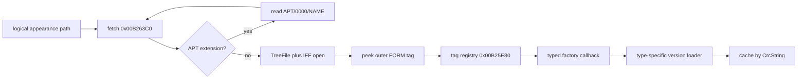

# Analysis Checkpoint — Asset Identity and Appearance Factory

Date: 2026-09-11  
Primary binary: `C:\Stardust-DEV\Stardust.exe`  
SHA-256: `E782BF1C49B3DA730F66B54BC558947C46493F7133F672EED1D8E0C56A6B6150`

## Outcome

This block removed the ambiguity in TREE filename identity and reconstructed the architectural boundary from a logical appearance path through IFF framing into typed appearance-template factories.

Strict whole-client progress advances from **43% to 44%**. The VFS/TRE/templates/assets workstream advances from **32% to 42%**.

## Confirmed filename identity

The client checksum at `0x00AA4790` is non-reflected CRC-32 polynomial `0x04C11DB7`, initialized to `0xFFFFFFFF`, finalized by complement, and applied to normalized path bytes excluding NUL. It matches Stardust/Core3 `String::hashCode`. Read-only verification produced zero failures across 2,285 records from a Stardust override archive and a base archive.

ASCII paths are lowercased before lookup. A locale-aware alternate exists, so the replacement should deliberately specify ASCII identifiers and separately reject or test non-ASCII filenames.

## Confirmed appearance dispatch

APT redirects are limited to one level. Unsupported outer tags are not coerced. Base `APPR` supports versions 0001, 0002 and 0003. Recovered tags are `LSAT`, `MESH`, `MKAT`, `BEAM`, `CMPA`, `DTLA`, `QUAD`, `SPRT`, `SWSH`, `LEFX`, `PEFT`, `SMAT`, `PLNT`, `MPTA`, `PTAT`, `APPR`, `NRND`, and `STAT`.

## Replacement consequences

The resource layer should expose normalized logical paths and bounded streams. Generic IFF navigation should remain independent of rendering types. A separate appearance registry should map outer tags to explicit decoders; each decoder owns its versions and produces an engine-neutral template. This matches original behavior without preserving global registries or 32-bit layouts.

## Remaining questions

- Finish SearchPath, SearchAbsolute, SearchCache and TOC backing-file behavior.
- Trace `MESH` through SPS shader references, vertex/index formats and extents.
- Recover SHT/EFT material and pass registration before translating shader semantics.
- Characterize exact locale-mode activation, although deployed asset paths are ASCII.
- Specify bounded malformed-IFF and decompression behavior for the x64 implementation.

## Exact resume point

Decompile the MESH constructor/loader reached through factory `0x007962D0` and follow its SPS blocks into ShaderTemplateList. In parallel, resolve the remaining VFS node vtables so loose-file overrides and cache invalidation are implementation-grade.
