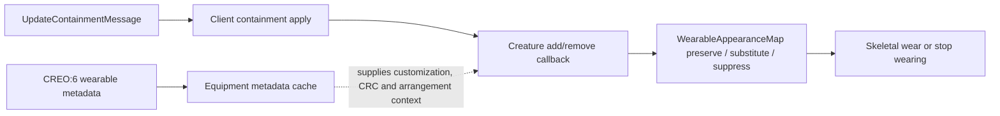

# Stardust.exe Analysis Checkpoint — Containment Wearables and PLAY Codecs

Date: 2026-09-11  
Subject: `C:\Stardust-DEV\Stardust.exe`  
SHA-256: `E782BF1C49B3DA730F66B54BC558947C46493F7133F672EED1D8E0C56A6B6150`  
Scope: second bounded analysis block after the persistent-Ghidra checkpoint

## Outcome

Overall implementation-grade, replacement-relevant research is now estimated at **53%**, up from 44% at the start of this block. This is not the percentage of all machine functions named. It measures how much behavior has been converted into evidence-backed constraints for a compatible replacement.

The block closed three high-value boundaries:

1. Visible wearable attachment is driven by containment changes, not by installed callbacks on the CREO:6 wearable vector; appearance-map substitution and suppression are now closed.
2. PLAY ability, draft-schematic and quest-data container element grammars are executable-confirmed, and remaining PLAY scalar ambiguity is more tightly bounded.
3. Malformed field payloads are bounds-checked at byte reads but unsafe at view-field index lookup, can leave partial mutation, and propagate through every inbound layer inspected so far.
4. Weapon, resource-container and installation derived-object schemas are now constructor-correlated with current server packets.
5. Logout and server-driven browser behavior are now exact enough to specify safer replacement policies.

## Findings and evidence

### Wearable metadata versus visible attachment

**Confirmed by code:** CreatureObject constructor `0x0042ECF0` creates `AutoDeltaVector<WearableEntry,CreatureObject>` at object `+0x91C`. Its aggregate/remove/insert/replace callback slots at `+0x944/+0x948/+0x94C/+0x950` are explicitly zeroed and remain uninstalled. The vector snapshot/delta methods `0x00441740/0x00441920` therefore maintain metadata only.

**Confirmed by code:** CreatureObject's vtable contains add/remove callbacks `0x00436D90` and `0x00437050`. They delegate to `0x0067A060` and `0x0067A140`; when the contained child has a usable appearance these call `skeletal_wear_object_VA_007C9A50` and `skeletal_stop_wearing_object_VA_007C9C30`.

**Confirmed across executable and server:** `UpdateContainmentMessage` `0x56CBDE9E` carries child U64, parent U64 and arrangement U32. GroundScene parses it at `0x00ADC6D0`, resolves the child and applies containment through `0x00555020`. Current server `PlayerContainerComponent` separately updates the creature wearables vector when tangible equipment enters/leaves the player container. These are complementary messages/state, not duplicate attachment owners.

### PLAY specialized codecs

| Field | Client methods | Confirmed wire value |
|---|---|---|
| PLAY:9 index 0 abilities | `0x00661E20`, `0x00662030` | variable byte string: U16 length, or `0xFFFF` then U32 length, followed by bytes |
| PLAY:9 index 4 draft schematics | `0x006633A0`, `0x00663530` | two U32 values per element |
| PLAY:8 index 6 quest map | `0x00665C40`, `0x00666430`, value decoder `0x01233560` | U32 quest CRC -> U64 owner, U16 active mask, U16 completed mask, U8 completed, U32 counter |

Abilities and draft schematics use the same five indexed-vector operations already found elsewhere: remove, insert, set, replace-all and clear. Both perform stale-prefix reconciliation from operation count/update counter.

PLAY:9 crafting fields are narrower now: index 1 is experimentation enabled, index 2 has client RTTI `Crafting::CraftingStage`, index 3 is nearest crafting-station NetworkId and index 5 is experimentation points. Index 6 remains **Unknown** because server comments call it species data while client RTTI publishes `ExperienceChanged`; no semantic guess was substituted.

### Malformed payload behavior

**Confirmed:** `archive_read_fixed_checked_VA_00439910` reaches `byte_stream_read_checked_VA_0118B030`, which rejects reads beyond the bounded ByteStream and throws an Archive exception.

**Confirmed unsafe behavior:** `autodelta_byte_stream_delta_decode_VA_0118AA00` reads a U16 index, evaluates `registry[index]` without a visible size check, dereferences it and invokes the field delta virtual. A one-byte trailing remainder throws during the next U16 read; an out-of-range field index can read outside the registry.

**Confirmed non-atomic behavior:** decoders mutate containers in place. If a later field throws, prior mutations remain while the outer post-delta commit is not reached. Synchronous element callbacks, where installed on other fields, may already have fired.

**Confirmed propagation depth:** no catch is present in the field decoder, GroundScene receiver `0x0051BD10`, keyed event fan-out `0x00AC2AB0`, connection message dispatcher `0x005A8C50`, or the connection-server named-message callback `0x0069B510`. MSVC EH state in these functions performs destruction/unwind cleanup. The first outer catch or process-level policy remains **Unknown**; it is therefore unsafe to assume the legacy client recovers from a malformed replication message.

Replacement rule: parse the entire bounded payload into a validated mutation plan, require known field indices and legal operation bodies, then commit atomically and publish deterministic callbacks.

### Appearance-map result states

**Confirmed by code:** `WearableAppearanceMap` loads `source_wearable_appearance_name`, `wearer_appearance_name`, and `mapped_wearable_appearance_name`, sorts entries, and binary-searches the `(source, wearer)` key at `0x011B9FF0`. A non-empty result replaces the child's appearance before attachment; an empty mapped result suppresses visual attachment; no match uses the nominal appearance. `0x00647E20` is the second and only other lookup consumer, using an empty source to create wearer-specific fallback clothing.

`skeletal_wear_object_VA_007C9A50` retains a watcher/reference to the worn object. `0x007CB440` marks affected skeletal slots dirty; it should no longer be described as the complete rebuild function.

### Additional derived-object schemas

| Object/view | Added fields | Result |
|---|---|---|
| `WEAO` views 3/6 | none beyond TangibleObject | current server's commented weapon-specific baseline tail is not part of this client's registry |
| `RCNO:3` | index 11 quantity U32, index 12 resource ID U64 | server quantity delta index 11 is correct; commented resource-ID index 14 is invalid |
| `RCNO:6` | index 2 max stack U32, 3 type ASCII, 4 name Unicode | server helpers using 5/6 are out of range and explain the checked-in “Causes CTD” warning |
| `INSO:3` | index 11 active U8, 12 surplus-power F32, 13 base-rate F32 | current baseline bytes and active delta index align |
| `MSCO:3` | inherited status at 4, crafting map at 5, creator Unicode at 6, S32 at 7, F32 at 8 | server crafting-map delta index 5 aligns; manufacture-limit helper incorrectly also targets 5 instead of inherited index 4 |
| `MSCO:6` | ASCII fields 1/2, schematic CRC 3, active bool 4, resource-slot U8 5 | source-level U32/U16 padding exactly encodes two empty ASCII16 values and bool/U8 |
| client `FactoryObject` | none beyond TangibleObject | constructor calls Tangible directly; do not conflate automatically with server installation hierarchy |
| `MISO:3` | indices 5-16: difficulty, destination, creator, reward, start, template CRC, description, title, refresh, type CRC, target, waypoint | all current server delta indices align; callback-bearing refresh/type/waypoint fields reach mission presentation |

`ResourceContainerObject` uses resource type/name to derive and apply a texture under appearance tag `REP0`. The resolver builds `appearance/ui_res_<resource-class>.spr`, falls back to class `inorganic`, requires a `SpriteAppearance` with a `StaticShader`, and fetches shader texture tag `MAIN`. This is a concrete, multi-stage asset-pipeline dependency for inventory resources rather than a direct DDS lookup.

MSCO view-6 callbacks connect replicated appearance metadata to presentation: schematic-CRC changes resolve the draft-schematic template and appearance, appearance-data changes validate a `SharedTangibleObjectTemplate` and create a custom appearance, appearance changes update the live appearance, and resource-slot changes publish `ManufactureSchematicObject::Messages::ChangeSignal`. Invalid template/appearance paths are logged rather than silently assigned.

### Session and platform messages

`LogoutMessage` contains no payload. GroundScene calls `0x0089A430`, which closes the connection-server object and clears retained selection state, then `game_cleanup_scene_VA_00423700` tears down the scene.

`LaunchBrowserMessage` carries one ASCII16 string. The legacy platform function preserves strings beginning exactly with `http://`; otherwise it prepends `http://`, then calls `ShellExecuteA(..., "open", ...)` with no host allowlist or user confirmation. A replacement must accept only explicit `https` URLs (plus any intentionally configured development exception), show the destination, and require user consent.

## Confidence summary

| Claim | Confidence |
|---|---|
| CREO wearable callback slots are null | Confirmed by constructor writes |
| visible wear/unwear is containment-driven | Confirmed by message and direct call path |
| ability/draft/quest codecs | Confirmed by executable decoders and server serializers |
| malformed fixed read throws | Confirmed by byte-stream boundary code |
| malformed delta may partially mutate | Confirmed by mutation-before-return ordering |
| no catch through connection-server named callback | Confirmed through five inspected inbound layers; outermost policy Unknown |
| wearable map preserve/substitute/suppress behavior | Confirmed |
| RCNO/INSO/WEAO/MSCO/MISO schema order | Confirmed by executable constructors, RTTI, codecs and server serializers |
| PLAY:9 index 6 historical meaning | Unknown |

## Replacement impact

- Keep CREO:6 wearable entries as non-owning protocol metadata keyed by U64 NetworkId; do not instantiate engine nodes directly from vector callbacks.
- Make containment a first-class object-graph command and let presentation observe validated parent/equipment changes.
- Decode ability names into engine-neutral identifiers; the legacy 12-byte string object is not a wire or x64 layout.
- Store draft-schematic pairs and quest records in fixed-width value types.
- Never reproduce the legacy unchecked field-index lookup or partial-commit behavior.

## Remaining priorities

1. Resolve remaining PLAY historical scalar semantics. Index 6 is definitively an `ExperienceChanged<int>` client field despite the server's `species data` comment; indices 14–15 have no direct static consumers found in this pass.
2. Locate the first catch/report boundary outside connection message dispatch, or prove process-level termination behavior with a controlled future harness.
3. Expand composed schemas to additional gameplay object classes.
4. Continue high-value named message handlers and ObjectController payloads not required by the minimum login POC.
5. Recover deeper customization-variable merge behavior after appearance-map substitution.

## Progress statement

The increase from **44% to 53%** reflects closure of a protocol-to-presentation ambiguity, three specialized PLAY container grammars, six representative derived-object boundaries, two platform/session handlers, two replication-to-appearance chains, and a security-critical decode boundary. Raw function naming remains far below one percent and is intentionally tracked separately from replacement readiness.
