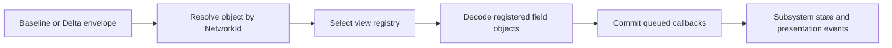

# Two-Hour Ghidra and Replication Checkpoint

Date: 2026-09-11

## Executive result

This pass converted the earlier one-off static analysis into a persistent, resumable Ghidra project and materially strengthened the client replication model. Overall implementation-grade, replacement-relevant research is now estimated at **44%**, up from 38%. The estimate does not mean 44% of every machine-code function has been reverse engineered; it measures the behavior needed to specify a compatible replacement client.

The most important new conclusion is that baseline/delta parsing is driven by a client-side ordered field registry assembled through object inheritance. Wire-declared counts are not trusted as the schema. This explains several current Stardust server anomalies and gives the replacement a concrete architecture: tag/view schema selection, bounded field decoding, transactional state commit, then semantic change events.

## Confirmed findings

### Persistent analysis foundation

- Correct target: `C:\Stardust-DEV\Stardust.exe`, SHA-256 `E782BF1C49B3DA730F66B54BC558947C46493F7133F672EED1D8E0C56A6B6150`.
- Ghidra 12.1.3 whole-program analysis completed and was saved locally.
- MSVC RTTI, vtables, imports, call paths, and server packet source can now be cross-referenced in one stable database.
- The final stable-name import contains 216 unique address/name pairs: 191 function symbols and 25 address labels in the current database.
- Ghidra's final raw 243,269 function count includes four manually created, independently confirmed functions. Exactly 121,817 entries are eight bytes or smaller and 168,041 are 16 bytes or smaller, so the total remains unsuitable as a semantic-completion denominator. The exported inventory currently contains 192 stable `_VA_` function names (0.079% of raw function objects), reported separately from replacement-relevant coverage.
- `ghidra/replication_registration_inventory.tsv` now records 86 ordered constructor registration rows with view, per-class ordinal, x86 object offset, directly observed vtable, and dynamic member pointer. It is generated by `tools/replication_registration_inventory.py` rather than maintained by hand.
- `ghidra/replication_registration_rtti.tsv` resolves embedded MSVC RTTI for all 86 registration rows across 52 unique vtables, preserving raw decorated names for independent verification. Five dynamic/decompiler-obscured rows use explicit overrides in `tools/confirmed_replication_vtables.csv`, each backed by constructor/destructor evidence rather than a guessed type.
- The local resumable corpus now contains 42 top-level Markdown research documents (about 503 KB), plus the persistent Ghidra database, targeted pseudocode, inventories, address lists, and read-only probes.

### Shared baseline/delta architecture

`ClientObject` constructor `0x00554240` embeds view registries for views 1, 3, 4, 6, 8, and 9; view 7 is an optional dynamic UI package. Views 2 and 5 are absent from both dispatchers.

- Baseline dispatch: `0x00554CF0` -> per-view snapshot virtual.
- Delta dispatch: `0x00554E90` -> per-view delta virtual -> callback commit.
- Field registration: `0x0118A840`, assigning U16 ordinal in insertion order.
- Snapshot decode: `0x0118B740`, iterating the complete registered field list.
- Delta decode: `0x0118AA00`, consuming U16 field index/value pairs until bounded payload end.
- Commit: `0x0118A970`, invoking changed-field callbacks then clearing pending state.

Dirty-field enqueue `0x0118A7C0` is an ordered-set insertion. Duplicate field identities are suppressed, so repeated mutations of one field in a single delta generate one deferred callback. Commit order follows the set's field identity order rather than packet order.

The wire U16 declared baseline-field count and delta-update count are read but do not govern these loops. Delta lookup also exposes no visible field-index bounds check before indexing. A modern client must validate indices and payload bounds before mutation.

This does not make truncated payloads valid: baseline decode still visits every registered field, and any nonzero delta remainder triggers another U16-index read. Compatibility means tolerating known count drift and selected surplus tails, not accepting missing fields or partial encodings.

### Constructor-composed schemas

Confirmed added registrations, composed with base classes:

| Class constructor | View 1 | View 3 | View 4 | View 6 | View 8 | View 9 |
|---|---:|---:|---:|---:|---:|---:|
| common `ClientObject` | 2 | 4 | 0 | 1 | 0 | 0 |
| `IntangibleObject` | 0 | 1 | 0 | 0 | 0 | 0 |
| `TangibleObject` | 0 | 7 | 0 | 1 | 0 | 0 |
| `CreatureObject` | 2 | 7 | 14 | 16 | 0 | 0 |
| `PlayerObject` | 0 | 5 | 0 | 1 | 7 | 18 |

This fixes schema cardinality and inheritance, but not yet every field's semantic name.

The complete composed `CREO:6` order is now resolved: common U32; defenders; level; performance animation; mood string; weapon ID; group ID; pair-valued group inviter ID/invite counter; guild ID; target ID; mood ID; performance start time; performance type; HAM; maximum HAM; wearables; alternate appearance; frozen. The server declares 22 operands but emits these 18 logical registered fields. The pair-valued inviter field explains one otherwise misleading two-U64 sequence.

PLAY:8's seven fields are fully ordered as experience, waypoints, current/max force, completed/active quest bits, and quest-data map; two later server zeros are an unused legacy tail. PLAY:9's 18 field positions and concrete scalar/container categories are bounded. Several historical semantics and the original producer of its fallback waypoint map remain unknown, while view-8-over-view-9 precedence is confirmed.

The common view-3 fields are now confirmed as complexity, StringId, custom name, and volume. Tangible view 3 appends customization, visible components, options/condition flags, use count, condition damage, maximum condition, and visibility. Creature view 3 then appends posture, faction rank, creature-link ID, height, shock wounds, state mask, and wounds. This closes the ordered inheritance spine used by common ground objects.

The two leading Player-specific PLAY:3 fields share the RTTI type `MatchMakingId`. Decoder `0x01223E10` fixes their wire grammar as U32 count plus U32 elements; the current server sends four entries for player bitmasks and four for profile settings. The legacy decoder has no schema-specific count cap.

CREO:1 is closed as bank credits, cash credits, base HAM, and skill set. CREO:4's 14 positions are also closed from acceleration through encumbrance/skill modifiers, movement modifiers, listen target, and space-mission objects. Together with CREO:3 and CREO:6, all four principal CreatureObject baseline views now have confirmed cardinality and order.

ITNO:3 is closed as the common four fields plus status. ITNO:6 has only the common U32 registered; the current server's later item-identifier and detailed-description strings are a characterized unused tail for this executable. Current server delta helper indices were audited against the recovered CREO/PLAY schemas and agree, with a documented warning that some server method names overload inherited tangible slots.

Wearable delta notification timing is now bounded. Remove/insert/replace invoke per-element callbacks synchronously; clear invokes removal for every old entry; replace-all records replacement operations. The field is then marked dirty and receives one coalesced outer callback during view commit. Exact installed appearance callback target names remain to be recovered.

An earlier wearable claim was narrowed: `0x00437450` is confirmed default underwear/fallback wearable refresh, not the generic replicated wearable-entry callback. It still proves `/shared_owner` customization and `SkeletalAppearance2` attach/detach ownership. The replicated vector's element callback targets remain an explicit open item.

### Waypoint state bridge

The PlayerObject maps at `+0x538` (view 8) and `+0x53C` (view 9) are both `AutoDeltaMap<NetworkId,Waypoint,...>`. Local-player callback installation at `0x0065C3B0` binds three mutation callbacks to each map. View-8 callbacks create/update/remove `ClientWaypointObject` presentation state and publish `PlayerObject::Messages::WaypointsChanged` through `0x00668920`.

This is the first fully confirmed replication-to-presentation bridge:

`PLAY:8 waypoint bytes -> Waypoint value map -> ClientWaypointObject lifecycle -> WaypointsChanged -> waypoint/map UI subscribers`

The second view-9 map has parallel callbacks that first search the primary view-8 map and act only if that NetworkId is absent. The presentation state is therefore a union with view 8 taking precedence; view 9 is a behaviorally confirmed lower-priority fallback/legacy source. Its historical producer remains unknown, and current Stardust PLAY:9 sends an empty placeholder shape.

### Initial world-object schemas

- `CellObject` constructor `0x006E58A0` derives from ClientObject and adds one view-3 U32 cell-number field. Current `CellObjectMessage3` exactly matches the resulting five fields.
- `StaticObject` constructor `0x00709FE0` adds no replicated fields. Current `StaticObjectMessage3` exactly matches the four common fields.
- `BuildingObject` constructor `0x0070DBB0` derives from TangibleObject and adds no replicated fields. Its view 3 therefore has 11 inherited fields and view 6 has the common U32 plus tangible defender vector.
- Common view-6 U32 snapshot/delta methods are `0x00542DA0` and `0x00542DC0`. Its semantic name is not yet known.
- `SCLT:6` and `STAO:6` carry unused legacy tail bytes after the single registered common U32. `BUIO:6` consumes the corresponding empty vector as its inherited defender field.

## Confidence assessment

| Claim | Confidence | Evidence |
|---|---|---|
| shared view registry and dispatch | Confirmed | constructor calls, dispatcher switches, vtable methods |
| count-independent baseline/delta iteration | Confirmed | direct decompilation of `0x0118B740` and `0x0118AA00` |
| deferred callback commit | Confirmed | `0x0118A970` and changed-field queue calls |
| view-8 waypoint presentation bridge | Confirmed | callback installation, callback bodies, transceiver publisher and RTTI |
| Cell/Static/Building inheritance schemas | Confirmed | three client constructors plus current server packet constructors |
| secondary PLAY:9 waypoint precedence | Confirmed | all three callbacks gate on absence from the primary view-8 map |
| common view-6 U32 meaning | Unknown | width, storage and callback mechanics are known; semantic consumers are not |

## Replacement implications

1. Keep wire values (`U16` indices/counts, `U32` counters/CRCs, `U64` NetworkIds) fixed-width regardless of x64 host types.
2. Build schemas compositionally from base object type to concrete type.
3. Decode into temporary values, validate the complete payload, then commit state and publish callbacks.
4. Reject out-of-range field indices even if the legacy client may fault or throw.
5. Model protocol values separately from engine/presentation objects; waypoints demonstrate this boundary directly.
6. Permit known legacy tails only in explicit tag/view compatibility policies with captured tests.

## Remaining high-value unknowns

- remaining historical semantics and specialized element codecs in `PLAY:3/8/9`, especially disabled/legacy fields;
- malformed/unknown delta index behavior and archive exception boundaries;
- historical producer/use case for the PLAY:9 fallback waypoint map; precedence is resolved;
- precise wearable callback timing for add/drop/set/replace-all/clear;
- remaining gameplay message handlers outside the already mapped login, scene, trade, controller, replication, and representative world paths;
- live end-to-end validation against Stardust, deferred to the networking proof of concept.

## Progress estimate

Overall replacement-relevant analysis: **44%**.

This six-point increase reflects a durable decompiler workflow, a confirmed generic replication engine, callback transaction boundary, one complete protocol-to-presentation path, initial non-rendering world schemas, complete common/Tangible/Intangible/Creature ordering, bounded `PLAY:3/6/8/9` ordering, and a server delta-index audit. Raw individual-function semantic coverage remains well below one percent and is reported separately; exhaustive naming of all compiler-generated helpers is neither complete nor required for an engine decision.
