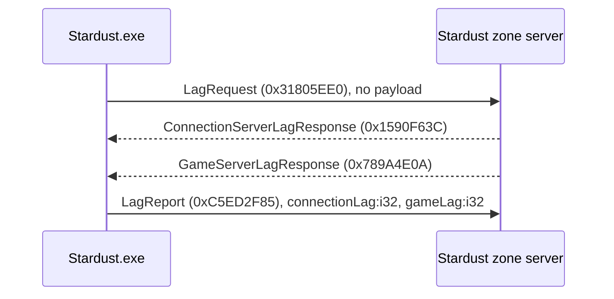

# One-Hour Client Analysis Continuation — 2026-09-11

## Scope and identity

This block continued static analysis of `C:\Stardust-DEV\Stardust.exe` only (SHA-256 `E782BF1C49B3DA730F66B54BC558947C46493F7133F672EED1D8E0C56A6B6150`). No client or server executable was run, no replacement code was written, and no repository publication was performed.

The bounded unit was the connection-option/timeout path left open by the interrupted block. Work stopped after completing that unit.

## Findings

### 1. Two distinct timeout domains are confirmed

`[ClientGame] connectionTimeout` defaults to a float `600.0` and has one direct executable caller. `avatar_selection_update_VA_00C62970` starts accumulating frame delta after sending `SelectCharacterMessage`; crossing the threshold terminates the avatar-selection wait and enters its failure presentation path. This is a ten-minute application/session timeout, not the UDP handshake timeout. **Confidence: Confirmed by code and single-caller xref.**

SharedNetwork uses integer timer options in its transport configuration. Relevant defaults are `oldestUnacknowledgedTimeout=90000`, `stallReportDelay=30000`, `keepAliveDelay=15000`, `noDataTimeout=46000`, `icmpErrorRetryPeriod=2000`, `maxDataHoldTime=50`, `resendDelayAdjust=500`, and `resendDelayPercent=125`. The state-0 pump at `0x012C4A80` already proves periodic 14-byte session-request retransmission and disconnect reason 5 when its constructor-supplied timeout expires. **Confidence: Confirmed defaults and pump behavior; exact final source of the constructor timeout remains Unknown.**

### 2. The default network-options object is structurally recovered

`shared_network_options_ctor_VA_012B9E10` materializes a `0x88`-byte option object. The majority of fields now have stable offsets, including buffer sizes, packet/window limits, fragment size, pool sizing, history size, reliability timers, no-data timeout, reliable-overflow limit, port remapping and TCP enablement. `game_connection_base_ctor_VA_012B6150` copies a selected subset into the lower connection manager configuration before binding/connecting.

This is enough to define a typed compatibility configuration in a future x64 client without reproducing the original 32-bit in-memory layout. Only values and behavior at the transport boundary need preservation. **Confidence: Confirmed layout/getter order; lower internal copy structure is partially reconstructed.**

### 3. Periodic latency reporting is recovered end to end

The client behavior is:

Client tick `0x0069B8D0` triggers the exchange after `lagRequestDelay` (default 600000 ms). Callback `0x0069B510` records the two elapsed values independently. `0x0069B690` sends the report only after both responses arrive. `lagReportThreshold` (default 10000 ms) controls warning output and does not alter the wire exchange.

Stardust source in `MMOCoreORB/src/server/zone/packets/zone/LagReport.h` independently confirms all four CRCs, empty request/response bodies, and report field order. Its `LagReportCallback::run()` is currently empty, so measurements are accepted and discarded. **Confidence: Confirmed by matching client and server code.**

## Replacement-client consequence

The minimal network POC need not implement lag reporting before login/connection establishment succeeds, but the session layer should reserve it as a periodic post-connect service. Use monotonic 64-bit time internally and serialize the two report values as protocol-defined 32-bit integers. Keep avatar-selection timeout policy outside the transport implementation.

## Remaining questions from this unit

- Identify the exact factory/call site that supplies the outbound UDP object's state-0 establishment timeout at object offset `+0xF8`.
- Finish mapping SharedNetwork option offsets through the intermediate manager structure into live connection offsets.
- Determine whether `useTcp=true` is exercised by Stardust's normal game path or only enables an available fallback/parallel transport.
- Assign semantic names to disconnect reason codes beyond the presently observed numeric values.

## Progress assessment

Replacement-relevant implementation-grade coverage advances from **57% to 58%**. The one-point increase reflects closure of a narrow but important connection-policy unit, not broad raw-function coverage. The pre-build engine/POC decision analysis remains complete; many asset, rendering, UI and gameplay internals still remain intentionally below function-by-function completeness.

## Exact next analysis step

Trace callers of outbound connection factory `0x012C1990`, identify the supplied establishment timeout, then follow `useTcp` and port-remapping branches from the same factory. That should finish the lower connection-creation policy before moving to another workstream.
