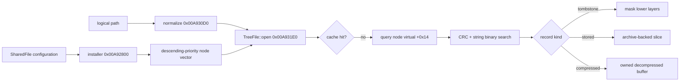

# Analysis Checkpoint — VFS/TRE Runtime

Date: 2026-09-11  
Primary binary: `C:\Stardust-DEV\Stardust.exe`  
SHA-256: `E782BF1C49B3DA730F66B54BC558947C46493F7133F672EED1D8E0C56A6B6150`

## Outcome

This block reconstructed the executable's virtual-filesystem mount and lookup path sufficiently to constrain a direct original-asset implementation. It did not modify or execute the client or any TRE asset.

Strict comprehensive progress advances from **42% to 43%**. The VFS/TRE/templates/assets workstream advances from **20% to 32%**. The smaller overall increment reflects that this is one 10%-weighted workstream in the whole-client ledger.

## Confirmed findings

1. `TreeFile::open` is retained at `0x00A931E0` and is called broadly by game and resource systems.
2. Installer `0x00A92800` reads all configured `searchPath`, `searchTree`, and `searchTOC` entries for priorities zero through `maxSearchPriority`.
3. Search nodes are stored in descending numeric priority. `TreeFile::open` queries them in that order and returns the first successful result. Higher configured priority wins.
4. Path normalization strips leading separators and leading relative-dot segments, canonicalizes slash direction, collapses duplicate separators, and case-folds normal bytes.
5. An enabled cache is checked before node traversal. A missing file either returns null or causes a fatal error according to the call's allow-missing flag.
6. RTTI exposes `SearchNode`, `SearchPathA`, `SearchAbsolute`, `SearchTree`, `SearchTOC`, and `SearchCache`.
7. SearchTree accepts archive versions 0004 and 0005. SearchTOC requires version 0001.
8. TREE records are found by CRC plus full normalized string, preventing CRC collision from being treated as path equality.
9. A TREE record with zero payload size is a tombstone/mask that prevents fallback to a lower-priority node.
10. Stored records return archive-backed bounded files. Compressed records are read and eagerly decompressed into owned memory before being returned.

## Evidence chain

Primary functions inspected: `0x00A92800`, `0x00A92B00`, `0x00A92B20`, `0x00A930D0`, `0x00A931E0`, `0x00A992E0`, `0x00A99550`, `0x00A99780`, `0x00A99930`, `0x00A99CF0`, and `0x00A99EC0`. Supporting evidence includes the SearchTree and SearchTOC vtables at `0x015EA454` and `0x015EA470`, retained diagnostics/RTTI, installed SharedFile configuration, and the previously parsed 58-archive corpus.

## Confidence

| Finding | Confidence |
|---|---|
| descending numeric priority and first-success wins | Confirmed by executable code |
| path separator/relative-prefix normalization | Confirmed by executable code |
| ordinary-character lowercase/case folding | Strongly inferred; helper semantics not yet independently characterized |
| CRC plus full-string lookup | Confirmed by executable code |
| zero-size TREE tombstone/mask | Confirmed by executable control flow |
| stored archive slice vs eager decompression | Confirmed by executable code |
| exact decompression algorithm for all possible compression flags | Partly confirmed; observed corpus is zlib type 2, additional historical modes remain unknown |

## Replacement consequences

The modern client must treat original assets as a layered virtual filesystem, not as a one-time conversion input. Its source-of-truth resource key is a normalized logical path resolved against priority-ordered mounts. Archive readers must use bounded arithmetic, reject index/name/payload ranges outside the file, cap decompressed allocation sizes, and keep source archive/record identities for diagnostics and cache invalidation.

Optional engine-native or GPU-ready caches remain valid only as disposable products of the original TRE/IFF inputs. Deleting the cache must never make a legally complete Stardust installation unusable.

## Remaining VFS/asset questions

- Identify the exact filename CRC and byte-folding behavior with executable-derived test vectors.
- Finish `SearchPathA`, `SearchAbsolute`, and `SearchCache` open/invalidating semantics.
- Resolve TOC backing-file schema and determine whether deployed content uses it.
- Trace one representative logical path from `TreeFile::open` into the IFF reader and typed factory registry.
- Specify bounded failure behavior absent from or unsafe in the 32-bit implementation.
- Continue format-family work for SHT/EFT, MSH/MGN, APT/LOD/SAT, SKTM, LAT/ASH, PTAT, PRTO, UI, audio, and localization.

## Exact resume point

Start with the CRC helper called by `search_tree_find_record_VA_00A99550` (`0x00AA4790`) and the character-fold helper used by `tree_normalize_logical_path_VA_00A930D0`. Generate known logical-path vectors from installed archives and confirm them against stored TREE checksums. Then trace the highest-value appearance-template caller of `TreeFile::open` into its IFF tag/version factory.
