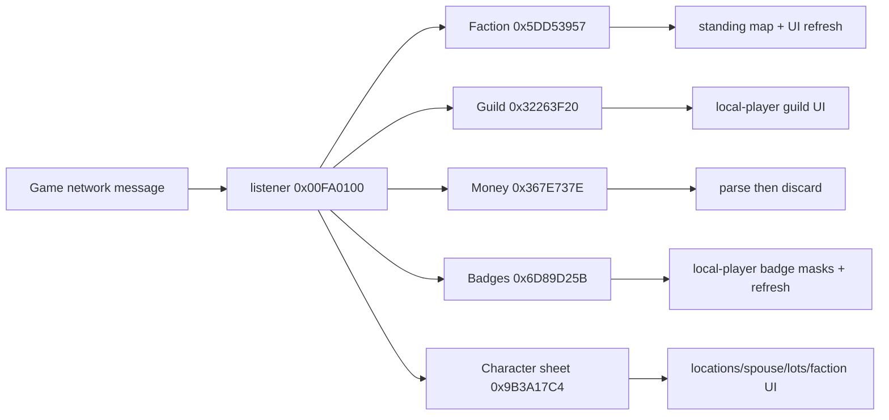

# Analysis checkpoint: character-sheet response family

Date: 2026-09-12  
Executable: `C:\Stardust-DEV\Stardust.exe`  
SHA-256: `E782BF1C49B3...` (canonical corpus recorded in `EXECUTABLE_OVERVIEW.md`)

## Scope and result

This block closes the five messages consumed by the listener at `0x00FA0100`: faction standings, guild, money, badges and the aggregate character-sheet response. Client codec construction was checked against the current Stardust server constructors. No inference from `SWGEmu.exe` was used.

## Confirmed route

## Wire contracts

### FactionResponseMessage

`ASCII16 rank, S32 rebel, S32 imperial, S32 Hutt, U32 nameCount, nameCount * ASCII16 name, U32 valueCount, valueCount * F32 standing`.

The client updates the three headline numeric widgets first. It rebuilds the detailed map only if the two parallel-array counts agree. Each string record occupies 12 bytes internally; the float array is four bytes per entry. Current Stardust emits Hutt as zero.

### GuildResponseMessage

`U64 creatureId, ASCII16 guildName, U16 trailingValue`.

The client compares `creatureId` to the local player before applying it. Current Stardust emits the trailing value as zero. Its original label is not required for compatibility, but the field must be consumed and retained for forward compatibility.

### PlayerMoneyResponse

`U32 bankCredits, U32 cashCredits`.

The listener constructs the typed message and immediately destroys it. There is no character-sheet state or widget write on this branch. Currency is replicated elsewhere, so a replacement should support this wire response but need not treat it as authoritative state.

### BadgesResponseMessage

`U64 playerId, U32 legacyTerminalIndex, (legacyTerminalIndex + 1) * U32 masks` for the deployed value `legacyTerminalIndex = 0x0F`.

Current Stardust emits five real badge masks and eleven zero masks, for sixteen entries total. The client copies the resulting U32 vector only when the ID is the local player, then refreshes badge presentation. The server comment confirms that other leading values fail to display; therefore `0x0F` is protocol-significant even though its original enum/field label remains unpublished.

### CharacterSheetResponseMessage

The client registers these fields in exact order:

1. U32 spacer 0
2. U32 spacer 1
3. Vector3 bind position (wire floats X, Z, Y)
4. ASCII16 bind planet
5. Vector3 bank position (X, Z, Y)
6. ASCII16 bank planet
7. Vector3 home position (X, Z, Y)
8. ASCII16 home planet
9. Unicode16 spouse name
10. U32 lots remaining
11. U32 faction CRC
12. U32 faction status

Current Stardust supplies real bind/home locations when their objects and zones resolve, zero bank coordinates with a bank planet string, and compresses the packet. These are wire values and must not widen in an x64 client.

## Replacement implications

- Decode all five messages with fixed-width wire types independent of native pointer size.
- Treat the parallel faction arrays as an atomic pair; reject or retain diagnostically when their counts differ instead of partially rebuilding state.
- Preserve the guild trailing U16 and both character-sheet spacer U32s as reserved fields.
- Preserve `0x0F` and sixteen badge masks for current-server compatibility; expose the vector internally without baking the server's five-used-mask assumption into the renderer/UI.
- Treat PlayerMoneyResponse as a compatibility message, while sourcing authoritative currency from the normal replicated object model.

## Remaining uncertainty

Only historical labels are unresolved: the guild trailing U16 and the badge leading `0x0F`. Their byte width, position, current values and client behavior are known. They are Class D naming uncertainty, not Class C build blockers.
