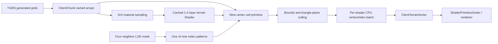

# Analysis checkpoint: ClientChunk mesh, terrain blending and seams

Date: 2026-09-12  
Primary subject: `C:\Stardust-DEV\Stardust.exe`  
SHA-256: `E782BF1C49B3DA730F66B54BC558947C46493F7133F672EED1D8E0C56A6B6150`

## Outcome

This block traces generated procedural-terrain arrays into ClientChunk CPU data, per-cell terrain shader primitives, runtime blend shaders, exact seam index patterns, visibility/culling data and the final per-frame batching boundary. It confirms that background chunk generation does not directly create a monolithic GPU mesh. The chunk retains CPU primitives; visible primitives append vertices and selected indices into terrain-sorter batches for later renderer submission.

Decompiler output is reconstructed pseudocode. Provisional names are evidence-backed labels, not original symbols.

## Generated data retained by ClientChunk

`client_chunk_build_render_data_VA_008618D0` receives generated create-data and copies several dimensioned arrays into owned ClientChunk containers. Confirmed element widths include:

| ClientChunk field | Element width | Observed role |
|---:|---:|---|
| `+0xA0` | 3 bytes | terrain shader/classification samples used by 3x3 material selection |
| `+0xA4` | 2 bytes | generated scalar grid |
| `+0xC4` | 3 bytes | generated packed sample grid |
| `+0xC8`, `+0xCC`, `+0xD0` | 2 bytes each | generated scalar grids |
| `+0xD4` | 1 byte | generated mask grid |
| `+0xD8` | 12 bytes | Vector3 grid |
| `+0xA8` | 1 byte | generated byte mask |

The exact semantic labels for every scalar/mask array remain unknown. Their widths, dimensions, ownership transfer and downstream consumers are confirmed. The builder also transfers chunk bounds, validity flags and terrain-template state.

## Cell primitive model

For each generated cell, `0x008618D0`:

1. Samples a 3x3 neighborhood of terrain shader/classification entries through `terrain_select_cell_material_VA_008612B0`.
2. Finds or creates a 16-byte ShaderSet keyed by the resolved terrain material combination.
3. Creates a pooled 328-byte (`0x148`) `ClientProceduralTerrainAppearance::ShaderSet::Primitive` through `terrain_create_cell_primitive_VA_00865DA0`.
4. Stores nine positions, nine normal-like vectors and nine packed per-vertex values.
5. Stores a shader reference, cell spacing/scale, culling bounds, selected seam-index pattern and eight triangle planes.
6. Adds the primitive to the ShaderSet and ClientChunk primitive vector.

RTTI/memory-pool strings confirm the `ShaderSet` and nested `ShaderSet::Primitive` class identities. Their pools are installed at `0x008659A0` and `0x00866CA0`.

The nine-vertex patch layout is **Confirmed** by fixed loops and indexed access. It consists of one center vertex (`0`) and an eight-vertex perimeter ring (`1..8`).

## Terrain material blending

`terrain_select_cell_material_VA_008612B0` examines the 3x3 classification neighborhood, resolves unique shader identities, selects level textures, and passes a compact material key to `terrain_fetch_blend_shader_VA_008654F0`.

The runtime shader constructor fetches `shader/terrain_%sblend%i.sht`, yielding deployed families:

- `shader/terrain_blend0.sht` through `terrain_blend3.sht`;
- `shader/terrain_dot3_blend0.sht` through `terrain_dot3_blend3.sht`;
- Stardust overlays also contain `_spec` variants.

The numeric suffix represents progressively larger layer combinations; the recovered parameter table supports a base layer plus three additional layers—four terrain levels total.

Confirmed mutable shader parameters are:

| Layer | Level texture | Normal texture | Blend/alpha input |
|---:|---|---|---|
| 0 | `LVL0` | `NRM0` when dot3 is enabled | base `TERR` setup |
| 1 | `LVL1` | `NRM1` | `ALP1` |
| 2 | `LVL2` | `NRM2` | `ALP2` |
| 3 | `LVL3` | `NRM3` | `ALP3` |

Base source shaders expose `MAIN` and optionally `NRML`; those texture references are copied into the generated terrain shader parameters. `TERR` and the level/normal/alpha tags are therefore part of the original terrain material contract. The exact encoding of each per-vertex alpha/blend value is not yet fully labeled.

Material combinations are cached in 60-byte records with a reference/use count. The client reuses an existing generated Shader when its layer identity tuple matches rather than constructing one per cell.

## Exact seam topology

`terrain_primitive_select_seam_indices_VA_00865FF0` selects one of nine global 16-bit index lists. The lists are embedded at `0x015E7490`; their index counts at `0x015E7468` are:

```text
24, 21, 18, 21, 18, 21, 18, 21, 18
```

Thus the normal patch contains eight triangles. A single collapsed perimeter edge contains seven triangles, and a compatible adjacent-edge/corner combination contains six.

The base pattern is an eight-triangle fan:

```text
(0,1,2) (0,2,3) (0,3,4) (0,4,5)
(0,5,6) (0,6,7) (0,7,8) (0,8,1)
```

The other eight tables omit selected perimeter midpoint vertices. Selection considers the four-bit neighbor seam mask and whether a cell lies on the relevant chunk boundary. The available patterns cover:

- no collapsed edge;
- four single-edge collapses;
- four adjacent-edge corner combinations.

Seam changes replace the primitive's selected index-list pointer at `+0x120` and recompute triangle planes. Vertex positions are not regenerated. This closes the earlier edge-mask unknown.

## Visibility, occlusion and batching

Each primitive stores X/Z bounds and eight triangle planes. Camera-side code tests those bounds/planes before sending the primitive to `ClientTerrainSorter`.

When `ClientTerrain.useOcclusion` is enabled, ClientChunk also builds a render-world/occlusion test model at `+0xDC`:

- with `useRealGeometryForOcclusion`, it copies a `(2N+1)^2` position grid and constructs `2*N*N` triangles;
- otherwise it builds a conservative eight-vertex/36-index proxy volume.

These are culling representations, not the visible terrain material mesh.

`terrain_shader_set_append_visible_geometry_VA_008668E0` appends each visible primitive's nine Vector3 positions and selected 16-bit indices into per-shader terrain-sorter arrays, offsetting indices by the destination vertex base. This is the concrete CPU-to-renderer handoff. GPU buffer allocation/upload belongs to the downstream sorter/graphics path and is not owned by individual ClientChunks.

## Reconstructed pipeline



## Asset and replacement requirements

- Original PTAT/TGEN evaluation must produce compatible height, shader classification, level texture, normal texture and blend inputs.
- Preserve support for up to four terrain material levels and the `MAIN`, `NRML`, `TERR`, `LVL0..3`, `NRM0..3` and `ALP1..3` semantics.
- Do not bake the legacy ShaderSet, 60-byte cache key, 328-byte primitive, memory pools or D3D9 buffer path into compatibility interfaces.
- A replacement may build larger indexed chunk meshes, but must preserve material transitions, deterministic sampling and crack-free mixed LOD.
- The exact nine-pattern fan is a viable compatibility reference. A modern engine may instead use skirts, shared-edge remeshing or geomorphing after visual equivalence is demonstrated.
- Keep occlusion/collision representations separate from visible render meshes.
- Background jobs should publish renderer-neutral arrays; engine/GPU objects should be created or updated only on the permitted render/main thread.

## Remaining unknowns

1. Exact semantics of all generated scalar and mask grids copied into ClientChunk.
2. Per-vertex blend/alpha encoding and how ALP1..3 are sourced by the shader.
3. Full coordinate/normal/UV payload passed to downstream GPU vertex buffers.
4. Exact terrain shader program semantics for programmable and fixed-function branches.
5. Collision/query use of ClientChunk grids versus the occlusion proxy.
6. WMAP/SMAP participation in generation or rendering.

## Progress estimate

- Expanded comprehensive whole-client research: **59%**.
- Replacement-relevant behavioral/specification readiness: **80%**.
- Renderer workstream: **67%**.
- Terrain/world/collision/camera/transitions workstream: **54%**.

These are replacement-relevant evidence estimates, not raw-function naming percentages.
