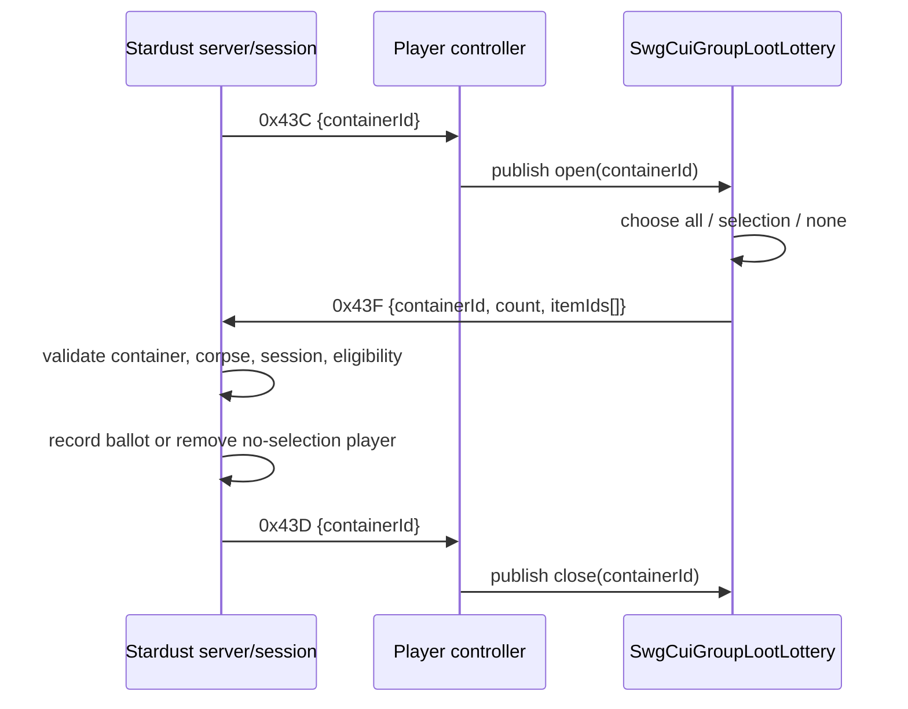

# Analysis checkpoint: group loot lottery

Date: 2026-09-12  
Subject: `C:\Stardust-DEV\Stardust.exe`, correlated with current Stardust server source

## Result

The active group-loot lottery protocol is completely bounded by three ObjectController types: `0x43C` opens the UI for a container, `0x43D` closes it, and `0x43F` submits a ballot. `0x43E` is a reserved/unsupported gap in both the recovered client registry and current Stardust endpoint registrations.

## Client behavior

The player-controller dispatcher RTTI-checks `0x43C` and `0x43D` as `MessageQueueGenericValueType<NetworkId>` and publishes the ID through separate open/close transceivers. The executable contains `SwgCuiGroupLootLottery`, its item icon callback/container filter, three controls named `buttonAll`, `buttonSelection`, and `buttonNone`, and `/PDA.lottery`.

`0x00F121F0` implements those three submission modes. It enumerates either the applicable complete list or selected list, converts client objects to NetworkIds, retains the container ID, constructs the payload and queues `0x43F` with flags `0x23`. A zero-length vector is a deliberate ballot meaning, not malformed input.

`0x01196FE0` serializes the nested payload exactly as `U64 containerId, U32 count, count * U64 itemId`. The outer ObjectController contributes the scalar before it.

## Server behavior

Stardust resolves `containerId`, requires its parent to be an AI agent/corpse, locks the corpse, requires an active unfinished `LOOTLOTTERY` session and an eligible player. Zero selections remove that player from the eligible pool. Nonzero selections create one `LootLotteryBallot` and remove the player from eligibility via `addPlayerSelections`.

The session schedules a 35-second draw. For each item it gathers ballots that selected that ID, randomly chooses a candidate, and transfers the item; an item with no takers is left available and its move deny is cleared. This server policy is not client logic but is essential for reproducing the correct ballot lifecycle and timeout expectations.

## Replacement implications

- Use a fixed-width `NetworkId` wire type and bounds-check `count * 8` before allocation.
- Preserve an empty selection as a valid opt-out ballot.
- Treat open/close messages as keyed by container ID, allowing stale close events to target only their matching view.
- Do not invent behavior for `0x43E`; log it through the ordinary unsupported-inner-type path if ever received.
- The future UI need not resemble `/PDA.lottery`, but must expose all, subset and none outcomes and submit once per eligibility cycle.

## Confidence and unknowns

Wire layouts, routes and active server state transitions are Confirmed. Exact original widget composition and styling are replaceable presentation details. No Class C compatibility unknown remains in this family.
