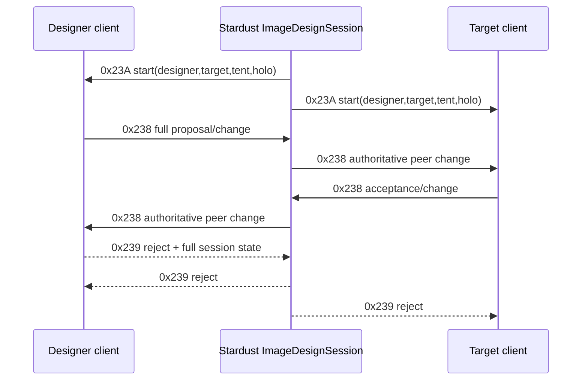

# Analysis checkpoint: image-design session

Date: 2026-09-12  
Subject: `C:\Stardust-DEV\Stardust.exe`, correlated with current Stardust server source

## Result

The image-design protocol has one server-start type (`0x23A`) and two bidirectional session types (`0x238` change and `0x239` reject). The latter pair intentionally share a single large codec. Current Stardust constructs the fixed identity prefix and then appends `ImageDesignData`; it is not sending a truncated record.

## Routes

## Exact start contract

`0x23A`: outer U32 scalar, U64 designer ID, U64 target ID, U64 tent/cell ID, ASCII16 holo-emote. Parser `0x00B11260` reads exactly this sequence. The dispatcher compares designer and target identities with the local player to select designer-side versus recipient-side start notification; self-design is also handled.

## Exact shared `0x238/0x239` contract

After outer scalar and `U64 designer, U64 target, U64 tent, U8 type`, both directions carry:

1. ASCII16 hair template
2. ASCII16 hair customization byte string
3. U32 session ID
4. U32 timestamp
5. U32 required payment
6. U32 offered payment
7. U8 designer accepted
8. U32 target accepted
9. U8 stat-migration requested
10. U32 body skill modifier
11. U32 face skill modifier
12. U32 markings skill modifier
13. U32 hair skill modifier
14. U32 body-attribute count, then repeated ASCII16 name + F32 value
15. U32 color-attribute count, then repeated ASCII16 name + U32 value
16. ASCII16 holo-emote

This is Confirmed by client serializer `0x00B0B620`, parser `0x00B0B990`, copied session structure `0x0121FE30`, and server `ImageDesignData::parse/insertToMessage`.

## Server behavioral contract

The server requires an active `IMAGEDESIGN` session. It stores each update, validates the four-minute cross-player stat-migration timer, coordinates designer/target acceptance, handles offered/required payment, applies body/color/hair changes, installs holo-emotes, awards image-designer experience and cancels the session after commit. A reject causes the full state to be sent to both peers before teardown.

This logic should remain authoritative server behavior. The replacement client needs to represent proposal state accurately, but must not treat client-side timer or acceptance checks as security boundaries.

## 64-bit and parser implications

- All IDs remain U64 wire values; native pointers never enter the DTO.
- `targetAccepted` is U32 while `designerAccepted` and `statMigrationRequested` are U8. Normalizing every boolean to one byte would break compatibility.
- Map counts and string lengths require overflow/bounds checks before allocation.
- The same numeric type has a different semantic direction: C→Z carries a proposal/rejection request; Z→C carries authoritative peer/session state.
- Preserve customization data as opaque bytes until the original customization-variable codec is independently modeled.

## Confidence and remaining work

Wire layout and principal session transitions are Confirmed. Fine-grained UI mediator behavior, customization-variable semantics and every appearance-variable name remain separate asset/UI breadth. No unresolved function in this block prevents implementing the transport/session DTOs.
