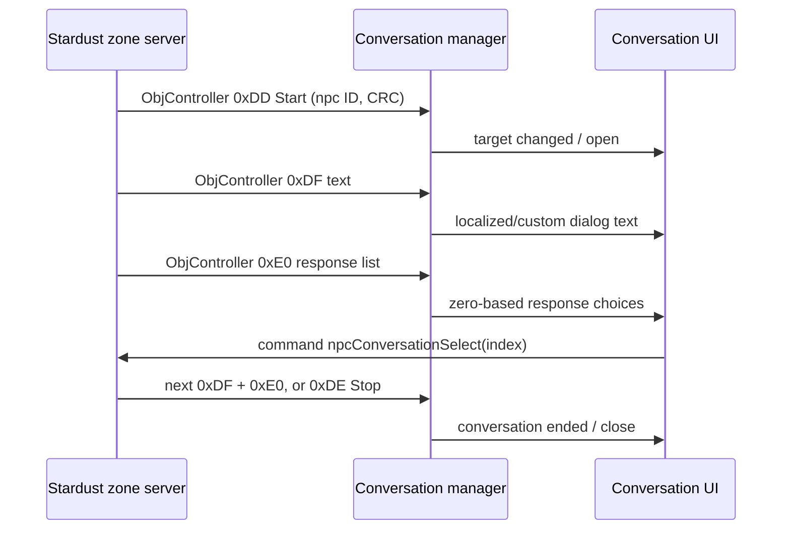

# Stardust.exe NPC Conversation Protocol

Scope: `C:\Stardust-DEV\Stardust.exe`, correlated with current Stardust-3 conversation packets, `ConversationScreen`, and `NpcConversationSelectCommand`. This closes the ordinary ground and JTL/space conversation message loop; it does not catalog every screenplay conversation tree.

## End-to-end message map

The four inbound payloads are ObjectController inner messages addressed to the player creature with priority `0x0B`. Their factories are registered directly in Stardust.exe:

| Inner type | Server class | Client factory/parser | Player-controller branch | Conversation-manager action |
|---:|---|---:|---:|---:|
| `0xDD` | `StartNpcConversation` | install `0x00B12D60`, parser `start_npc_conversation_payload_parse_VA_00B12F20` | `0x0062AD56` | `cui_conversation_start_VA_008E7CA0` |
| `0xDE` | `StopNpcConversation` | install `0x00B12AD0`, parser `stop_npc_conversation_payload_parse_VA_00B12BD0` | `0x0062AD88` | `cui_conversation_stop_VA_008E7E30` |
| `0xDF` | `NpcConversationMessage` | install `0x00B14ED0`, parser `npc_conversation_text_payload_parse_VA_00B14FF0` | `0x0062ADB6` | `cui_conversation_set_text_VA_008E7AA0` |
| `0xE0` | `StringList` | install `0x00B121C0`, parser `conversation_string_list_payload_parse_VA_00B123A0` | `0x0062ADE4` | `cui_conversation_set_responses_VA_008E7550` |

The common controller dispatcher delegates all four values to the player/creature-specific dispatcher; the latter RTTI-casts the typed payload and calls the manager routines above.

## Exact payloads

```text
0xDD StartNpcConversation:
    U64       npcOrAgentId
    U8        starter
    ASCII16/extended-length ASCII text
    U32       mobileCrc

0xDE StopNpcConversation:
    U64       npcOrAgentId

0xDF NpcConversationMessage:
    Unicode16/extended-length Unicode conversation text

0xE0 StringList:
    U8        optionCount
    repeat optionCount:
        Unicode16/extended-length Unicode option
```

The `0xDD` parser retains all four fields, but the active client dispatcher passes only the NPC/agent ID and mobile CRC to `CuiConversationManager`. The legacy `starter` byte and ASCII string are therefore wire-compatible ignored fields in this build. Current ground calls send `starter=0`, empty ASCII, CRC zero. Ship/JTL callers send an agent ID and mobile CRC.

`0xDF` has one Unicode payload. The current server can place either literal custom Unicode text in it or a binary StringIdChatParameter representation framed as a Unicode-length payload. The client text handler normalizes/localizes the content into its retained conversation text, publishes it through the conversation presentation path, and also routes presentation through the spatial-chat formatter.

`0xE0` uses a one-byte option count, not U32. The parser allocates a runtime vector of Unicode strings and iterates exactly that count. The server sends text first and the option list second for each `ConversationScreen`.

## Runtime state and events

`cui_conversation_start_VA_008E7CA0` compares the requested target with the current target, updates the retained NetworkId, stores the mobile CRC, clears prior responses/text when the target changes, and publishes target/response state. The CRC enables the separate space-conversation presentation path.

`cui_conversation_set_responses_VA_008E7550` replaces the retained response vector, performs display-string processing, emits `RESPONSES_CHANGED`, and updates conversation-menu presentation state.

`cui_conversation_set_text_VA_008E7AA0` replaces/extends normalized conversation output, emits/presents the text, and clears the pending wait state.

`cui_conversation_stop_VA_008E7E30` accepts the target ID, ends a matching ground or space conversation, clears target/content state, emits the conversation-ended notifications, and invokes the relevant presentation teardown. The server sends ground stops immediately; space conversations can schedule a three-second delayed stop.

## Client-to-server option selection

The option-selection path at `0x008E7434` lazily resolves the command CRC for `npcConversationSelect`, formats the selected zero-based response index as Unicode decimal text, and submits it through the ordinary command queue. The current server command:

1. ignores the command target and instead uses `PlayerObject::conversatingObject`;
2. parses the Unicode argument as an integer option index;
3. resolves the current conversation object;
4. requires matching parent for creature conversations and squared world distance `< 25.0` (less than five units), while ship objects bypass that ground-distance condition;
5. calls `selectConversationOption(option, creature)` and notifies `SELECTCONVERSATION` observers.

The server catches exceptions around selection and currently returns success after that catch. A replacement client should still validate the local index but must treat the server as authoritative.

## Sequence



## Replacement implications

- Implement the conversation state machine above the generic ObjectController and command-queue layers; it is not a standalone socket protocol.
- Preserve U64 IDs, U8 count/starter, U32 mobile CRC, extended string-length rules, and zero-based option indices.
- Retain the original StringId encoding/localization path and original string-table assets. Literal custom text and localized StringId content share the same message boundary.
- Treat the `0xDD` starter/ASCII fields as decoded compatibility fields even though this executable ignores them.
- Separate ground conversation presentation from the optional CRC-selected space communicator UI while sharing one protocol state model.

## Confidence

- **Confirmed by executable and server source:** all four IDs, factories, field order/width, typed controller branches, active manager calls, response replacement, option command name/argument, server validation and next-screen ordering.
- **Strongly inferred:** exact original public names for several private manager members and notification wrappers.
- **Remaining breadth:** every individual Lua conversation screen and localization key. Those are content data, not unknown protocol functions.

