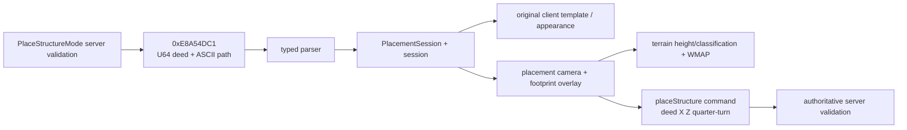

# Analysis checkpoint: structure-placement network and client flow

Date: 2026-09-12  
Target: `C:\Stardust-DEV\Stardust.exe`  
SHA-256: `E782BF1C49B3DA730F66B54BC558947C46493F7133F672EED1D8E0C56A6B6150`

## Outcome

The structure-placement entry message and the client/server handoff are now mapped from the server producer through the executable's message parser, central receiver, CUI mediator, preview template/object, placement camera and outgoing command.

This closes a representative gameplay/UI path and also explains one of the newly identified WMAP water-mask consumers.

## Server-to-client entry message

Current server `EnterStructurePlacementModeMessage.h` emits:

```text
LE16 operand count = 3
LE32 opcode        = 0xE8A54DC1
LE64 deedId
ASCII16 clientObjectTemplatePath
```

`PlaceStructureModeCommand` validates player state, parent/cell state, client region restrictions, deed existence/ownership/faction, lot capacity, and resolves the server template's client-object CRC back to a client template path before sending this message.

## Client parser and handler

The executable archive type is `EnterStructurePlacementModeMessage` (RTTI at `0x01906D04`). Its default/archive constructor is `enter_structure_placement_message_parse_VA_013F3C00`. It registers two fields:

- an eight-byte NetworkId/LE64 value at object archive member `+0x38`;
- an ASCII byte-string/path at archive member `+0x48`.

The central receiver `game_message_receiver_dispatch_VA_00E40E40` compares the incoming named-message type against global type identifier `0x0160985C`, constructs the parser at `0x013F3C00`, and retrieves the fields through accessors `0x013F3E00` and `0x013F3E10`.

It fetches/activates the `SwgCuiStructurePlacement` mediator through the CUI workspace and calls `swg_cui_structure_placement_begin_VA_00CA9FB0(deedId, clientTemplatePath)`. Failure causes the mediator/workspace entry to be deactivated rather than leaving a partial placement mode.

## Preview construction

`0x00CA9FB0` first clears any prior placement resources, stores the deed NetworkId, validates the nonempty path, fetches the client object template, and requires a `SharedTangibleObjectTemplate` (`.?AVSharedTangibleObjectTemplate@@`). It derives the appearance/template data needed for the preview, allocates a temporary 0xA0-byte scene object, assigns its appearance, adds it to the render scene, and passes both the preview extent/data and object to `StructurePlacementCamera`.

Cleanup `0x00CAA260` frees the copied path, releases the fetched template, clears derived preview data, and destroys the temporary scene object. Replacement placement mode must therefore own these resources as one cancelable session.

## Placement camera and terrain overlay

RTTI confirms `StructurePlacementCamera`; its vtable is at `0x015E15FC`. Constructor code loads:

- `shader/placement_red.sht`
- `shader/placement_green.sht`
- `shader/placement_yellow.sht`
- configuration flag `alwaysAllowStructurePlacement`
- configuration flag `renderLotManager`

The large vtable method at `0x006CBA40` transforms the mouse/view ray into terrain coordinates, obtains terrain collision/height data, iterates the rotated footprint in one of four quarter-turn orientations, builds ground-conforming cell quads from four corner-height samples, and selects placement overlay shaders according to classification/validity.

Water cells are detected by the PTAT WMAP point query. In the footprint overlay path, a terrain classification value of 3 or a set WMAP bit uses the yellow shader. Green and red are passed together to the per-cell builder for ordinary valid/invalid classification. The method also computes the preview object's world placement point and applies it through the placement camera/object transform.

The exact historical enum names for every terrain classification are not asserted; the observed shader and water behavior is sufficient for a modern equivalent.

## Client-to-server completion

`swg_cui_structure_placement_submit_VA_00CA9A30` formats:

```text
"%s %1.2f %1.2f %i"
 deedId, worldX, worldZ, quarterTurn
```

It hashes/queues command name `placeStructure` through the ordinary command-queue path. The server `PlaceStructureCommand` parses exactly `U64 deedID`, two floats, and an integer angle 0..3; recomputes floor height; enforces approximately 100-meter horizontal/3D reach and height restrictions; rejects active no-build areas/object conflicts; then begins the authoritative placement session with `angle * 90` degrees.

Client preview validity is advisory. Server-side validation remains authoritative and must remain so in a replacement.

## Replacement model



The replacement can redesign camera, scene object and overlay rendering, but must preserve message fields, client-template lookup, four rotations, terrain/WMAP-aware feedback, cancel cleanup and outgoing command grammar.

## Confidence

- Inbound opcode and wire fields: **Confirmed by server producer and executable parser layout**.
- Parser -> central receiver -> CUI mediator -> begin method: **Confirmed by direct calls**.
- Template type, preview object lifecycle, shader paths and WMAP use: **Confirmed by RTTI, strings and code**.
- Outgoing command grammar and server parsing/validation: **Confirmed end-to-end**.
- Exact original names of terrain classification values and every placement-camera helper: **Not claimed**.

