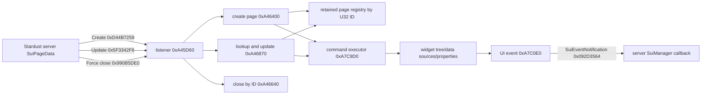

# Stardust.exe SUI Page Protocol and Runtime

Scope: static analysis of `C:\Stardust-DEV\Stardust.exe` correlated with the current Stardust-3 server SUI implementation. This checkpoint covers the server-driven page protocol, client dispatch, command execution, event callbacks, update behavior, and forced closure. It does not claim that every concrete SUI page template or every UI widget class is reconstructed.

## Findings

### Named-message listener and dispatch

`sui_network_message_listener_VA_00A45D60` is the confirmed client listener. Installation at `0x00A45CC0` registers the names `SuiCreatePageMessage`, `SuiForceClosePage`, `SuiUpdatePageMessage`, and one additional shutdown/control notification. The listener compares the incoming message type and follows these routes:

| Server message | Opcode in current server | Client parser | Client manager entry | Result |
|---|---:|---:|---:|---|
| `SuiCreatePageMessage` | `0xD44B7259` | `sui_create_page_message_parse_VA_00B008F0` | `sui_manager_create_page_VA_00A46400` through bridge `0x00A46830` | Load the named root page, create a mediator/runtime page, execute its command stream, retain it by page ID, bind optional target/distance, and activate it. |
| `SuiUpdatePageMessage` | `0x5F3342F6` | `sui_update_page_message_parse_VA_00B00320` | existing-page lookup/update bridge `0x00A46870` | Locate the retained page by ID and apply its command stream. Event-subscription commands are skipped on updates. |
| `SuiForceClosePage` | `0x990B5DE0` | `sui_force_close_page_parse_VA_00B01FA0` | `sui_manager_close_page_by_id_VA_00A46640` through bridge `0x00A46850` | Find the retained page by ID, close/deactivate it, and remove it from the page registry. |

The client routes these as named GameNetwork messages rather than exposing a direct opcode switch at the SUI listener. The server constants above establish the wire hashes.

### Page-data wire schema

The current server's `SuiPageData::toBinaryStream()` is the authoritative emitter and matches the client message objects' registered field structure:

```text
U32       pageId
ASCII16   rootPage
U32       commandCount
repeat commandCount:
    U8        commandType
    U32       wideParameterCount
    repeat wideParameterCount: Unicode16 parameter
    U32       narrowParameterCount
    repeat narrowParameterCount: ASCII16 parameter
U64       targetNetworkId
F32       forceCloseDistance
U64       unknownNetworkId
```

The command is a variable-size wire record. The client converts it to a 28-byte runtime record; that in-memory size is not a wire ABI. Likewise, page IDs remain U32 and network IDs remain U64 in a native x64 replacement.

The server writer emits `commandType` as **U8**. Its currently unused `SuiCommand::parseFromBinaryStream()` reads an integer instead, but that reverse parser is not the server-to-client contract and should not be copied into a replacement client.

### Command executor

`sui_runtime_execute_command_VA_00A7C9D0` obtains the command type and dispatches through the seven-entry table at `0x00A7D410`:

| Type | Server name | Client branch | Confirmed effect |
|---:|---|---:|---|
| 1 | `SCT_clearDataSource` | `0x00A7CA50` | Resolve the named data-source widget and clear its contents. |
| 2 | `SCT_addChildWidget` | `0x00A7CA7C` | Resolve parent and child names, create/find the UI object, and attach it to the parent. |
| 3 | `SCT_setProperty` | `0x00A7CBD3` | Resolve a widget/property/value tuple and set the property; this can also mark page state requiring a refresh. |
| 4 | `SCT_addDataItem` | `0x00A7CD1E` | Create a data item from supplied names/value and attach it to the resolved data source. |
| 5 | `SCT_subscribeToEvent` | `0x00A7CF40` | Resolve widget/event information, install the UI callback, and retain callback extraction rules for the later notification. |
| 6 | `SCT_addDataSourceContainer` | `0x00A7CE2F` | Create and attach a data-source container beneath the requested parent. |
| 7 | `SCT_clearDataSourceContainer` | `0x00A7CA58` | Resolve the named data-source-container widget and clear it. |

The switch accepts only types 1 through 7 (`type - 1 <= 6`). Any other value reaches the diagnostic `Invalid SuiCommand::Type found: %d` at `0x00A7D3DD`. The server declares type 8 (`SCT_addDataSource`) but its current `SuiPageData` API does not emit it. A replacement should implement the observed 1–7 contract first and fail safely on unsupported command values.

`sui_runtime_apply_page_data_VA_00A7C480` provides an important lifecycle rule. On first application it executes all commands. On subsequent updates it skips type 5, preventing duplicate event subscriptions, while applying the other commands. It then applies the page target and force-close distance from the page data.

### Client-to-server event notification

The client UI callback path is `sui_runtime_handle_ui_event_VA_00A7C0E0`. It finds the subscription matching the UI event, constructs `SuiEventNotification` with `sui_event_notification_construct_VA_00B0A700`, extracts the subscribed widget values into a Unicode vector, and sends it reliably through `0x00462670`.

The current server callback opcode is `0x092D3564`. The exact payload accepted by the current server is:

```text
U32       pageId
U32       eventIndex
U32       argumentCount
U32       auxiliaryCount
repeat argumentCount:
    Unicode16 argument
```

The client constructor registers two 32-bit scalar fields and a vector of Unicode strings. The fourth count is part of the vector/container encoding, not an additional semantic argument list in the current server callback. The server parses it but presently consumes only the first Unicode list.

On receipt, `SuiManager::handleSuiEventNotification()` validates the player and page, removes the `SuiBox` from the player's retained page map before invoking the callback, clears its options, maps `eventIndex` to the subscribed command/callback, and dispatches the native or Lua callback with the Unicode arguments. Concrete callback classes perform their own range and type validation.

## Architecture model



## Replacement-client implications

- SUI is a protocol interpreter layered over a client widget tree; it should not be hard-coded as one handler per dialog.
- Preserve page IDs as U32, object IDs as U64, command tags as U8, string length encodings, and command ordering exactly.
- Keep a page registry keyed by server page ID and remove pages before invoking terminal callbacks, matching server lifecycle expectations.
- Separate widget adapters from the protocol interpreter. A future Godot UI adapter can implement clear/create/set/subscribe operations without leaking Godot node types into the network layer.
- Treat `rootPage` as a lookup key into the original UI asset/template namespace. This is another direct original-asset dependency.
- Implement idempotent update semantics: do not reinstall subscriptions on `SuiUpdatePageMessage`.
- Unknown command types must be logged with page ID/type and rejected without corrupting the stream or widget registry.

## Confidence and remaining breadth

- **Confirmed by executable and server code:** listener branches, parser/manager routes, page-data field order emitted by the server, command types 1–7, unsupported-type diagnostic, update subscription suppression, event construction/reliable send, server callback lifecycle.
- **Strongly inferred from direct widget calls:** the fine-grained UI class names behind each widget operation; their behavioral category is clear but stripped symbols prevent original method names.
- **Unknown/breadth work:** exhaustive catalog of every `rootPage` asset and every property/event string used by all gameplay systems. That catalog is large and asset-driven, but it is not an unknown in the core SUI protocol architecture.

