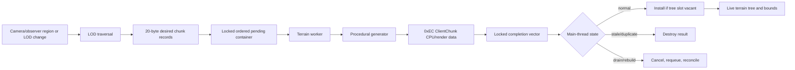

# Analysis checkpoint: asynchronous terrain chunk pipeline

Date: 2026-09-12  
Primary subject: `C:\Stardust-DEV\Stardust.exe`  
SHA-256: `E782BF1C49B3DA730F66B54BC558947C46493F7133F672EED1D8E0C56A6B6150`

## Outcome

This block reconstructs the original client's background procedural-terrain pipeline far enough to constrain a replacement implementation. The client has one dedicated member-function worker, a synchronized ordered request container, a synchronized completion vector, a main-thread three-state reconciliation controller, and explicit stop/signal/join teardown. CPU chunk construction is performed off-thread; ownership transfer into the live terrain tree is performed by the main thread.

Decompiler output is reconstructed pseudocode. Names below are stable provisional names, not recovered source symbols.

## Confirmed findings

### Ownership and synchronization

- RTTI identifies `ClientProceduralTerrainAppearance::ClientChunk` and `MemberFunctionThreadZero<ClientProceduralTerrainAppearance>`. Their vtables are `0x015E731C` and `0x015E66A8`.
- `client_procedural_terrain_construct_VA_00849350` binds worker callback `0x0085EE60` to the terrain appearance and stores the wrapper at `this+0x228`.
- The synchronization region begins at `this+0x20C`; the condition/event object used to wake the worker is at `this+0x224`.
- The stop byte is `this+0x230`, the ordered pending-request container is `this+0x234`, and the completion vector is `this+0x238`.
- Both request and completion payloads are 20-byte/five-dword records. The first three fields are used as chunk-tree coordinates/key components. The final field at `+0x10` is the generated `ClientChunk*`. Exact semantic names for the middle fields remain open.

### Producer and worker

- `terrain_enqueue_chunk_requests_VA_0085F400` locks the shared mutex, rejects requests already completed or already resident, inserts new 20-byte records into the ordered pending container, signals the worker through `0x00B5B4B0`, and unlocks.
- The pending container applies an ordering key involving record field `+0x0C`; this is a scheduling priority/order field, but its exact unit is not yet proven.
- `client_procedural_terrain_worker_entry_VA_0084BFF0` invokes bound member callback `terrain_chunk_worker_loop_VA_0085EE60`.
- The worker waits while the pending container is empty, exits when `this+0x230` is set, removes one request while locked, appends its completion record, unlocks for expensive construction, calls `terrain_build_client_chunk_VA_0084A530`, then relocks and fills the completion record's `ClientChunk*` field.
- The 236-byte (`0xEC`) ClientChunk pool is installed by `0x00860BD0`, with 1,000 initial blocks. `0x0084A530` runs procedural generation and converts the generated result into client render structures.

The completion record is intentionally visible before its pointer is filled. Main-thread code tests the `+0x10` field and stops at an incomplete record while holding the same lock. The observed code therefore does not support calling this a data race.

### Main-thread reconciliation state machine

`terrain_reconcile_completed_chunks_VA_0085EFD0`, called each appearance update, holds the shared mutex and switches on `this+0x22C`:

| State | Observed behavior | Interpretation |
|---|---|---|
| `0` | Walk completed records in order until a null chunk pointer; install into the live terrain tree only if the target slot remains vacant, otherwise destroy the stale/duplicate chunk; clear consumed records and update aggregate bounds. | Normal commit |
| `1` | Destroy completed chunks rather than install them while draining. Once empty, requeue the retained desired-request set and advance to state 2. | Cancellation/drain |
| `2` | Wait until the pending container is empty and every completion is ready; reconcile results with existing nodes, clear completion and retained-request vectors, reset state to 0 and clear `this+0x23C`. | Rebuild/reconciliation completion |

The descriptive state names are **Strongly inferred**. Numeric transitions and ownership actions are **Confirmed by code**.

### LOD and dirty-region trigger

- `terrain_queue_dirty_region_VA_0085F820` appends a 16-byte X/Z region record to `this+0x1F8`.
- `terrain_begin_dirty_region_rebuild_VA_0085F950` pops the newest dirty region, sets busy byte `this+0x23C`, sets state 1, clears pending work, traverses the four-way chunk tree, and retains 20-byte chunk descriptors intersecting the requested region.
- `terrain_lod_visit_and_request_VA_0085EDA0` updates the four-way LOD tree and emits missing chunk requests through the terrain appearance virtual at vtable `+0x188`.
- `0x0085EBE0` recursively subdivides unloaded LOD nodes into four children down to a requested scale and emits requests for leaf nodes.

The subsequent LOD-policy block established that this virtual region path is distinct from camera movement and is strongly inferred to be terrain-change invalidation. Exact caller semantics remain open. Four-child traversal, intersection filtering and request emission are confirmed.

### Shutdown safety

`client_procedural_terrain_destroy_VA_00849FB0` performs this critical ordering:

1. Lock `this+0x20C`.
2. Set stop byte `this+0x230 = 1`.
3. Signal the worker at `this+0x224`, then unlock.
4. Join through `WaitForSingleObject(INFINITE)` at `0x00B8D6B0`.
5. Clear pending requests and destroy uncommitted completion chunks.
6. Release queues, worker wrapper, synchronization objects and terrain ownership.

This proves teardown does not free the terrain owner while its chunk builder is still executing.

## Reconstructed flow

## Replacement requirements

- Keep procedural evaluation and CPU mesh/material preparation off the render thread.
- Use fixed-width request identity plus a generation token, never pointers as cross-job identity.
- Publish immutable completed CPU results to a main-thread commit queue.
- Revalidate residency/generation before installation and discard stale results deterministically.
- Stop accepting work, cancel or drain jobs, join/fence them, then free terrain and asset state.
- Perform engine/GPU object creation on the engine-authorized thread. The original pointer layouts and 1,000-block pool are not compatibility contracts.
- Preserve deterministic PTAT/TGEN interpretation and asset identity.

## Remaining terrain unknowns

1. Exact field labels and units for the 20-byte work record and 16-byte dirty-region record.
2. Exact LOD threshold/height-bias decisions, hysteresis and eviction limits.
3. Which ClientChunk portions are CPU-only versus graphics-resource-backed.
4. WMAP/SMAP client consumers and their relationship to chunk generation.
5. Cross-zone orchestration above terrain destruction, including replicated objects and portal interiors.

## Progress estimate

- Expanded comprehensive whole-client research: **57%**.
- Replacement-relevant behavioral/specification readiness: **78%**.
- Renderer workstream: **62%**.
- Terrain/world/collision/camera/transitions workstream: **38%**.

These figures measure replacement-relevant evidence coverage, not the percentage of raw executable functions named.
