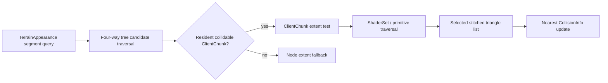

# Analysis checkpoint: terrain collision and surface queries

Date: 2026-09-12  
Primary subject: `C:\Stardust-DEV\Stardust.exe`  
SHA-256: `E782BF1C49B3DA730F66B54BC558947C46493F7133F672EED1D8E0C56A6B6150`

## Outcome

This block traces world-level procedural-terrain collision into resident ClientChunks and proves how chunk triangles implement arbitrary segment collision, height lookup and surface-normal lookup. It also separates these services from render-world/DPVS occlusion geometry and from the server's independent procedural height implementation.

Decompiler output is reconstructed pseudocode. Provisional names are evidence-backed labels, not original symbols.

## Confirmed query hierarchy

`ClientProceduralTerrainAppearance` vtable entry `+0x0c`, `terrain_appearance_collide_VA_0084BDF0`, traverses the active four-way terrain tree for a segment query. Leaf nodes with a live ClientChunk call that chunk's collision virtual at `+0x0c`, `client_chunk_collide_segment_VA_00860F60`. Nodes without a collidable chunk can be tested against their extent as a fallback while traversal continues.

The high-level path initializes the collision result's point from the supplied segment endpoint and visits candidate leaves. It accepts a hit from a leaf object only when the node's collision-enabled flag is set. This establishes broad-phase tree traversal above exact cell triangles.

## Arbitrary segment collision

`client_chunk_collide_segment_VA_00860F60` first rejects a segment that misses the chunk extent. It then visits every material ShaderSet at ClientChunk `+0xB4..+0xB8` and calls `terrain_shader_set_collide_segment_VA_008662E0`.

For every enabled cell primitive, `0x008662E0`:

1. Reads the primitive's currently selected seam index list at `+0x120` and triangle-plane array at `+0x124`.
2. Uses the selected index count divided by three, so collision follows the same 8/7/6-triangle topology used for rendering.
3. Performs a plane-facing/direction rejection.
4. Intersects the segment with the triangle plane.
5. Tests the resulting point against the triangle vertices.
6. Compares squared distance with the best collision already stored.
7. Updates the result with hit point, plane normal and final Euclidean distance when nearer.

The result layout is consistent with a legacy `CollisionInfo`-like value: point begins at `+0x04`, normal at `+0x10`, and distance at `+0x1C`. These offsets are confirmed; the complete type name and all fields are not.

This is geometry collision against the live terrain surface. It does not consult the ClientChunk occlusion model at `+0xDC`.

## Height and normal queries

ClientChunk vtable entries `+0xB8` and `+0xB4` are two vertical surface-query variants:

- `client_chunk_query_height_VA_00860FF0` returns a hit and writes the intersection Y value.
- `client_chunk_query_height_normal_VA_00861140` additionally writes the triangle-plane normal.

Both construct a vertical segment at the requested X/Z coordinate from above the chunk maximum Y to below its minimum Y. They reject the chunk extent first, then call `terrain_shader_set_query_vertical_surface_VA_00866550` for each ShaderSet. That routine bounds-tests X/Z, uses the selected stitched index list, tests X/Z containment against each triangle and produces the intersection point and associated plane normal.

The generic procedural-terrain wrappers at `0x00B5DF50` and `0x00B5DFB0` locate the relevant terrain leaf and dispatch to the ClientChunk `+0xB8` or `+0xB4` virtual respectively. This connects appearance-level surface requests to resident chunk geometry.

## Retained-grid query services

Not every ClientChunk query is geometric collision. The methods at `0x00862720` and wrappers `0x00862880`/`0x008628B0` map world coordinates to array indices and read the 16-bit grids at `+0xCC` or `+0xD0`, then resolve an associated 3-byte classification and group entry. `0x008628E0` indexes the byte grid at `+0xD4` and resolves an environment-group-like entry.

The coordinate-to-grid mapping and element widths are confirmed. Exact labels for the two 16-bit grids and the resolved group types remain tentative; they must not yet be named as collision, flora or radial data without stronger RTTI/caller evidence.

## Occlusion is separate

The detailed or proxy geometry stored at ClientChunk `+0xDC` is attached to the render-world object during chunk activation. Neither segment collision nor vertical surface lookup references `+0xDC`. Gameplay/camera surface queries therefore use the stitched cell primitives, while the optional real/proxy model exists for visibility/occlusion.

## Server correlation and compatibility consequence

Stardust server source independently evaluates PTAT/TGEN rules in `ProceduralTerrainAppearance::getHeight()` and uses that result for movement, placement, missions, structures and other authoritative systems. Its collision manager also compares terrain and water height. The client path recovered here instead queries the generated resident triangle surface when a ClientChunk is available.

This creates an important replacement requirement:

- authoritative server height/passability remains the server's procedural result;
- client visual collision and height must be generated deterministically enough to agree with that result within expected precision;
- wire formats do not carry native pointers or ClientChunk layouts;
- a replacement may use an engine-native BVH/heightfield, but it must build it from the same generated geometry/material-domain inputs and keep collision topology synchronized with LOD seams;
- occlusion proxies must never become authoritative terrain collision accidentally.

## Confidence

| Finding | Confidence |
|---|---|
| TerrainAppearance tree traversal calls ClientChunk collision virtual | Confirmed |
| ClientChunk collision tests its extent then every ShaderSet | Confirmed |
| Collision uses the current stitched triangle list and stored planes | Confirmed |
| Nearest result contains point, normal and distance at recovered offsets | Confirmed |
| Vertical X/Z query yields height and optional normal | Confirmed |
| Occlusion geometry is excluded from surface collision/query paths | Confirmed |
| `+0xCC`, `+0xD0`, `+0xD4` exact semantic group names | Unknown/tentative |
| Exact tolerance constants and backface-policy names | Tentative |

## Remaining unknowns

1. Exact semantic identities of the retained `+0xC8/+0xCC/+0xD0/+0xD4/+0xD8` grids.
2. Exact public type/flag names for collision parameters and the complete collision-result structure.
3. Whether any movement or camera callers intentionally request two-sided terrain collision.
4. Numeric tolerance at LOD edges and agreement with server-side procedural height.
5. WMAP/SMAP participation in passability, minimap or non-render surface queries.
6. Interior floor/cell collision, which is a separate portalized-world system.

## Progress estimate

- Expanded comprehensive whole-client research: **60%**.
- Replacement-relevant behavioral/specification readiness: **81%**.
- Renderer workstream: **67%**.
- Terrain/world/collision/camera/transitions workstream: **58%**.

These estimates measure replacement-relevant evidence, not the percentage of raw functions assigned names.
