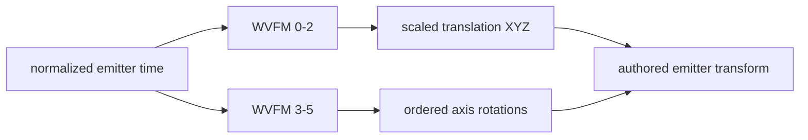

# EMTR sixteen-channel waveform runtime map

Date: 2026-09-13  
Authority: `C:\Stardust-DEV\Stardust.exe`, SHA-256 `E782BF1C49B3DA730F66B54BC558947C46493F7133F672EED1D8E0C56A6B6150`

## Result

The sixteen ordered `WVFM` members common to modern `EMTR` descriptions are now mapped to their runtime evaluation sites. Ten have confirmed or strongly supported behavioral roles, three form emitter transform rotation, and three are confirmed dormant-zero channels in every effective deployed emitter. Their original editor labels remain unknown.

Confidence terminology remains conservative: **Confirmed** means both evaluation and downstream state use are visible; **Strong** means the mathematical role is visible but the original editor label or Euler-axis naming is unavailable; **Unknown** means no behavior is assigned.

## Channel map

| # | Member | Runtime role | Confidence | Primary evidence |
|---:|---:|---|---|---|
| 0 | `+0x3C` | emitter translation X | Confirmed | evaluated at `0x007A2F7D`, scaled and added to transform X |
| 1 | `+0x54` | emitter translation Y | Confirmed | evaluated at `0x007A2F96`, scaled and added to transform Y |
| 2 | `+0x6C` | emitter translation Z | Confirmed | evaluated at `0x007A2FAF`, scaled and added to transform Z |
| 3 | `+0x84` | second/Y-like emitter rotation channel | Strong | evaluated at `0x007A2F22`, passed to matrix rotation helper `0x00AB8EA0` |
| 4 | `+0x9C` | first/X-like emitter rotation channel | Strong | evaluated at `0x007A2EF3`, passed to matrix rotation helper `0x00AB8E10` |
| 5 | `+0xB4` | third/Z-like emitter rotation channel | Strong | evaluated at `0x007A2F51`, passed to matrix rotation helper `0x00AB8F30` |
| 6 | `+0xCC` | spawn direction/spread magnitude | Strong | evaluated at `0x007A39F9`; contributes to pre-speed direction construction |
| 7 | `+0xE4` | spawn-position/shape extent scale | Strong | evaluated at `0x007A39DD`; scales the concrete shape's generated vector |
| 8 | `+0xFC` | angular spread for direction mode 1 | Strong | evaluated at `0x007A3AD9`; randomized sign feeds sine/cosine direction construction |
| 9 | `+0x120` | particle generation rate | Confirmed | evaluated at `0x007A6A0B`; integrated into emitter accumulator `+0x58` |
| 10 | `+0x138` | initial particle speed | Confirmed | evaluated at `0x007A3E31`; multiplies all three spawned velocity components |
| 11 | `+0x150` | dormant zero-valued compatibility waveform; original label unknown | Confirmed for deployed corpus | no executable-wide direct displacement read; all 6,373 records have zero value lanes |
| 12 | `+0x168` | dormant zero-valued compatibility waveform; original label unknown | Confirmed for deployed corpus | no executable-wide direct displacement read; all 6,373 records have zero value lanes |
| 13 | `+0x180` | dormant zero-valued compatibility waveform; original label unknown | Confirmed for deployed corpus | no executable-wide direct displacement read; all 6,373 records have zero value lanes |
| 14 | `+0x198` | particle lifetime | Confirmed | evaluated at `0x007A3E65`, stored at particle `+0x48`; age is compared to and divided by it at `0x007A486C`/`0x007A4880` |
| 15 | `+0x1B0` | gravity acceleration scale | Confirmed | evaluated at `0x007A3E85`, stored at particle `+0x64`; integrated into vertical motion at `0x007A49A8` |

## Transform path

`particle_emitter_update_authored_transform_VA_007A2E10` evaluates channels 0-5. Rotation channels are applied to a temporary transform through three distinct matrix-axis helpers, while translation channels are scaled by the owning effect scale and added to the transform's translation vector. The unusual evaluation order (channel 4, then 3, then 5) is observable compatibility behavior if the rotation helpers compose rather than overwrite.

## Spawn path

`particle_emitter_initialize_spawned_particle_VA_007A3990` evaluates channels 6-8 to combine a concrete shape-generated vector with a direction/spread basis. The description mode at `+0x1C` selects between two construction branches. The result produces a spawn offset and direction; channel 10 subsequently scales the direction into initial velocity. Channel 14 becomes the particle lifetime. Channel 15 becomes a per-particle gravity magnitude.

The shape object itself is therefore responsible for generating the normalized/random source vector for circle, sphere, rectangle, cube, line or X geometry. The emitter description supplies time-varying extent, spread and speed.

## Generation and lifetime

`particle_emitter_advance_generation_accumulator_VA_007A6980` evaluates channel 9 using normalized emitter time, then updates the runtime generation accumulator. It coordinates:

- continuous versus alternate accumulation selected by description `+0x20`;
- capacity comparison against description `+0x2C`;
- optional integer burst selection from inclusive `+0x34..+0x38`;
- the 0013 backlog-policy byte at `+0x228`;
- repeated calls to the single-particle spawn routine.

Particle age is accumulated at particle `+0x04`; reaching channel-14-derived lifetime `+0x48` expires or loops the particle according to later policy. The ratio `age / lifetime` is cached at `+0x70` and drives nested quad/mesh particle-description waveforms.

Gravity is not a renderer feature. Channel 15 is evaluated once at spawn, scaled by owning effect scale, stored per particle, and integrated during simulation.

## Three dormant channels

Channels 11-13 (`+0x150`, `+0x168`, `+0x180`) are constructed, copied, loaded and saved like the other waveform objects. An executable-wide direct-displacement scan found no runtime read. Constructor/reset helpers at `0x007B9860`, `0x007B9880`, and `0x007B98B0` invoke the random-key builder at `0x00ABF420` with value bounds `0.0, 0.0`; the latter two additionally enable the waveform's zero lower clamp.

A corrected no-external-padding IFF walk inspected all 101,968 modern waveform records: 6,373 emitters times sixteen channels. Each channel has 1,882 `WVFM/0001` and 4,491 `WVFM/0002` records. Loader `0x00ABFAA0` dispatches those versions to `0x00ABFD00` and `0x00ABFE00`; version 0001 has a 12-byte header and version 0002 a 20-byte header, followed in both cases by 16-byte keys. Every key in ordinals 11-13 has zero in all three non-time lanes. Their many byte-level hashes and sizes come only from randomized key counts/times generated by the default initializer, not authored nonzero behavior.

This closes their behavioral requirement for the installed corpus: a normalized importer may represent them semantically as constant zero while retaining their original serialized forms for lossless round-trip/debugging. It does **not** recover their historical editor-facing names, and it does not prove that some other unreleased asset corpus never authored them.

## Replacement-client requirements

1. Evaluate emitter transform channels independently from particle-local channels.
2. Preserve the executable's transform composition order.
3. Keep generation accumulation and spawning in deterministic simulation code.
4. Store lifetime, normalized age and gravity as per-particle runtime state.
5. Let shape implementations generate geometry-neutral spawn vectors.
6. Feed already simulated position/orientation/size/color into the renderer.
7. Treat channels 11-13 as constant zero for deployed-asset execution, but retain their raw records when lossless round-trip fidelity is required.

## Next bounded analysis

Decode the nested `ParticleDescriptionQuad`/`PTQD` and common `PTCL` channels. These own the age-normalized visual evolution seen in the runtime—rotation, length/width/size, color/alpha and texture animation—and are the next dependency for original-asset rendering compatibility.
