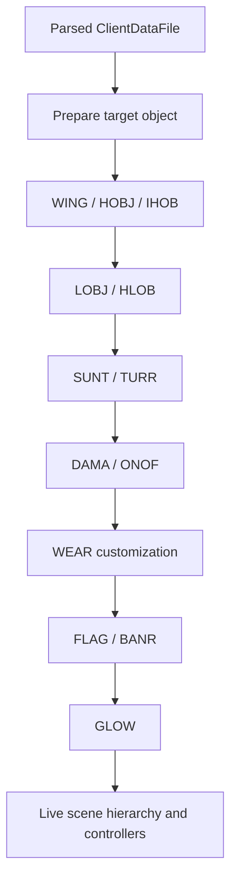

# ClientDataFile Runtime Application Order

Date: 2026-09-21

## Result

`FUN_00604420` is the central `ClientDataFile::applyToObject`-like routine. It consumes the typed records retained by the CLDF loader and builds the target object's local presentation hierarchy in a fixed order. This closes the bridge between the previously documented file grammar and runtime object ownership.

## Confirmed application sequence

The routine first performs common target-object preparation through `FUN_00609830`, then processes these retained record collections:

1. `ClientDataFile +0x20` (`WING`): create a referenced object-template instance or appearance-only child, resolve its attachment transform, and install the wing motion/controller state when configured.
2. `+0x24` (`HOBJ`): create the referenced appearance object and attach it at the named hardpoint.
3. `+0x28` (`IHOB`): resolve the hardpoint, create the child, and install an interpolating attachment controller when the interpolation parameters are nonzero.
4. `+0x2c` (`LOBJ`): create a light using `FUN_006095d0`, then apply its local position and rotations.
5. `+0x30` (`HLOB`): create a light and attach it to a named hardpoint.
6. `+0x3c` (`SUNT`): create the turntable and disk children, connect the two named hardpoints, and install the sun-tracker controller.
7. `+0x40` (`TURR`): create the turret base and barrel hierarchy, attach both at their named hardpoints, apply angular constraints, and install the weapon/muzzle controller.
8. `+0x44` (`CNCF`): connect a singleton object-lifetime receiver when clear-flora exclusion circles exist. The receiver later obtains the object's CDF and registers/unregisters those circles with the terrain/world system.
9. `+0x48` (`DAMA`): register the damage-change event key `0xa0bd02c5` when damage records exist and apply the initial damage tier through `FUN_00605ea0(..., 0)`.
10. Apply initial `ONOF` state through `FUN_006055f0`; its state argument is derived from the target appearance/portal state.
11. `+0x50` (`WEAR`): apply wearable entries through `FUN_006feec0` when the target appearance supports customization, followed by `FUN_006fedb0` when at least one entry exists.
12. `+0x54` (`FLAG`): instantiate each flag controller through `FUN_006fe8f0`.
13. `+0x58` (`BANR`): instantiate each structure-banner controller through `FUN_006fe440`.
14. Create the `GLOW` presentation last through `FUN_006052d0(..., 0)`.

This is a presentation-composition order, not merely a parsing order. A replacement client should retain it where later components depend on earlier hardpoint children or customization state.

## Attachment resolution

`FUN_006031f0` walks an object and, when permitted by the object's parent flag, its parent chain. It attempts to resolve a named hardpoint transform from each object's appearance. A global-name predicate can also satisfy the lookup. The helper returns success after releasing the queried string/key object. This establishes that CDF attachment references are resolved against the live appearance hierarchy, not pre-baked into the CDF record.

## Damage-state helper

`FUN_00605d10` clears or reinitializes the target's current damage presentation, optionally restores a full-health/default value, then chooses between the base destruction appearance at `ClientDataFile +0x38` and the damage tier associated with event CRC `0xa0bd02c5`. This supports the existing interpretation of `DAMA`/`DSTR` as stateful presentation layers driven by object damage changes.

## Ownership and cleanup observation

`FUN_006097c0` is not a per-CDF attachment helper. It iterates a global object collection and destroys entries whose owner/reference predicate no longer matches the supplied object. It is therefore provisionally named as a global prune-by-owner callback and kept distinct from the normal `applyToObject` sequence.

The apply routine allocates ordinary client objects, appearance-only objects, lights, and controllers, then hands them into the existing object/parent/controller ownership systems. The 64-bit replacement must use explicit handles or owning smart references internally; it must not reproduce the original 32-bit raw-pointer/vector layouts. Resource paths, hardpoint names, angular values, and record ordering remain file-visible compatibility data.

## Conceptual flow

## Confidence

- Central apply role and record processing order: confirmed by decompiled control flow.
- Hardpoint lookup walking the live object/appearance parent chain: confirmed.
- Damage event CRC and initial-tier application: confirmed.
- Exact class names for several controller allocations: provisional.
- Exact historic class names for the `CNCF` notification receiver and terrain registration interface remain unknown; their behavior is established.
- Global prune callback's precise collection type: unknown.
