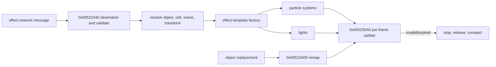

# ClientEffectManager: network ingress, effect creation, tracking, and retirement

Scope: the contiguous `Stardust.exe` manager cluster at `0x00522070..0x00523E88`, plus Stardust server packet constructors. This closes the runtime bridge from three incoming effect-message families to transient client effects.

## Install and message dispatch

`0x00522360` installs a message receiver for:

| Message | Server opcode/evidence | Client action | Confidence |
|---|---|---|---|
| `PlayClientEffectObjectMessage` | `0x8855434A`; server writes effect ASCII, hardpoint/aux ASCII, and uint64 object ID | Resolve object ID, resolve effect template, play it relative to the object/hardpoint. | Confirmed |
| `PlayClientEffectObjectTransformMessage` | Class name is registered and dispatched in the executable; no matching Stardust constructor found | Resolve object and effect, then play using an object-relative transform. | Strongly inferred |
| `PlayClientEffectLocMessage` | `0x02949E74`; server writes effect, zone, x/z/y, cell uint64, terrain delta, label | Validate scene/zone, resolve cell/world location, compensate terrain/interior coordinates, then play at a world transform. | Confirmed, with some helper names inferred |

The receive callback is `0x00522440`. It compares the dispatch type against all three registered names, constructs the appropriate archive wrapper, extracts fields, resolves object/scene context, invokes one of three effect-play wrappers, and releases all temporary strings/archive objects. Scene mismatch, missing cell, or unavailable terrain/interior context exits without creating an effect.

Server constructors confirm two wire layouts directly:

```text
PlayClientEffectObjectMessage:
  operand 5, opcode 0x8855434A, effect ASCII, aux/hardpoint ASCII, objectId uint64

PlayClientEffectLocMessage:
  operand 9, opcode 0x02949E74, effect ASCII, zone ASCII,
  x float32, z float32, y float32, cellId uint64,
  terrainDelta int32, label ASCII
```

Internal pointers/handles are not wire values; the uint64 object/cell identifiers must remain exactly 64-bit in an x64 replacement.

## Creation wrappers and managed records

| Address | Provisional name | Behavior | Confidence |
|---|---|---|---|
| `0x00523020` | `playClientEffectAtObjectHardpoint` | Calls the object/hardpoint effect factory, starts a returned effect, releases the temporary effect handle, and reports success. | Strong |
| `0x00523060` | `playClientEffectAtObjectTransform` | Same ownership contract for an object-relative transform. | Strong |
| `0x005230A0` | `playClientEffectAtLocation` | Same ownership contract for a world/cell location. | Strong |
| `0x005230E0` | `trackManagedLight` | Allocates an 84-byte managed-light record, keeps referenced owner/target objects, effect handle, lifetime, and a 3x4 transform; appends it to the light vector. | Strong |
| `0x005232B0` | `trackManagedParticleSystem` | Allocates an 88-byte managed-particle record with the same core fields plus a one-byte termination-policy flag; appends it to the particle vector. | Strong |
| `0x00523480` | `queueEffectObjectRemap` | Appends an 8-byte old/new object-handle pair for deferred remapping. | Tentative |

Separate fixed-block managers are installed for 88-byte `ManagedParticleSystem` records and 84-byte `ManagedLight` records. These are implementation pools, not asset or protocol formats.

## Per-frame maintenance

`0x005235A0` is the manager update:

- recomputes tracked transforms from the referenced owner/attachment context;
- applies updated transforms to both particles and lights;
- subtracts frame delta from the remaining lifetime;
- removes expired or invalid records;
- gives particle systems a policy-controlled opportunity to finish naturally, otherwise stops/releases them;
- compacts the pointer arrays after removal.

`0x00523960` removes all managed particle systems associated with a particular referenced object. `0x00523A00` remaps effects from one object to another, optionally constrained by a clipping plane and optionally forcing attached particle systems to reparent/restart their attachment state. This is important during client object replacement/appearance transitions.



## Replacement-client requirements

- Preserve the two confirmed wire layouts byte-for-byte, including x/z/y ordering and uint64 IDs.
- Treat `.cef` as an original-asset compatibility boundary; a modern renderer may redesign GPU particles/lights but must interpret the effect graph behavior.
- Use generation-checked entity handles or weak references for managed effects. Do not carry legacy 32-bit pointers into delayed updates.
- Keep missing object/cell/scene resolution nonfatal and discard the presentation request cleanly.
- Separate authoritative messages from transient presentation state: effect lifetime, attachment, remap, and GPU resources are client-local.

## Remaining unknowns

- Stardust currently has no constructor for `PlayClientEffectObjectTransformMessage`; its exact wire field order still needs either a server implementation elsewhere or direct archive-constructor recovery.
- Several engine helper classes inside the `.cef` factory remain provisionally typed, but their manager-level ownership and lifecycle are now clear.
