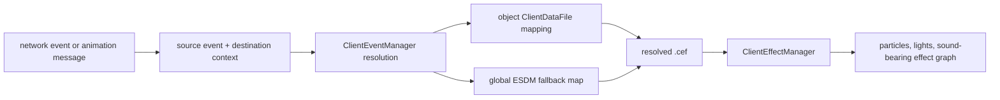

# ClientEventManager and animation-message event routing

Scope: `ClientEventManager` (`0x005F10D0..`) and `GameAnimationMessageCallback` (`0x00623470..`), the effective `misc/client_event_source_dest_map.iff`, and the corresponding Stardust server packet constructor.

## Architectural finding

The client has a data-driven event layer above `ClientEffectManager`. A client event is not itself an effect resource. It is a symbolic source/destination pair that is resolved through object `ClientDataFile` metadata and a global fallback map, producing a `.cef` request that is handed to the already documented effect manager.



## Install and network ingress

`0x005F10D0` installs the manager, a listener, and receivers for `PlayClientEventObjectMessage` and `PlayClientEventLocMessage`; it also loads `misc/client_event_source_dest_map.iff`. `0x005F11E0` is the receive callback.

| Message | Server/executable evidence | Result | Confidence |
|---|---|---|---|
| `PlayClientEventObjectMessage` | Stardust constructor: operand 5, opcode `0xAF83C3F2`, event ASCII, aux/destination ASCII, object ID uint64 | Resolve object and symbolic event, then dispatch object-attached or hardpoint/transform presentation. | Confirmed |
| `PlayClientEventLocMessage` | Registered and parsed by the client; no Stardust constructor found | Resolve scene/cell/world location and dispatch symbolic event at that location. | Strongly inferred |
| `PlayClientEventObjectTransformMessage` | RTTI/class name exists in the executable, but this manager's observed installer does not register it | Dormant/other-path compatibility type, not an active receiver in this manager build. | Confirmed registration absence; semantics tentative |

The object packet layout is therefore directly recoverable and wire-stable:

```text
uint16 operand=5
uint32 opcode=0xAF83C3F2
ASCII event
ASCII aux/destination
uint64 objectId
```

## Global source/destination map

The effective asset is from `mtg_patch_013_configurable_02.tre` (configured priority 42), `FORM ESDM/FORM 0000`, with eleven `EMAP` chunks. Each chunk is exactly three NUL-terminated strings: source, destination, resolved effect.

| Source | Destination | Effect |
|---|---|---|
| `EVENT_SOURCE_footstep` | `EVENT_DEST_dirt` | `clienteffect/dirt_footstep.cef` |
| `EVENT_SOURCE_footstep` | `EVENT_DEST_grass` | `clienteffect/grass_footstep.cef` |
| `EVENT_SOURCE_footstep` | `EVENT_DEST_water` | `clienteffect/water_footstep.cef` |
| `EVENT_SOURCE_footstep` | `EVENT_DEST_interior` | `clienteffect/interior_footstep.cef` |
| `EVENT_SOURCE_footstep` | `EVENT_DEST_cement` | `clienteffect/cement_footstep.cef` |
| `EVENT_SOURCE_footstep` | `EVENT_DEST_desert` | `clienteffect/desert_footstep.cef` |
| `ranged` | `missterrain` | `clienteffect/combat_bls_1_red_miss_terrain_01.cef` |
| `ranged` | `misswater` | `clienteffect/combat_bls_1_red_miss_water_01.cef` |
| `ranged` | `misshittarget` | `clienteffect/combat_bls_1_red_miss_creature_01.cef` |
| `ranged` | `misshitother` | `clienteffect/combat_bls_1_red_miss_creature_01.cef` |
| `ranged` | `hittarget` | `clienteffect/combat_bls_1_red_hit_creature_01.cef` |

`0x005F1910` opens `ESDM/0000`; `0x005F19B0` parses `EMAP` records into two lookup structures. `0x005F1F10` and `0x005F2080` perform source and destination lookups. The split structures support resolving a source key and then a destination-specific resource rather than treating the pair as a single opaque string.

## Runtime resolution

| Address | Provisional name | Behavior | Confidence |
|---|---|---|---|
| `0x005F1C60` | `playClientEventOnObject` | Wrapper for same-object event resolution. | Strong |
| `0x005F1C80` | `playClientEventAtObjectTransform` | Wrapper selecting transform-oriented arguments. | Strong |
| `0x005F1CA0` | `playClientEventSourceToDestination` | Wrapper with distinct source and destination objects. | Strong |
| `0x005F1CD0` | `resolveAndPlayClientEventOnObjects` | Validates objects/templates/client-data, resolves event resource, and routes it to object hardpoint, object transform, or a non-`.cef` presentation handler based on resource prefix. | Strong |
| `0x005F1EB0` | `resolveAndPlayClientEventAtLocation` | Resolves source/destination event names and passes the resulting resource to the location effect wrapper. | Strong |

Missing object, template, client data, symbolic mapping, or effect resource returns false without destabilizing the scene.

## Animation message grammar

`0x00623470` installs `GameAnimationMessageCallback` and registers callback state. `0x00623530` attaches `0x00623570` to an object's appearance/animation notification route. The callback recognizes six prefixes:

- `event_...`: event on the animated object, with footstep specialization;
- `hpevent_...`: hardpoint event syntax, parsed with a bounded 260-byte buffer;
- `swing_...` and `uswing_...`: directed swing event variants;
- `hit_...` and `uhit_...`: directed hit event variants with validated target-selection categories.

For footsteps, the callback first looks for an explicit animation suffix. If absent it builds a `footstep_<surface>`-style destination from the object's current surface classification, then calls `ClientEventManager`. Swing/hit variants choose source/destination objects using animation-combat context and then call `0x005F1CA0`.

## Replacement-client requirements

- Original animation assets can emit semantic strings; those strings are part of the compatibility contract and must reach the event router.
- Preserve the ESDM file format and overlay precedence. The map is content, not renderer code.
- Preserve uint64 object IDs on the wire while using internal generation-safe handles.
- Keep symbolic client events separate from resolved `.cef` assets. This allows original assets to work while the modern particle/audio/render backends are redesigned.
- Enforce bounded parsing for animation-message suffixes and treat malformed/unknown messages as ignorable presentation events.

## Remaining unknowns

- The exact wire layout/opcode of `PlayClientEventLocMessage` is not supplied by this Stardust source tree and remains to be recovered from its archive constructor.
- A few target-category numeric values in `hit_`/`uhit_` resolution are known to be accepted (`1`, `2`, `4`) but their original enum labels remain provisional.
- Non-`.cef` resource-prefix branches in `0x005F1CD0` need dedicated classification, although the main client-effect path is closed.
