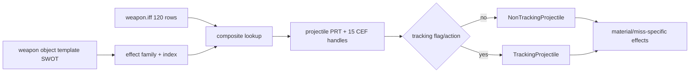

# ClientWeaponObjectTemplate and ground-weapon presentation table

Scope: `ClientWeaponObjectTemplate` install/construction at `0x0060F240..0x0060FD49` and the effective `datatables/weapon/weapon.iff`. This is the ground-weapon presentation counterpart to the space projectile table.

## Effective weapon table

The effective table is supplied by `mtg_patch_022.tre` at configured priority 51. It contains 120 rows. Each row is keyed by a string `Weapon Effect Id` plus integer `Weapon Effect Index`, then defines:

- projectile appearance template (`.prt`);
- firing/muzzle `.cef`;
- hit effects for creature, metal, stone, wood, and other;
- miss effects for water, terrain, creature, metal, stone, wood, other, and nothing;
- ricochet `.cef`.

This is a 19-column presentation schema. The first rows demonstrate indexed red, green, and blue `bolt` variants, but the full corpus supplies many effect families. Case varies (`clientEffect/...`), so compatibility lookup should normalize exactly as the original resource system does rather than assume case-sensitive host filesystem semantics.

## Runtime loading

| Address | Provisional name | Behavior | Confidence |
|---|---|---|---|
| `0x0060F240` | `ClientWeaponObjectTemplate::install` | Installs the shared weapon-template base, registers tag `SWOT`, loads `datatables/weapon/weapon.iff`, builds a composite ID/index lookup, and registers cleanup. | Confirmed |
| `0x0060F4F0` | `ClientWeaponObjectTemplate::ctor` | Constructs the shared weapon template base and initializes client-only projectile/effect storage. | Strong |
| `0x0060F9C0` | `ClientWeaponObjectTemplate::postLoad` | Reads the weapon's effect family and index from template data, resolves the table row, fetches the projectile appearance, and preloads fifteen named `.cef` categories; empty effect names generate explicit warnings. | Strong |
| `0x0060F830` | `ClientWeaponObjectTemplate::createProjectile` | Creates either `TrackingProjectile` (`0x108`) or `NonTrackingProjectile` (`0x138`) based on template/action flags and supplies the template's loaded appearance/effect set. | Strong |
| `0x0060FD50` | `ClientWeaponObjectTemplate::create` | Allocates the 0x4A8-byte legacy concrete template wrapper from the registered `SWOT` factory. | Strong |

The client object template contains fifteen managed effect handles corresponding to the table's fire/hit/miss/ricochet categories. Those references are released by `0x0060F600`.

## Presentation flow

## Relationship to server state

Server combat and object-template data choose weapon behavior and send combat/playback outcomes. The client template uses the local effect family/index to select original presentation assets. These table rows do not authorize hits, damage, or range; they determine how already-decided actions look and sound.

## Replacement-client requirements

- Support `SWOT` client weapon templates and their inherited shared-template fields sufficiently to recover the effect family/index.
- Preserve `weapon.iff` composite-key lookup and all 120 effective rows under TRE overlay precedence.
- Preserve every semantic outcome category, including the distinction between hit and miss-on-creature and between miss-terrain/water/nothing.
- Route `.prt` and `.cef` through the original-asset compatibility layer; do not flatten the table into renderer constants.
- Replace fifteen raw/reference-wrapper members with typed resource handles. Legacy 0x4A8/0x3E0 allocation sizes are not x64 ABI requirements.
- Missing/empty resources should be diagnosed and handled safely, not substituted with invented assets.

## Remaining unknowns

- The complete inherited `SWOT` binary field layout is governed by the shared object-template loader and has not been rewritten field-by-field here.
- The precise flag names selecting tracking versus nontracking creation remain provisional, although the concrete class branch and sizes are confirmed.
