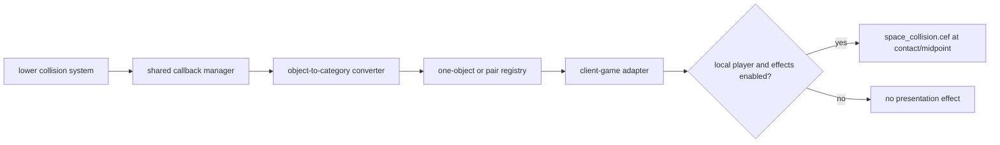

# Collision callback registry and client collision presentation

Scope: the shared `CollisionCallbackManager` at `0x011FE4E0..` and the client-game `CollisionCallbacks` adapter at `0x005890E0..`. This block documents routing/policy; it does not replace the separately analyzed terrain and projectile geometry queries.

## Shared callback manager

`0x011FE4E0` installs the shared manager into the lower collision system and registers three global hooks: no-collision-this-frame, collision-on-hit, and an ignore/intersection predicate. It requires a client-supplied `Object* -> integer type/index` converter.

The registry supports two callback shapes:

- `0x011FE5D0`: one-object callback keyed by a single integer category;
- `0x011FE650`: pair callback keyed by two integer categories.

`0x011FEC70` converts an object to its category and invokes a registered one-object callback. `0x011FECE0` converts both objects, searches the nested pair-callback map, and invokes the matching callback. Null objects or a missing converter are fatal programming errors, while a missing category registration simply produces no callback.

The manager also maintains an ignore-intersection set with reference-counted entries. Its removal diagnostic explicitly states that a nonempty ignore list indicates a reference-counting problem. This makes ignore registration/removal a balanced lifetime contract, not a fire-and-forget flag.

## Client adapter registration

`0x005890E0` installs the client adapter and supplies:

- the object-to-category converter;
- per-frame/reset callback(s);
- a one-object callback for category `0x20000001`;
- pair callbacks between `0x20000001` and `0x20000001`, `0x20000002`, `0x20000003`, `0x20000004`, `0x00002023`, `0x20000005`, and `0x20000006`.

The original symbolic names of those integer categories are not present in this block, so they remain numeric rather than being guessed.

The adapter preloads `clienteffect/space_collision.cef` through the client-effect-template manager and exposes `ClientGame/CollisionCallbacks.ignoreCollision` as a runtime option.

## Client collision behavior

| Address | Provisional name | Behavior | Confidence |
|---|---|---|---|
| `0x005892E0` | `convertCollisionObjectToIndex` | Validates non-null input and derives the collision registry category from the client object. | Strong |
| `0x00589340` | `handleSimplePlayerCollision` | If collision effects are enabled and the first object is the local player object, plays the space-collision effect at the midpoint of both object transforms, once per reset interval. | Strong |
| `0x00589420` | `handleDetailedPlayerCollision` | For the local player, asks the shared manager for collision/contact data, derives a contact transform, and plays the collision effect once. | Strong |
| `0x005894D0` | `dispatchPlayerCollisionPresentation` | Chooses detailed or simple handling based on current scene/world context. | Strong |

The once-only byte is reset by the client callback chain, preventing multiple registered object pairs from producing an effect storm during one frame/contact interval.

## Replacement-client requirements

- Preserve the separation between collision detection and game/presentation callbacks.
- Replace numeric category lookup internally with typed collision layers/categories, but retain a compatibility mapping for original behaviors.
- Use RAII tokens for ignore-intersection registrations so balanced removal is structurally enforced.
- Reset per-frame suppression deterministically at the frame boundary.
- Route the original `space_collision.cef` through the compatibility effect system; renderer/physics redesign must not discard that asset behavior.
- Client collision callbacks are presentation and local movement policy, not server-authoritative damage evidence.

## Remaining unknowns

- Symbolic labels for the registered integer categories remain unknown; assigning names without RTTI/caller evidence would be speculative.
- The exact lower-level contact manifold structure passed through `0x011FE6F0` remains only partially typed, although position/normal/contact-transform use is clear.
