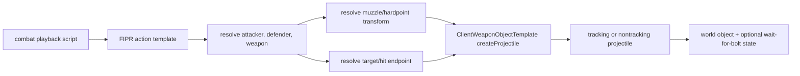

# FireProjectileAction: combat playback to projectile presentation

Scope: `FireProjectileAction`, `FireProjectileActionTemplate`, and `WaitForBoltActionTemplate` around `0x005FCD00..0x005FE1EB`. This closes the ground-combat playback bridge from an action script to `ClientWeaponObjectTemplate::createProjectile`.

## Action-template format

`0x005FD1B0` installs `FireProjectileActionTemplate` with the playback-script action registry. The template loader accepts `FORM FIPR`, version `FORM 0000`, containing `INFO`.

`0x005FD790` proves the version-0000 payload field widths and order:

```text
int16
int32
int32
int32
int16
uint8/bool
int16
int16
```

The 52-byte runtime template stores those values at offsets `+0x08` through `+0x24`; three four-character tags default to `NONE`, and three signed indices default to `-1`. When the boolean is true and its associated index is negative, the loader sets an additional derived flag at `+0x2C`. Original source enum/field labels are not present, so this checkpoint deliberately records the stable binary contract without inventing names.

## Runtime action

| Address | Provisional name | Behavior | Confidence |
|---|---|---|---|
| `0x005FCDB0` | `FireProjectileAction::installMemoryPool` | Installs a fixed-block pool for 0x21C-byte legacy action instances. | Confirmed |
| `0x005FCFC0` | `FireProjectileAction::ctor` | Constructs the playback action and registers a callback/listener used during its lifetime. | Strong |
| `0x005FD1B0` | `FireProjectileActionTemplate::install` | Registers the FIPR factory plus projectile-creation diagnostics option. | Confirmed |
| `0x005FD690` | `FireProjectileActionTemplate::ctorFromIff` | Initializes defaults, validates `FIPR`, and dispatches version 0000. | Confirmed |
| `0x005FD790` | `FireProjectileActionTemplate::load_0000` | Reads the eight-field `INFO` payload and derives one compatibility flag. | Confirmed |
| `0x005FD3B0` | `FireProjectileAction::update` | Resolves actors/weapon, computes muzzle and target endpoints, asks the client weapon template to create the projectile, attaches it to the world, starts associated appearance/controller state, records optional bolt-wait state, and completes according to projectile/action lifetime. | Strong |
| `0x005FDBC0` | `FireProjectileAction::createProjectile` | Validates that the playback weapon uses `ClientWeaponObjectTemplate`, invokes `0x0060F830`, and seeds projectile timing. | Strong |
| `0x005FDC80` | `FireProjectileAction::transformEndpointsToCommonCell` | Converts muzzle/target points between world and cell frames and normalizes direction. | Strong |
| `0x005FDE40` | `FireProjectileAction::configureTravel` | Computes distance/speed timing and applies projectile travel parameters, including a small default/fallback scalar. | Strong |
| `0x005FE110` | `WaitForBoltActionTemplate::install` | Registers a companion playback action that waits on projectile/bolt state. | Confirmed |

## Data flow



Several muzzle CRC strings are initialized (`muzzle`, `muzzle2`, `muzzle3`, `muzzle4`, and another adjacent muzzle key), supporting weapons with multiple alternating launch hardpoints.

## Replacement-client requirements

- The playback-script interpreter must support `FIPR/0000/INFO` and retain its exact field widths/tags.
- Resolve action actors and weapon objects through safe playback/entity handles, never stored raw 32-bit addresses.
- Preserve multi-muzzle hardpoint lookup and cell/world endpoint conversion.
- Delegate projectile visuals to the asset-driven client weapon template; do not embed weapon effect choices in the action interpreter.
- Preserve the companion wait-for-bolt synchronization concept so later playback actions can depend on projectile progress/completion.
- Treat projectile creation failure as a logged presentation failure, not a reason to alter server combat results.

## Remaining unknowns

- Original semantic names for the eight `INFO` fields and three `NONE` tags require broader playback-script schema recovery or matching tool source.
- A few optional branches create ancillary appearance/controller objects; their precise original class labels remain tentative, though they do not change the core projectile bridge.
