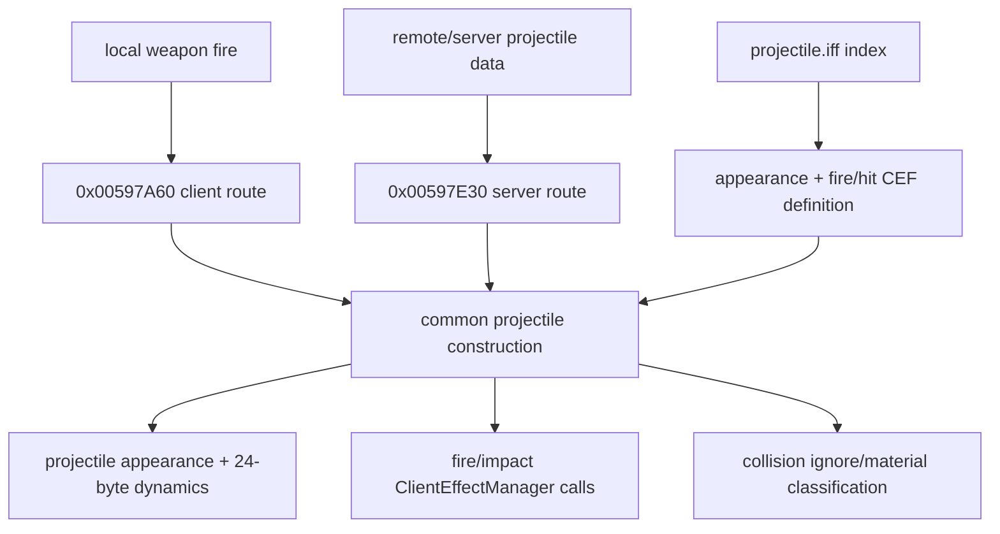

# ProjectileManager, projectile presentation table, and creation paths

Scope: the `Stardust.exe` cluster `0x00596E30..0x005988CA`, the effective `datatables/projectile/projectile.iff`, and Stardust's `CreateProjectileMessage` implementation.

## Data-driven projectile definitions

The effective table comes from `mtg_patch_013_configurable_02.tre` at configured priority 42. It has 17 rows (`index` 0 through 16) and thirteen columns:

1. integer `index`;
2. projectile `appearanceTemplateName` (`.prt`);
3. firing `.cef`;
4. generic/other-hit `.cef`;
5. metal-hit `.cef`;
6. stone-hit `.cef`;
7. acid-hit `.cef`;
8. ice-hit `.cef`;
9. molten-stone-hit `.cef`;
10. obsidian-stone-hit `.cef`;
11. shield-hit `.cef`;
12. shield-shell-hit `.cef`;
13. friendly-fire-hit `.cef`.

Rows cover red/green/blue space bolts, slug thrower, disruptor, lightning, ion, flash, advanced laser, proton/acid ion variants, and turbolaser. The table therefore binds a compact projectile index to original visual assets and material-specific impact effects. It is not a physics or damage table.

## Install and preload

| Address | Provisional name | Behavior | Confidence |
|---|---|---|---|
| `0x00597720` | `ProjectileManager::install` | Loads all table rows, creates a 200-byte definition per unique index, copies the twelve asset-name columns, inserts definitions into the index map, and caches a default/fallback entry. | Confirmed |
| `0x00596E30` | `ProjectileManager::preloadDefinition` | Fetches/preloads the `.prt` appearance and every nonempty fire/impact `.cef`; emits category-specific warnings on failure. | Confirmed |
| `0x005972E0` | `ProjectileManager::remove` | Recursively destroys definition-map nodes/resources and clears manager state. | Strong |
| `0x00598850` | `ProjectileDynamics::install` | Installs a fixed-block allocator for 24-byte projectile-dynamics objects and registers removal. | Confirmed |

The client can lazily preload a definition during projectile creation, but the resources and category mapping are wholly asset-driven.

## Two creation routes

`0x00597A60` is the client/local projectile route. It resolves the projectile definition by index, preloads it, derives muzzle/target transforms and appearance, creates the projectile/dynamics object, starts the firing client effect, and emits the outgoing projectile network message where appropriate. Missing index logs `createClientProjectile ... weapon [%d] which doesnt exist` and follows a fallback appearance path rather than silently inventing a definition.

`0x00597E30` is the server/remote projectile route. It reconstructs position/direction, speed and lifetime inputs, resolves weapon/projectile presentation, creates the local projectile object/dynamics, and starts its effects. Missing definitions log the corresponding `createServerProjectile` warning and use the explicit fallback path.

`0x005973B0` performs common projectile-object construction and dynamics configuration. `0x00597500` builds collision-ignore/related-object state from the source object's hierarchy/attachments. `0x00598490` appends 3x4 transform records used by the creation/collision path.



## Stardust wire correlation

Stardust defines `CreateProjectileMessage`, opcode `0xB88AF9A5`, operand count `0x12`. Its transmitted body is:

```text
uint16 shipUniqueId
uint8  weaponIndex
uint8  projectileType
uint8  componentIndex
PackedPosition position
PackedPosition direction   (or three signed scaled shorts in the ship constructor)
uint32 synchronizationStamp
```

The server callback parses those fields in exactly that order, maps `weaponIndex` to `Components::WEAPON_START + weaponIndex`, validates component function/energy, and branches to ordinary projectile, missile, or countermeasure handling. This is an authoritative server simulation path; the client-side projectile object is presentation/prediction. The byte-sized `projectileType` indexes presentation/weapon data and must not be widened on the wire in an x64 client.

## Replacement-client requirements

- Preserve `projectile.iff` overlay lookup and all `.prt`/`.cef` references. Original assets are the definition of projectile appearance and material impact feedback.
- Preserve the `0xB88AF9A5` wire field widths/order, packed-position scale, coordinate ordering, and synchronization stamp.
- Keep presentation projectile instances distinct from authoritative damage simulation.
- Rebuild the 24-byte legacy dynamics object as a typed x64 component; do not preserve pointer-size-dependent layouts.
- Maintain explicit missing-index and missing-asset diagnostics plus a safe fallback path.
- Material/shield/friendly-fire impact categories should remain semantic inputs to the effect resolver, not be embedded in renderer code.

## Remaining unknowns

- The exact class labels for several common-construction helpers and the full 24-byte `ProjectileDynamics` field layout require a focused dynamics/collision block.
- Missile, countermeasure, nontracking, and tracking projectile subclasses are adjacent but are separate blocks; this checkpoint covers the shared manager and ordinary creation bridge.
