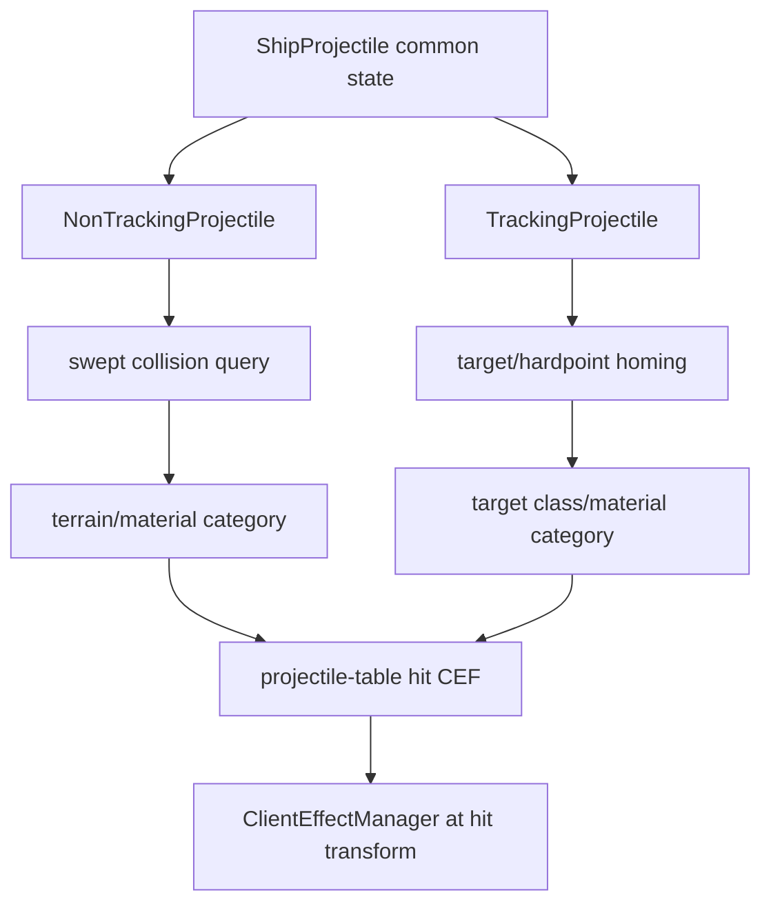

# ShipProjectile, NonTrackingProjectile, and TrackingProjectile runtime

Scope: the adjacent projectile subclasses at `0x00600D50..0x006032C5`. This extends the shared ProjectileManager block into concrete lifetime, collision, homing, and impact-effect behavior.

## Class/install boundaries

| Class | Installer | Legacy allocation size | Key role | Confidence |
|---|---:|---:|---|---|
| `ShipProjectile` | `0x00600E40` | `0x148` (328) | Common ship-projectile state, appearance, launch/impact effect references, source/target links, speed/lifetime. | Confirmed |
| `NonTrackingProjectile` | `0x00601D90` | `0x138` (312) | Straight-line integration, swept collision, material classification, material-specific impact effect. | Confirmed |
| `TrackingProjectile` | `0x006026B0` | `0x108` (264) | Target-following/homing integration and target-type impact selection. | Confirmed |

Each class has a dedicated fixed-block allocator and exit-chain removal. `ShipProjectile::install` also registers `ClientGame/ShipProjectile.disableHitEffects`, proving impact visuals can be globally suppressed without altering projectile simulation.

The sizes are compiler/layout observations only. They are not file or wire structures and must not be reproduced as packed x64 classes.

## Common ship projectile

`0x00600EF0` constructs common projectile state and initializes ten managed effect/template references; `0x006010F0` releases them. `0x00601C60` updates a ref-counted related object/target link. `0x00601CB0` and `0x00601CC0` set scalar movement/lifetime parameters. `0x00601CD0` invokes an impact/event path in the current world/cell context.

The common base is fed by `ProjectileManager` definitions: appearance, firing effect, generic/material effects, shield effects, and friendly-fire effect.

## Nontracking update and collision

`0x00602180` is the nontracking alter/update routine:

1. advances base projectile lifetime/motion;
2. on first active update, performs a swept query from the spawn point along forward travel;
3. classifies the hit as terrain or tangible material;
4. for tangibles, maps the shared tangible template's material category to metal, stone, acid, ice/molten/obsidian or generic fallback categories;
5. stores hit cell/object, point, normal, and remaining distance;
6. as the projectile reaches the recorded impact distance, resolves coordinates into the hit object's cell frame when necessary;
7. plays the category-specific `.cef` and terminates the projectile.

The collision result and rendering effect are decoupled: collision supplies semantic hit category plus transform, while the projectile table supplies the `.cef`.

## Tracking update and impact

`0x00602990` is the tracking alter/update routine:

1. requires a live target reference;
2. obtains the target world position or an attachment/hardpoint position;
3. computes direction and remaining distance with a small terminal-radius allowance;
4. steers/updates forward movement toward the target using its configured speed;
5. terminates when lifetime/base update expires or the projectile enters the terminal distance;
6. classifies a creature/tangible target and selects the appropriate hit effect, otherwise uses the generic fallback effect at the projectile transform.

The decompiler did not recover one impact-category jump table symbolically, but its input is clearly target class/material and its output is one of the stored hit-effect handles.

## Server correlation

Stardust's `CreateProjectileMessageCallback` decides among ordinary projectile, missile, and countermeasure after validating the ship weapon component, capacitor energy, and projectile data. Those are authoritative server decisions. These client subclasses implement local trajectory/presentation and impact feedback; they must not be trusted for damage or hit authorization.

## Replacement-client requirements

- Implement ordinary and homing projectile presentation as typed components sharing a common definition handle.
- Use continuous/swept collision for fast nontracking bolts; discrete overlap is not behaviorally adequate.
- Preserve cell/world transform conversion for interior or parented targets.
- Preserve semantic material/target categories and resolve their effects from `projectile.iff`.
- Use weak/generation-checked target and hit-object handles. Legacy reference wrappers and pointer offsets cannot cross the x64 boundary.
- Keep `disableHitEffects` as a presentation/debug option only.
- Server results remain authoritative even if client prediction disagrees.

## Remaining unknowns

- Original enum names for all tangible material values and one tracking impact jump table remain provisional, though their effect-category purpose is confirmed.
- Dedicated missile/countermeasure object classes and their guidance/network reconciliation can be analyzed separately; the shared tracking/nontracking visual foundation is now documented.
