# Procedural-terrain generation lifecycle

Date: 2026-09-21  
Target: `C:\Stardust-DEV\Stardust.exe`  
Scope: dirty-region queue, worker ownership, completion publication, stale-result policy, and destruction

## Result

This block closes the procedural-terrain worker lifecycle at the compatibility boundary. The client does **not** attach a generation number to work and later reject stale results. Instead, it serializes regeneration into one exclusive cycle and prevents camera/terrain invalidation from starting a second cycle until the first has published and retired its chunks.

## Confirmed flow

```mermaid
flowchart LR
    A[terrain modification notification] --> B[0x0085F820 append 16-byte dirty envelope]
    B --> C[0x0085F950 begin cycle when active flag is clear]
    C --> D[build priority-ordered 20-byte work records]
    D --> E[0x0085EE60 worker pops record under lock]
    E --> F[append result slot, unlock, construct ClientChunk]
    F --> G[publish chunk pointer under lock]
    G --> H[0x0085EFD0 main-thread three-state publish/retire cycle]
    H --> I[clear active flag; later movement can schedule another cycle]
```

- `0x0084A8B0`, the ordinary terrain frame update, calls `0x0085F950` and then `0x0085EFD0` before the remaining terrain update work.
- `0x0085F820` appends one four-DWORD/16-byte dirty-region record to the vector at object `+0x1F8`.
- `0x0085F950` consumes only when that vector is nonempty and byte `+0x23C` is clear. It removes one envelope, sets `+0x23C = 1` and state `+0x22C = 1`, clears/rebuilds the priority work container, and enqueues affected quadtree nodes.
- `0x0085EE60` is the worker entry installed by the constructor. Under the terrain mutex it waits on the worker event, exits when byte `+0x230` is set, removes the highest-priority 20-byte work record, and appends that record to the result vector at `+0x238`. It unlocks while `0x0084A530` constructs the chunk and then writes the returned pointer into the result record under the same lock.
- `0x0085EFD0` owns main-thread publication. State 1 waits until queued construction has drained, state 2 waits until every result record has a non-null chunk pointer, installs the completed chunks, retires prior chunks, clears both result/work vectors, resets state to zero, and clears `+0x23C`.
- While `+0x23C` is set, `0x0084A960` does not issue a new observer-position terrain update and `0x0085F950` does not consume another dirty envelope. Movement during construction is therefore observed after the current cycle ends rather than cancelling or versioning in-flight work.

## Destruction and cancellation semantics

`0x00849FB0` sets the worker-stop byte `+0x230` while holding the mutex, signals the worker event, releases the lock, joins the worker, and only then releases generated chunks, queues, terrain managers and thread references. There is no per-record cancellation handle and no callback into destroyed scene state. Safety comes from stop/signal/join ordering and exclusive-cycle serialization.

This is materially different from the general async asset loader, which permits callback cancellation while retaining request cleanup. A replacement client may use futures or generation tokens internally, but visible behavior must retain ordered publication and must never expose a partially built terrain set.

## Confidence

| Finding | Confidence | Evidence |
|---|---|---|
| worker pop/build/publish ownership | Confirmed | complete `0x0085EE60` decompile and mutex boundaries |
| exclusive generation cycle | Confirmed | `+0x23C` gates both position updates and cycle start |
| main-thread installation/retirement | Confirmed | complete `0x0085EFD0` state machine and frame caller |
| no stale-result generation tag | Confirmed for this path | complete 20-byte work/result record handling contains no epoch field |
| teardown joins before freeing queues/chunks | Confirmed | `0x00849FB0` stop/signal/join ordering |

## Remaining bounded uncertainty

The original public class/member names for the mutex, event and state fields are unavailable. The exact helper names behind thread join and event signaling are inferred from their lifecycle position, but the ordering and ownership contract are directly visible and sufficient for a replacement architecture.
