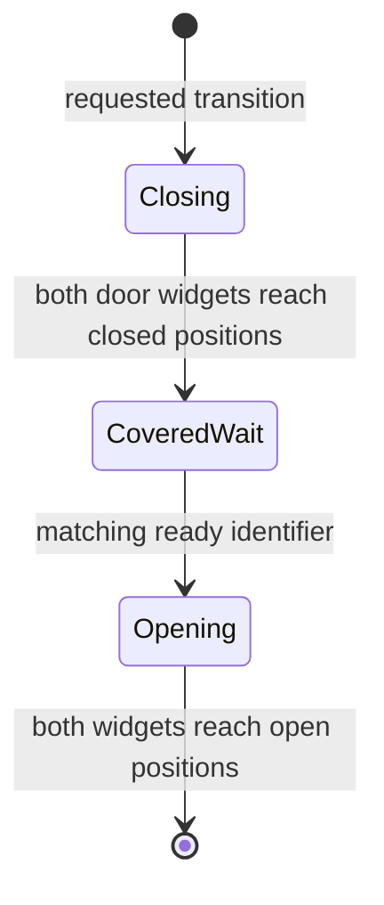

# CuiTransition overlay state machine

Date: 2026-09-22

## Result

`CuiTransition` is a local UI transition overlay that closes paired left/right
door widgets, waits at the covered midpoint until the requested transition is
declared ready, then reopens and closes itself. It provides presentation and
input masking around a caller-owned state change; it is not the network/scene
transition authority.

## Principal functions

| Address | Provisional name | Role |
|---|---|---|
| `0x013BA4B0` | `cui_transition_construct_VA_013BA4B0` | Resolves left/right door widgets; loads margins, speed and start/loop/close/open sound paths; installs singleton/debug flag. |
| `0x013BAB00` | `cui_transition_destroy_VA_013BAB00` | Releases transition records, sound strings and singleton ownership. |
| `0x013BAC50` | `cui_transition_activate_VA_013BAC50` | Enables updates and builds door motion records. |
| `0x013BAC70` | `cui_transition_deactivate_VA_013BAC70` | Disables updates and clears requested/ready names. |
| `0x013BACC0` | `cui_transition_set_requested_name_VA_013BACC0` | Stores the requested transition identifier. |
| `0x013BAE70` | `cui_transition_set_ready_name_VA_013BAE70` | Stores the identifier declared ready by the caller. |
| `0x013BB020` | `cui_transition_accept_ready_VA_013BB020` | Requires ready name to match requested name, switches from covered wait to opening, and diagnoses mismatches. |
| `0x013BB1B0` | `cui_transition_update_VA_013BB1B0` | Advances pixel motion, switches close/wait/open states, plays transition sounds and closes mediator after opening. |
| `0x013BB520` | `cui_transition_build_motion_records_VA_013BB520` | Captures source/closed positions for the door widgets using configured margins and horizontal speed. |

## State model

The update is pixel-speed based with fractional-time accumulation. At the
closing/opening boundaries it changes the associated audio route: start/loop,
stop-close and stop-open. A short 0.1-second retained delay prevents the first
post-boundary frame from immediately advancing again. A mismatched ready name
logs `CuiTransition bad transition ready attempt...` instead of opening the
wrong transition.

## Configuration and ownership

The original UI asset supplies `doorLeft`, `doorRight`, `DoorLeftMargin`,
`DoorRightMargin`, `HorizontalSpeed`, `soundStart`, `soundLoop`,
`soundStopClose`, and `soundStopOpen`. A `ClientUserInterface/transitions` debug
flag gates diagnostic/sound behavior.

This mediator never establishes a server connection, changes scenes, or owns
world loading. The caller starts the actual operation and later presents the same
identifier as ready. Therefore the replacement must keep this overlay optional
and never use completion of its animation as proof that network/world state is
ready.

## Replacement-client contract

Expose an asynchronous transition-overlay service with a request token and a
separate `ready(token)` operation. Modern presentation may use a fade instead of
doors, but token matching, covered waiting, cancellation/teardown and audio
lifetime are useful semantics. Asset-authored margins/sounds should be imported
when reproducing original presentation.

## Confidence

- Widget motion, state sequence, token match and sound phases: **Confirmed**.
- Separation from authoritative scene/network work: **Confirmed by absence of
  those operations and explicit caller readiness handoff**.
- Exact set of production callers: **Not exhaustively enumerated; interface
  behavior is closed**.
