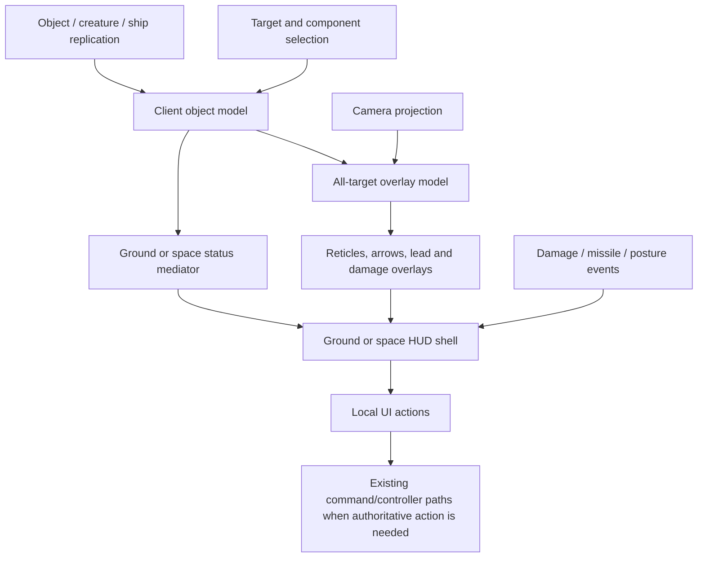

# HUD, Target and Status Architecture Checkpoint

Date: 2026-09-22  
Target: `C:\Stardust-DEV\Stardust.exe`

## Finding

The main gameplay HUD is an orchestrator over reusable target/status mediators
and local screen-space overlays. Ground and space specialize that shell; they do
not introduce a second object or combat protocol.

## Recovered class structure

RTTI confirms the following concrete families:

- `SwgCuiHud` -> `SwgCuiHudGround` / `SwgCuiHudSpace`;
- `SwgCuiHudWindowManager` -> ground / space managers;
- `SwgCuiTargets` with ground/space all-target specializations;
- `SwgCuiStatusGround` / `SwgCuiStatusSpace`;
- `SwgCuiHudActionGround` / `SwgCuiHudActionSpace`.

Representative constructors are `0x00BD46F0` (base HUD), `0x00BD3990`
(ground HUD), `0x00BD1720` (space HUD), `0x00FD4FB0` (all-targets base),
`0x00EE7EB0` (space all-targets), `0x00F00940` (ground all-targets),
`0x00F6E5B0` (targets container) and `0x00FFA760` (space status).

## Shared HUD shell

`0x00BD46F0` binds the reticle and selection-box layer and retains named overlay
groups for hover, target and mission-group selection. It resolves the original
cursor style `/styles.cursors.reticle.default` and installs object/command
selection actions. The HUD therefore owns screen interaction and mediator
composition; authoritative target identity remains in the gameplay/controller
state already mapped elsewhere.

## Ground and space specialization

The space HUD binds damage presentation, eject/exit-station/trainer controls,
incoming-missile-lock widgets and a deformation/effect widget. It loads
`datatables/space/ship_station/hud.iff`, whose chassis/station/element/enabled
columns drive station-dependent widget availability. It subscribes to typed
`CuiDamageManager::ShipDamage` and create-missile events.

The ground HUD shares the base reticle/selection architecture and substitutes
the ground mediator set. Its visual-posture subscription connects replicated
creature posture to local status presentation.

## All-target and target widgets

`SwgCuiAllTargets` binds sample status, reticle, ordinary arrow, waypoint arrow
and damage-text widgets. It maintains named render categories including
`lookAt`, `combat`, `arrowTarget` and `arrowCombat`. A custom
`SwgCuiAllTargetsNamespace::MyRenderer` performs the final overlay render.

The space specialization adds:

- a damage-direction arrow;
- virtual joystick;
- target-lead indicator;
- waypoint indicator;
- missile-target acquisition rendering and optional lead smoothing.

`0x00EE9D60` confirms the lead/acquisition overlay is calculated locally from
the player ship, target ship, transforms, weapon/missile state and camera
projection. The client draws projected markers only after both endpoints
project successfully. It sends no targeting authority from this render path.

`SwgCuiTargets` is the collapsible status-panel container: its constructor binds
collapse/expand buttons, toggle page and status page, and creates the target
icon action. This is composition state, not a separate gameplay model.

## Space target status

`0x00FFA760` binds target name, type, difficulty, shield, armor, systems,
chassis and selected-component labels, faction images, button bar and 3D object
viewer. Capability controls include follow, match, communications, dock and
inspect; the latter three are registered with masks `0x40000`, `0x80000` and
`0x200000` in the local action model. These masks should not be interpreted as
wire opcodes.

The status widgets consume the already-reconstructed ship/component baselines,
deltas and targeting state. Shield/armor/system/chassis percentages are derived
presentation values; the server remains authoritative for condition and
component state.

## Architectural dataflow

## Replacement guidance

Preserve this separation conceptually:

1. authoritative replicated game state;
2. a query/view-model layer that derives target status and capabilities;
3. camera-aware overlay projection;
4. renderer-independent HUD composition;
5. explicit command dispatch for follow/dock/inspect/etc.

The original UI assets, cursor styles, station-HUD table and icon/effect
resources remain compatibility inputs. The historical mediator inheritance and
raw widget pointers should be redesigned.

## Confidence and remaining work

- Class composition, principal widget roles, event subscriptions and local
  target-lead projection are **confirmed**.
- The division between replicated authority and local display is **confirmed**
  by the absence of sends in render paths and by known controller paths.
- Exact visual constants, every capability mask label and edge-case widget
  visibility are **strongly inferred / fidelity-test items**.

