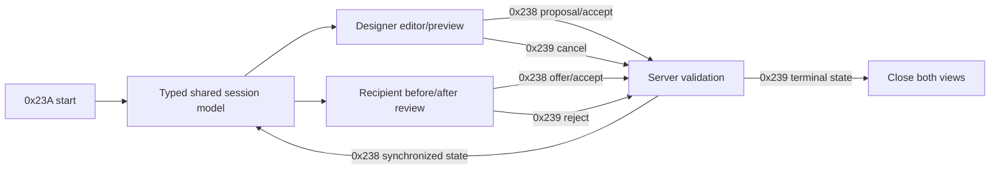

# Image designer workflow

Date: 2026-09-22  
Target: `C:\Stardust-DEV\Stardust.exe`  
SHA-256: `E782BF1C49B3DA730F66B54BC558947C46493F7133F672EED1D8E0C56A6B6150`

## Result

The image-designer feature is a server-authoritative, two-party proposal and
acceptance session represented by separate designer and recipient mediators. It
does not require a bespoke future-client service beyond the already mapped object
controller messages and a typed session model. The designer edits a preview,
price, optional stat migration and holo-emote; the recipient sees before/after
models, cost and categories, offers payment and accepts or rejects. The server
validates time, payment, salon presence, skills and customization values before
applying changes.

## Stable functions and classes

| Address | Provisional name | Role | Confidence |
|---|---|---|---|
| `0x005A4A20` | `client_image_designer_manager_install_remove_VA_005A4A20` | installs/removes shared client manager state and change callback | Strong |
| `0x00D9B190` | `swg_cui_image_designer_designer_construct_VA_00D9B190` | constructs designer controls, customization preview, timer, price, stat-migration and 18 holo-emote choices | Confirmed |
| `0x00D9C170` | `swg_cui_image_designer_designer_activate_VA_00D9C170` | activates customization editing against the session target | Strong |
| `0x00D9C2C0` | `swg_cui_image_designer_designer_deactivate_VA_00D9C2C0` | leaves editing mode and releases customization presentation state | Strong |
| `0x00D9C2F0` | `swg_cui_image_designer_designer_session_event_VA_00D9C2F0` | consumes shared session changes, opens recipient peer as needed, updates preview/session state and handles completion | Strong |
| `0x00D9D360` | `swg_cui_image_designer_designer_cancel_VA_00D9D360` | emits inner controller `0x239` reject unless already terminal, then closes | Confirmed |
| `0x00D9D550` | `swg_cui_image_designer_designer_update_preview_VA_00D9D550` | maps customization variables into preview/model changes and tracks dirty proposal data | Strong |
| `0x00DB0320` | `swg_cui_image_designer_recipient_construct_VA_00DB0320` | constructs before/after viewers, accept/reject, payment, category and session-status controls | Confirmed |
| `0x0121FFC0` | `shared_image_designer_manager_install_remove_VA_0121FFC0` | installs/removes shared session/message plumbing | Strong |

The two concrete RTTI classes are `SwgCuiImageDesignerDesigner` and
`SwgCuiImageDesignerRecipient`; their factory workspaces are
`/pda.imagedesigner.designer` / `WS_ImageDesignerDesigner` and
`/pda.imagedesigner.recipient` / `WS_ImageDesignerRecipient`.

## Controller messages

| Direction | Inner subtype | Purpose |
|---|---:|---|
| Z→C | `0x23A` | start session: designer U64, target U64, salon/tent U64, ASCII holo-emote |
| C↔Z | `0x238` | proposal/change/acceptance plus complete `ImageDesignData` |
| C↔Z | `0x239` | reject/cancel plus complete `ImageDesignData` |

The `0x238`/`0x239` prefix is designer U64, target U64, salon/tent U64 and
type U8. The previously mapped record that follows is:

1. ASCII hair template;
2. ASCII packed hair customization;
3. U32 session ID and U32 timestamp;
4. U32 required and offered payment;
5. U8 designer accepted, U32 target accepted, U8 stat migration requested;
6. four U32 skill-mod values: body, face, markings, hair;
7. U32 body count, repeated ASCII name + F32 value;
8. U32 color count, repeated ASCII name + U32 value;
9. ASCII holo-emote.

## UI state model

The designer mediator directly exposes:

- remaining time, cancel, revert and commit;
- requested cost and recipient's offered money;
- optional stat-migration checkbox;
- named holo-emote selection including Beehive, Brainstorm, Imperial, Rebel,
  Bubblehead, Hologlitter, Holonotes, Sparky, Bullhorns, Champagne,
  Technokitty, Phonytail, Blossom, Butterflies, Haunted and Hearts, plus
  All/None controls;
- morph sliders, color pickers and hair selection/preview.

The recipient mediator owns independent before/after 3D viewers, accept/reject,
time left, designer-accepted state, cost, stat-migration status, purchased
holo-emotes, offered-payment input and body/face category controls.

## Server authority

The local Stardust implementation provides the decisive compatibility rules:

- both participants receive `0x23A`; the U64 salon value is nonzero only when
  both resolve inside a salon building;
- the server registers position observers for a salon session;
- requested stat migration between different players requires four minutes;
  early designer acceptance terminates the session and is logged;
- designer acceptance alone waits for target acceptance, with a two-minute
  timeout; self-design needs no second party;
- payment is `max(requiredPayment, offeredPayment)` and may draw cash first,
  then bank, always crediting designer cash;
- commit can migrate stats, replace/create hair, apply body and color variables,
  install a holo-emote and award image-designer XP;
- all customization and skill checks remain authoritative in
  `ImageDesignManager`;
- cancel/timeout sends full `0x239` state to both peers and drops the session.

## Replacement-client contract

The future client should decode the full record into one shared session object
and expose role-specific views. Preview changes are provisional; authoritative
creature customization, inventory/hair containment, currency, XP and HAM changes
arrive through ordinary replicated state after commit.

## Unknowns and risks

- Original pixel layout, camera framing and slider response are visual fidelity.
- The server condition for stat migration tests the designer's salon parent twice
  in the commit branch; this appears to be a server-side typo because start logic
  validates both participants. It must be reviewed before integration testing.
- The `type` field's complete historical enum is not claimed. Current server code
  explicitly uses `1` for hair-style replacement and otherwise processes body,
  color and session state.
- The future client must bound both vector counts and ASCII lengths before
  allocating; the legacy codec should not dictate unsafe memory behavior.

