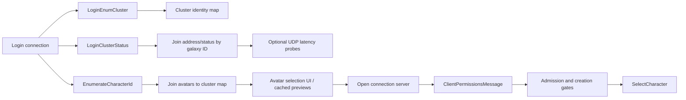

# Login Manager State and Avatar-Selection Boundary

## Scope

Core authentication, connection-server handoff, and `SelectCharacter` wire flows were already mapped. This block closes the client manager that joins cluster enumeration, live status, character enumeration, permissions, UDP latency probes, and cached avatar presentation into the login UI state model.

## Installation and dispatch

`cui_login_manager_install_VA_00898490` creates one message listener and subscribes it to:

- `LoginEnumCluster`
- `LoginClusterStatus`
- `EnumerateCharacterId`
- `ClientPermissionsMessage`
- `ConnectionServerConnectionClosed`

It also creates a dedicated UDP socket for cluster latency probes and subscribes to `GameNetwork::Messages::ConnectionServerConnectionChanged`.

`login_ui_message_dispatch_VA_008986C0` performs the exact name-hash dispatch, constructs the registered archive object, calls one semantic handler, destroys the archive, and releases the common network archive guard. This is manager/UI dispatch after lower-layer SOE message delivery, not a second transport parser.

## Joined state model

The manager maintains three distinct keyed collections:

1. enumerated cluster identity/metadata from `LoginEnumCluster`;
2. cluster connection/status/address records from `LoginClusterStatus`;
3. avatar records from `EnumerateCharacterId`.

`login_enum_cluster_handler_VA_00898AC0` clears and rebuilds cluster identity state. `login_cluster_status_handler_VA_00898C70` joins status records by galaxy ID, retains hostname/ports/status/recommendation metadata, constructs ping targets, and publishes `ClusterListChanged` / `ClusterStatusChanged` UI events. Unknown-cluster status records are diagnosed and skipped rather than creating incomplete clusters.

`enumerate_character_id_handler_VA_00898F80` clears and rebuilds the avatar collection, joins every avatar to its cluster, attempts to obtain matching cluster metadata, and publishes `AvatarListChanged`. It keeps the character `NetworkId` as a two-word/64-bit value and uses original template/race data for preview reconstruction.

`client_permissions_handler_VA_00899340` stores the first three permission booleans (login, regular-character creation, Jedi-character creation), correlates them with the selected/requested cluster, and publishes `ClusterConnection`. The server's fourth `skip tutorial` Boolean is parsed by the archive but not consumed by this manager build.

## Connection and latency probing

`cui_login_manager_open_cluster_VA_0089A400` passes the selected record's hostname, zone port, and cluster name to `game_network_open_connection_server_VA_00462060`, then retains the selected galaxy ID.

Separately, `cui_login_send_cluster_pings_VA_0089A440` iterates online clusters with a nonzero ping port. `cui_login_send_cluster_ping_VA_0089A480` sends a four-byte probe token through the manager-owned UDP socket. `cui_login_update_cluster_pings_VA_0089A4C0` receives replies, validates their size/token/source mapping, updates per-cluster latency, diagnoses malformed replies, and periodically begins another probe sweep.

This UDP measurement is presentation metadata only. It must not be confused with the connection-server SOE channel or made a prerequisite for login.

## Avatar preview and original assets

`cui_login_create_avatar_preview_VA_00899A10` instantiates the enumerated avatar's creature template, requires the result to be a creature-compatible object, associates it with a valid cluster, and restores cached avatar appearance/wearables when available. `cui_login_get_avatar_preview_by_id_VA_00899BF0` searches the avatar collection by 64-bit character ID and requests/creates that preview; invalid IDs produce a diagnostic.

This confirms a non-negotiable original-asset dependency in the login UI: avatar selection can require creature templates, customization data, skeletal appearances, and wearable templates before a world scene is entered. A minimal networking proof of concept may omit previews, but a proper client cannot replace avatar-selection records with names alone.

## Replacement state machine

## x64 and architecture requirements

- Model cluster IDs, status enums, ports, flags, and request fields at their fixed wire widths.
- Model character `NetworkId` as an explicit U64 value, never a pointer-sized integer.
- Store collections by IDs and values; do not reproduce legacy red-black-tree node layouts.
- Keep latency probing optional and separately owned from the reliable game connection.
- Publish immutable state snapshots/events to UI instead of exposing manager-owned raw object pointers.
- Preserve asset/template identifiers exactly for cached avatar preview creation.

## Confidence

Manager subscriptions, parser routing, state joins, permissions, connection opening, UDP probe ownership, and preview template creation are **Confirmed** by executable control flow. The precise historical names of a few cluster metadata integers remain unnecessary/unknown, but their byte widths and actual handler use are documented in the packet map.
