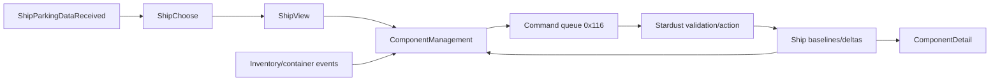

# Ship Selection and Component UI Checkpoint

Date: 2026-09-22  
Target: `C:\Stardust-DEV\Stardust.exe`

## Scope and result

This block closes the main ship-selection, ship-view, component-management and
component-detail mediator boundaries and correlates their authoritative actions
with the current Stardust server source.

## Mediator family

| Mediator | Constructor | Confirmed role |
|---|---:|---|
| `SwgCuiShipChoose` | `0x00DEA8D0` | Displays server-supplied parked ships and selection/close controls |
| `SwgCuiShipView` | `0x00DF64A0` | Ship viewer, attributes, manage/group/launch/travel actions |
| `SwgCuiShipComponentManagement` | `0x00DDDA70` | Inventory/slot comparison and install/uninstall/repair controls |
| `SwgCuiShipComponentDetail` | `0x00DCA000` | Ship/component slot, health and damage detail projection |

RTTI additionally confirms typed subscriptions for parked-ship data,
`ShipObject::ComponentsChanged`, `ShipObject::DroidPcdChanged`, inventory
container add/remove events and group membership changes.

## Selection and launch

`SwgCuiShipChoose` owns a list composite and sample ship row. Its model is
populated by `PlayerCreatureController::ShipParkingDataReceived`, whose payload
is a vector of `(NetworkId, string)` pairs. `SwgCuiShipView` binds manage,
group-launch, launch and travel controls. `0x00DF6BD0` routes group launch to
`WS_SpaceGroupLaunch`, travel to `WS_TicketPurchase`, and constructs the already
documented `launchIntoSpace` command for direct launch.

This confirms the parked-ship list is server-supplied session data, while the
3D ship and attribute views are local projections of object/template state.

## Component management

The management constructor binds:

- a 3D ship viewer and inventory tree;
- selected/installed object and component names;
- load, unload, component-repair and chassis-repair buttons;
- mass, power, energy and chassis summaries;
- a certification warning and not-near-terminal overlay.

The detail mediator binds ship viewer, slot list/sample, slot information,
slot/component names, health bar/holster, ship information and damage text.
Its refresh method resolves retained objects and rebuilds the slot/detail list.

Three exact client command-name wrappers are confirmed:

| Address | Command |
|---:|---|
| `0x00DDD820` | `installShipComponent` |
| `0x00DDD870` | `uninstallShipComponent` |
| `0x00DDD8C0` | `repairShipComponentInSlot` |

They enter the ordinary command-queue transport already mapped to controller
message `0x116`.

## Server correlation

The current server parses:

- `installShipComponent`: arguments `shipId slot componentId`; validates
  ownership, certification, slot compatibility, mass and component ancestry,
  handles factory-crate extraction, then installs and replicates the change;
- `uninstallShipComponent`: arguments `shipId slot`; resolves the ship and calls
  authoritative uninstall;
- `repairShipComponentInSlot`: currently performs only queue state/locomotion
  checks and returns success. It does **not** currently repair a component.

The latter is an important server-side functionality gap, not an unknown client
function. A replacement client should preserve the command contract but must
not assume the current server produces a repair state transition.

## Dataflow

## Replacement requirements

- Preserve U64 object IDs and exact textual command arguments on the wire.
- Derive mass/power/energy/certification and slot compatibility from original
  ship/component data plus replicated server state.
- Treat all local inventory and ship pointers as 64-bit handles/references;
  never serialize native pointers or native structure layouts.
- Consume original ship appearances, component slot definitions, icons,
  localization and UI data so the original asset corpus remains usable.
- Keep server validation authoritative even when the UI predicts button
  availability.

## Confidence and residuals

Mediator composition, event ownership, exact command names and current server
argument/validation behavior are **confirmed**. The exact client formatting of
each argument string is **strongly inferred** from executable control flow and
confirmed server parsing; it remains suitable for a focused integration test.
Chassis-repair behavior and several layout-only helpers remain open fidelity
items.

