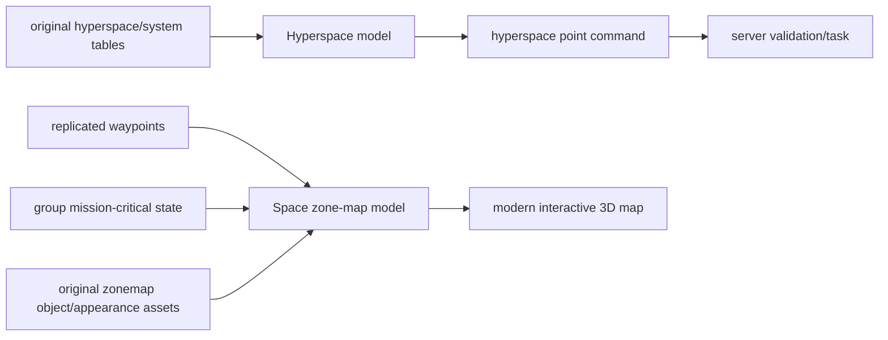

# Analysis checkpoint: hyperspace and space-zone navigation UI

Date: 2026-09-22  
Executable authority: `C:\Stardust-DEV\Stardust.exe`; correlated with current
Stardust server and deployed TRE corpus.

## Result

The two space navigation mediators are client-data-driven projections over the
ordinary command, waypoint and mission-critical state systems. The hyperspace
map chooses a named destination and submits the existing `hyperspace` queued
command. The space-zone map builds an interactive 3D miniature from original
space-map assets plus live waypoint/mission state; it is not a server-supplied
map image.

## Hyperspace map

`SwgCuiHyperspaceMap` RTTI is `0x018BD3C0`, with constructor `0x00DC65F0` and
vtables `0x015F2938`/`0x015F296C`. The constructor binds Hyperspace and Cancel,
ten system selectors (Corellia, Dantooine, Dathomir, Endor, Lok, Naboo, Rori,
Talus, Tatooine and Yavin 4), and name/description/system-location labels.

Click handler `0x00DC6AF0` maps those selectors to exact zone keys such as
`space_corellia` and retains a selected point. It also recognizes legacy
`space_light1` and `space_heavy1` destinations. Pressing Hyperspace requires a
selection and queues the command name `hyperspace` with that selected point
identifier; Cancel closes the mediator. Selection projection `0x00DC72F0`
resolves display name from `hyperspace_points_n`, description from
`hyperspace_points_d`, and system/location data from the retained point record.

The server `HyperspaceCommand` treats the argument as an exact destination name,
looks it up in `ShipManager`, validates the target space zone, ship, hyperdrive,
engine state and cooldown, then starts `HyperspaceToLocationTask`. Both client
and server deploy `datatables/space/hyperspace/hyperspace_locations.iff`; the
client also deploys `system_locations.iff` and the two localization tables.

## Space-zone map

`SwgCuiSpaceZoneMap` RTTI is `0x018BD43C`; constructor `0x00DD36C0` installs its
three vtable facets and binds filters for asteroids, nebulas, hyperspace points,
space stations, waypoints, mission-critical objects, the player ship and names.
It also binds a detail tree, zone-name label, zoom slider, reset-view button and
3D viewer, plus move/rotate/select/zoom cursor styles.

Activation `0x00DD40F0` switches input/camera policy and subscribes to
`PlayerObject::WaypointsChanged` and
`CreatureObject::GroupMissionCriticalObjectsChanged`. Deactivation
`0x00DD41A0` reverses those policies, removes the subscriptions and destroys the
temporary map scene. The per-frame update `0x00DD4550` rebuilds dirty category
sets, updates zoom and drives map/viewer transforms.

The category builders are independently visible:

| Function | Logical category |
|---:|---|
| `0x00DD69F0` | space stations |
| `0x00DD6C00` | hyperspace points |
| `0x00DD6E10` | active ordinary waypoints |
| `0x00DD7030` | inactive ordinary waypoints |
| `0x00DD7250` | active POI waypoints |
| `0x00DD7470` | inactive POI waypoints |
| `0x00DD7690` | mission-critical objects |

Input method `0x00DD4960` ray-picks map objects and implements drag/rotate,
wheel/drag zoom, selection and context-menu invocation. Context action handler
`0x00DD5950` includes waypoint activate/deactivate, rename and destroy routes;
`0x00DD5DF0` constructs the context menu according to picked-object type and
capabilities. A mismatch between picked scene object and map item is explicitly
warned, showing the model keeps those identities paired.

## Required original assets

The deployed archive confirms the map depends on original data and presentation
assets, including:

- `ui/ui_space_hyperspacemap.inc` and `ui/ui_space_zonemap.inc`;
- `datatables/space/hyperspace/hyperspace_locations.iff` and
  `system_locations.iff`;
- `object/static/space/zonemap/shared_ui_hyperspace.iff`,
  `shared_ui_spacestation.iff`, `shared_ui_waypoint*.iff`,
  `shared_ui_poi_waypoint.iff` and `shared_ui_mission_critical.iff`;
- `appearance/pt_ui_zonemap_grid_01.prt`, its shader/texture, and dedicated
  zonemap cursor textures;
- `appearance/ui_hyperspace.apt`, mesh, shaders and texture;
- hyperspace scene/effect/sound resources used by the transition system.

This is direct evidence for the non-negotiable original-asset requirement: the
modern client should parse these templates/data tables and render equivalent
objects rather than hard-code a replacement destination list or flat bitmap.

## Replacement boundary

Protocol/domain logic should stay independent of the UI engine. The renderer
needs adapters for original templates, appearances, particles, shaders and
textures; UI can be redesigned while retaining filters, picking, selection,
context actions and exact destination keys.

## Confidence and remaining unknowns

- UI class identities, controls, destination zone keys, command construction,
  server validation, live subscriptions and category builders: **Confirmed**.
- Exact semantic names of a few lower-level camera/map helper functions:
  **Strongly inferred** from direct input/update use and do not block behavior.
- Individual visual constants and legacy widget placement are fidelity work,
  not architecture or protocol unknowns.

