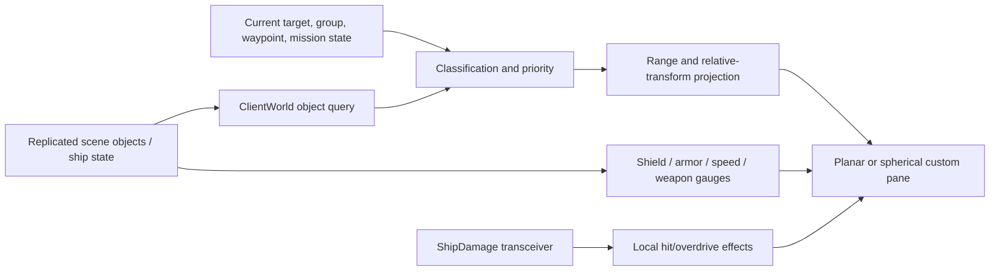

# Space Radar Runtime Checkpoint

Date: 2026-09-22  
Target: `C:\Stardust-DEV\Stardust.exe`

## Scope

This block reconstructs the space-radar mediator family and separates its
replicated inputs from its local projection/rendering behavior. Addresses are
virtual addresses in the analyzed PE image. Decompiler text is reconstructed
pseudocode, not original source.

## Confidence vocabulary

- **Confirmed**: directly visible in code, RTTI, UI member binding, strings, or
  the corresponding server implementation.
- **Strongly inferred**: control flow and object use establish the behavior but
  some anonymous helpers remain unnamed.
- **Tentative**: plausible interpretation that still needs dynamic validation.

## Class and lifecycle map

| Class | Constructor | Key runtime method | Confidence |
|---|---:|---:|---|
| `SwgCuiSpaceRadar` | `0x00EEF140` | `0x00EEF9B0` | Confirmed |
| `SwgCuiSpaceRadarPlanar` | `0x00FF6AF0` | custom head/tail pane | Confirmed |
| `SwgCuiSpaceRadarSpherical2` | `0x00FF8060` | blip render `0x010CD210` | Confirmed |
| `SwgCuiSpaceRadarSpherical` | `0x00FF9200` | blip render `0x010CF980` | Confirmed |

The base binds the dynamically created `RadarIcon`, top/bottom zoom controls,
latitude/height/longitude labels and range indicator. It registers the normal
mediator action handling plus preference callbacks. Its update path obtains the
player ship and world transform and gates the display using player-ship
controller state. The range preference callback clamps the effective range to
`0x40..0x2000` (64..8192 internal units) and marks the projection dirty.

## Spherical radar composition

Both spherical constructors bind:

- the square radar panel;
- ordinary, waypoint, bracket and group direction-arrow widgets;
- default, corpse, waypoint, structure, bracket and group blip images;
- front-left, front-right, back-left and back-right shield quadrants;
- matching armor quadrants;
- shield-overdrive page/effect;
- current/max speed, boost/overdrive and current-weapon displays.

Each creates and attaches a purpose-built blip pane. RTTI and vtables identify
distinct panes for the two spherical implementations. Their principal render
overrides are `0x010CD210` and `0x010CF980`; these are not generic UI-widget
rendering inherited by accident.

## Blip rendering behavior

`0x010CD210` directly establishes the following pipeline:

1. Resolve the current player object, player ship and current target.
2. Resolve the player's group identity and current waypoint context.
3. Query the client-world object collection within the radar range.
4. Ignore objects that are not eligible client objects and exclude the
   waypoint-proxy tag (`0x53574159`, `SWAY`) from the ordinary-object pass.
5. Compute squared distance and assign a render priority/style from object
   identity, target status, group relationship, attackability/faction state and
   object kind.
6. Insert candidates into a sorted local render collection.
7. Project ordinary candidates and then explicit waypoint/mission candidates
   through the shared blip projection helper.

`0x010CF980` performs the corresponding richer spherical pass. It resolves
player/ship/target and relationship data, builds ordered overlay collections,
then projects ordinary objects and special overlays. The additional state and
helpers are consistent with the constructor's shield, armor, speed, boost and
weapon instrumentation. Exact names for every transient sorted-list field are
not recoverable, but the behavioral boundary is.

The panes also subscribe to `CuiDamageManager::ShipDamage` transceivers. This
connects server-authored combat results, after normal ship-state replication,
to local quadrant/impact presentation; it does not give the radar authority to
change ship condition.

## Planar variant

The planar constructor binds a blip head and tail, creates a custom child
canvas/widget and records its scale constants. This is a local relative-motion
display rather than a distinct network consumer. No new wire message or command
was found for any radar variant.

## Dataflow

## Replacement-client requirements

The replacement should preserve the information model, not the original UI
class layout:

- consume the authoritative scene/object, group, target, waypoint, mission and
  ship-component state already decoded elsewhere;
- maintain a spatial query suitable for range-limited radar candidates;
- reproduce relationship/type classification and stable render ordering;
- project candidates into a selectable planar or spherical HUD presentation;
- keep hit flashes, arrow effects and gauge interpolation entirely local;
- use original UI imagery/styles where exact visual compatibility is desired.

This subsystem introduces no additional client/server protocol. Its hard
dependency is on correct upstream object replication and original HUD assets.

## Remaining uncertainty

- Exact visual constants, tie-breaking among equally ranked blips and a few
  transient collection-field meanings require screenshot/dynamic comparison.
- The precise preference key selecting planar versus either spherical variant
  was not named in this block.
- These are presentation-fidelity items, not architectural or transport gaps.

