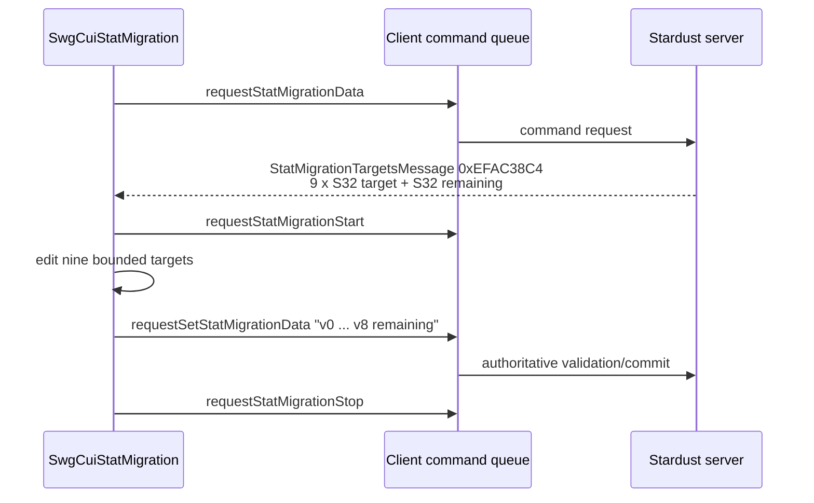

# Stat migration workflow

Date: 2026-09-22  
Target: `C:\Stardust-DEV\Stardust.exe`  
SHA-256: `E782BF1C49B3DA730F66B54BC558947C46493F7133F672EED1D8E0C56A6B6150`

## Result

This block extends the previously closed `StatMigrationTargetsMessage` packet
into the complete user workflow. `SwgCuiStatMigration` is an authoritative
session editor over nine fixed HAM targets. Activation requests the current
session model, receipt replaces all nine targets and points remaining, edits
update local slider/text projections, acceptance submits the nine targets, and
the start/stop command pair marks editing state. Stardust validates species
minimums, maximums and the total before applying any attribute change.

## Stable functions

| Address | Provisional name | Role | Confidence |
|---|---|---|---|
| `0x00DB8960` | `swg_cui_stat_migration_construct_VA_00DB8960` | constructs nine Health/Strength/Constitution/Action/Quickness/Stamina/Mind/Focus/Willpower rows, points-left and OK/Cancel controls | Confirmed |
| `0x00DB8E90` | `swg_cui_stat_migration_destroy_VA_00DB8E90` | disconnects the packet callback and destroys row/model state | Confirmed |
| `0x00DB9160` | `swg_cui_stat_migration_activate_VA_00DB9160` | binds player state and queues `requestStatMigrationData` | Confirmed |
| `0x00DB96D0` | `swg_cui_stat_migration_receive_targets_VA_00DB96D0` | type-checks and consumes the response, replaces nine targets and points remaining, refreshes and activates the UI | Confirmed |
| `0x00DB9940` | `swg_cui_stat_migration_refresh_VA_00DB9940` | refreshes points-left plus all current/target text and sliders | Confirmed |
| `0x00DB99F0` | `swg_cui_stat_migration_refresh_rows_VA_00DB99F0` | formats the nine current and target values and resets corresponding slider positions | Confirmed |
| `0x00DB9BE0` | `swg_cui_stat_migration_submit_targets_VA_00DB9BE0` | formats target values and queues `requestSetStatMigrationData` | Confirmed |
| `0x00DB9D30` | `swg_cui_stat_migration_set_active_VA_00DB9D30` | queues `requestStatMigrationStart` or `requestStatMigrationStop` | Confirmed |
| `0x00DB9EC0` | `swg_cui_stat_migration_reset_targets_VA_00DB9EC0` | copies the player's nine current base attributes into the target model and refreshes | Confirmed |
| `0x013F22B0` | `stat_migration_targets_parse_VA_013F22B0` | decodes the fixed ten-S32 response object | Confirmed |
| `0x013F24C0` | `stat_migration_targets_extract_values_VA_013F24C0` | extracts the nine targets and points remaining for the mediator | Confirmed |

## Wire and command flow

The executable formats ten decimal integers on submit. Current Stardust consumes
the first nine because its tokenizer loop is capped at nine; the trailing client
points-remaining value is therefore compatibility padding for this server path.

## Server authority and lifecycle

`RequestStatMigrationDataCommand` creates `MigrateStatsSession` on first use,
seeds it from base HAM and returns opcode `0xEFAC38C4`. Later requests return the
stored targets and compute remaining points from the species total.

`RequestSetStatMigrationDataCommand`:

1. requires a player creature and active migration session;
2. parses at most nine target values;
3. validates every value against species-specific minimum and maximum limits;
4. requires the nine-value sum to equal the species total;
5. updates the session targets only after validation;
6. immediately calls `migrateStats()` only in the tutorial zone or for a
   privileged player.

`MigrateStatsSession::migrateStats()` applies each delta consistently to base,
current and maximum HAM and then drops the active session. The current start and
stop command handlers perform state/locomotion checks but otherwise return
success; they do not themselves create or destroy the migration session.

## Replacement-client contract

- Decode exactly ten little-endian signed 32-bit values after the opcode.
- Preserve the canonical nine-attribute order.
- Treat displayed constraints as advisory; the server remains authoritative.
- Preserve the ten-integer submission string until server/client integration
  tests justify removing the ignored trailing value.
- Do not make migration an internal 64-bit structure merely because the new
  process is x64; wire values remain S32.
- Keep image-designer-assisted stat migration distinct from this standalone
  mediator even though both ultimately alter attributes.

## Unknowns and non-claims

- Exact slider acceleration and pixel formatting are presentation fidelity, not
  protocol unknowns.
- The historical intent of the otherwise empty start/stop server commands is not
  inferred.
- This block does not claim that migration is permitted everywhere; current
  server application is explicitly tutorial/staff-gated.

