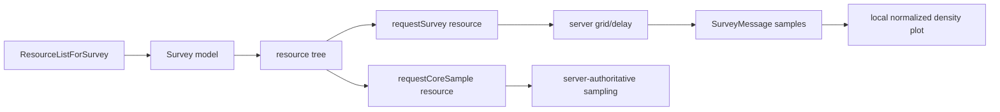

# Analysis checkpoint: survey UI runtime

Date: 2026-09-22  
Executable authority: `C:\Stardust-DEV\Stardust.exe`; correlated with Stardust
resource/survey server code and the previously recovered survey packet codecs.

## Result

`SwgCuiSurvey` is a client-side resource-selection and result-visualization
mediator over two ordinary queued commands and two server messages. The server
owns resource availability, density samples, delay and sampling authority; the
client owns the resource tree, ground-radar-like plot and presentation objects.

## Construction and lifecycle

RTTI identifies `SwgCuiSurvey` at `0x018C9EF8`. Constructor `0x00F0EA40`
installs four vtable facets and binds:

- resource-type label and resource tree;
- Survey and Get Sample buttons;
- a 3D viewer plus a `CuiWidgetGroundRadar`-typed map widget;
- map background, sample marker, player/here marker and range label.

The factory path `0x00F0F620` creates it from UI page `_Res_Surveying`.
Activation/deactivation `0x00F0F100`/`0x00F0F160` register and remove its live
message receivers and change the expected input mode.

## Outbound actions

Button handler `0x00F0F200` requires a selected resource identifier. Survey
queues command `requestSurvey <resource>`; Get Sample queues
`requestCoreSample <resource>`. With no selection it raises the normal UI error
path rather than emitting a malformed command.

Current server correlation:

- `RequestSurveyCommand`/resource manager validates the active survey session,
  tool, zone and resource name, builds a grid of sample points and schedules the
  delayed result;
- the sampling command validates the same authoritative state and performs the
  resource grant/damage/mission effects server-side.

No client-computed density or sample amount is authoritative.

## Inbound model and visualization

The earlier protocol checkpoints establish:

| Message | Client effect |
|---|---|
| `ResourceListForSurveyMessage` | populate the selectable resource hierarchy and associate resource IDs/names with the open tool/session |
| `SurveyMessage` | supply the sampled X/Z positions and density values used by the plot |

`0x00F0F690` rebuilds the resource tree from the current resource-manager
records, preserving hierarchical resource-class/name entries and restoring the
selected item where possible. Selection callback `0x00F0F400` copies the
resource identity into mediator state and updates the preview/details.

`0x00F0FD70` consumes the current survey-point vector, derives plot extent and
density range, and creates a marker for every nontrivial sample.
`0x00F0FFA0` converts density to a clamped 0..100 display value, interpolates
marker color across a retained gradient, normalizes each marker inside the map
extent and creates the corresponding UI object. `0x00F102B0` updates the range
label using the observed `%.0f m` format. Player position and heading are
projected locally into the same radar-style coordinate system.

This gives a clean replacement split:

The modern UI may render a heat plot instead of legacy marker widgets, but must
preserve point coordinates, density values, player/here marker, range and exact
resource identity. The original resource hierarchy/localization assets remain
part of presentation compatibility.

## Confidence and bounded unknowns

- Controls, exact outgoing command names/argument, inbound message roles,
  resource-tree rebuild and density normalization: **Confirmed**.
- Exact names of several anonymous vector/tree allocation helpers: ordinary
  container mechanics, intentionally not promoted to behavioral unknowns.
- Legacy pixel placement, marker sprite geometry and exact gradient constants:
  fidelity work only; not a protocol or gameplay blocker.

