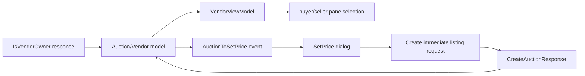

# Analysis checkpoint: vendor UI runtime

Date: 2026-09-22  
Executable authority: `C:\Stardust-DEV\Stardust.exe`

## Result

The dedicated vendor window is a thin specialization of the already recovered
auction-list framework. It does not introduce a second vendor wire protocol.
Its job is to select the appropriate auction panes from vendor ownership and
session state, while `SwgCuiVendorSetPrice` is a small modal adapter driven by
the auction manager's typed `AuctionToSetPriceOnChanged` event.

## Vendor mediator

RTTI identifies `SwgCuiVendor` at type descriptor `0x018BCF08` with primary and
secondary vtables `0x015F0B74` and `0x015F0BF8`. Constructor `0x00CB59B0`
invokes the auction-list base constructor `0x00E64F90`, installs those vtables,
and enables the same mediator lifecycle flags as the other auction views.

The base constructor binds the auction table, Exit, Details and Refresh
buttons, caption, two status labels and the money display. It owns the list
provider/filter state and therefore confirms that vendor inventory is presented
through the common auction data model, not through replicated container
contents.

`0x00CB5AC0` declares and selects six concrete pane/page pairs:

| Role | Concrete pane | UI page |
|---|---|---|
| seller active listings | `SwgCuiVendorPaneSellerSelling` | `pageVendorSSelling` |
| seller offers | `SwgCuiVendorPaneSellerOffers` | `pageVendorSOffers` |
| seller stockroom | `SwgCuiVendorPaneSellerStockroom` | `pageVendorSStock` |
| buyer listings | `SwgCuiVendorPaneBuyerSelling` | `pageVendorBSelling` |
| buyer offers | `SwgCuiVendorPaneBuyerOffers` | `pageVendorBOffers` |
| available-item source | `SwgCuiVendorPaneAvailable` | `pageAvailable` |

The selection depends on a retained vendor/session identity plus seller/owner
state. This agrees with the confirmed `IsVendorOwnerResponseMessage` route:
rights/error/terminal identity are published into the auction model before the
window chooses seller or buyer presentation.

## Set-price mediator

RTTI identifies `SwgCuiVendorSetPrice` at `0x018BCF24`, with vtables
`0x015F0C2C` and `0x015F0CB0`. Constructor `0x00CB5CE0` requires and type-checks
`textItemName`, `textboxPrice`, `buttonCancel` and `buttonOk`; a missing UI asset
is fatal in the legacy client.

Activation `0x00CB5FE0` subscribes a receiver to
`AuctionManagerClient::Messages::AuctionToSetPriceOnChanged` and immediately
refreshes from current auction-manager state. Refresh callback `0x00CB60F0`
looks up the retained listing/object record, rejects a bad identifier with the
embedded `bad bid id` warning, copies the item's Unicode display name into the
dialog, initializes/selects the price text, and focuses the price editor. The
receiver implementation and teardown are bounded by `0x00CB6280` and
`0x00CB6490`.

The executable evidence here closes the UI/model boundary. The actual listing
submission remains the already documented auction request path:
`CreateImmediateAuctionMessage`/`CreateAuctionMessage` carries U64 object and
terminal IDs, U32 price and duration, Unicode description and the premium byte;
`CreateAuctionResponseMessage` resolves the pending operation.

## Replacement architecture

The replacement may redesign every widget, but should retain one auction domain
model, typed ownership/access state, six logical vendor views, a modal price
editor, and pending-request correlation. Price and duration stay fixed-width
U32 on the wire; object and terminal identities stay U64.

## Confidence and bounded unknowns

- Class identities, inheritance boundary, required widgets, pane identities and
  set-price event subscription: **Confirmed by RTTI and direct code**.
- Seller/buyer selection dependence on retained ownership/session state:
  **Strongly inferred** from `0x00CB5AC0` and the confirmed ownership event path.
- Exact historical UX labels and focus behavior beyond the observed controls:
  presentation fidelity only; not a protocol blocker.
- Auction request duration unit remains the bounded uncertainty recorded in the
  auction request checkpoint; this block does not fabricate it.

