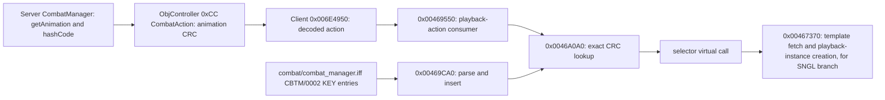

# Combat playback selection from `Stardust.exe` (2026-09-23)

## Scope and result

This block connects Stardust's server-side `CombatAction` animation string to the installed `combat/combat_manager.iff` selection table and the client's playback-script launcher. It does **not** assert that every combat animation or script branch has been reconstructed. All function names below are provisional; decompiler output is reconstructed pseudocode.

## Evidence chain

- **Confirmed by server source:** `CombatManager::broadcastCombatAction` obtains `combatCommand->getAnimation(...)`, hashes the nonempty animation string with `String::hashCode()`, and puts that `uint32` in `CombatAction` (`MMOCoreORB/src/server/zone/managers/combat/CombatManager.cpp` around 1089-1125; `packets/object/CombatAction.h`). The server only broadcasts that branch when the hash is nonzero.
- **Confirmed by executable xrefs/code:** the already mapped `0xCC` application `0x006E4950` calls `0x00469550`. The latter reads action field `+0x14` as the attacker action ID, calls `0x0046A0A0` with it, and invokes the returned selector's virtual method at `+8` with the combat action. A miss logs `failed to find a ScriptSelector`, the numeric attacker action ID and attacker/defender names/types; it does not invent a fallback script. `0x008C7FC0` is another caller of `0x00469550` and should be examined before claiming that all invocations originate in packet `0xCC`.
- **Confirmed by executable parser:** install `0x00469250` opens `combat/combat_manager.iff`; `0x00469B10` requires `CBTM/0002`. `0x00469CA0` reads each `ENTR/KEY ` string, computes its 32-bit hash via `0x00AA4810`, parses a polymorphic selector via `0x00466D10`, and inserts the key/selector into a tree. Duplicate hashes warn and discard the new selector. `0x0046A0A0` performs exact integer-key lookup and returns null on a miss. The selector factory compares the numeric four-byte tags `SNGL`, `RAND`, `DDSP`, `ATYP`, `DTYP`, `AEPS`, and `DEPS` (readable order from the constants; confirm the less-common spellings against asset bytes before treating them as a complete on-disk vocabulary). These are **selector-node types**, not network opcodes.
- **Confirmed by installed asset:** the highest-priority configured `combat/combat_manager.iff` comes from `mtg_patch_011_files_01.tre` (search-tree priority 40), is 474,358 bytes, has `FORM CBTM/FORM 0002`, and contains **406 top-level `ENTR/KEY ` records**, referencing **24 distinct `.pst` paths**. Examples include `fire_single`, `fire_burst`, `fire_suppression`, `ranged_coup_de_grace` and `fire_turret`. Its chunks are adjacent without an extra odd-size pad byte. The `fire_single` entry uses `DDSP` and `DEPS` selector nodes to reach `playback/fire_projectiles.pst`, with `TCAA=fire_single` and optional `CAHD=get_hit_light` variable strings. These names/values are asset facts; the exact meaning of every selector predicate remains under study.
- **Confirmed for the `SNGL` branch:** parser `0x00466F40` reads `NAME` and optional `VARS`; virtual launcher `0x00467370` fetches the referenced playback template through `0x00402FA0`, creates an instance through `0x00404200`, applies variables/actors and posture-related values, then leaves it to playback management. The manager file's full selector graph (especially `DDSP`/`DEPS`) is not yet exhaustively decoded.

## Boundary and implications

The on-wire field is a fixed-width **32-bit animation/action hash**, not a `.pst` path or an x86 pointer. The asset table resolves that hash locally; its selected scripts may drive sound, particles, animation and object presentation. For a replacement client, preserve `0xCC` wire decoding and the server's hash identity, but represent selectors and script actions as typed, engine-neutral data. Do not hard-code the 406 actions into protocol code. A headless networking proof of concept needs only to parse/log the hash and IDs; combat playback belongs in a later asset/scene phase.

There is a known legacy constraint upstream: `0x006E4950` discards actions with more than one defender. The server has a multi-target constructor. The replacement can support it while preserving the wire layout, subject to fixtures.

## Remaining uncertainties

1. **Resolved for this asset's lowercase ASCII keys:** `0x00AA4810` reaches the same 256-entry CRC algorithm as server `String::hashCode`; client filename normalization is inert for the installed keys. See `ANALYSIS_CHECKPOINT_2026-09-23_COMBAT_SPECIAL_EMISSIONS_AND_CRC.md`. Do not generalize that equivalence to uppercase or path-like strings.
2. Reconstruct all selector-node predicates and weighting, especially `DDSP`, `DEPS`, `RAND`, and posture/weapon/attacker distinctions.
3. Trace the secondary `0x008C7FC0` call to determine its UI/local-event origin and whether it can launch playback without an inbound `0xCC` packet.
4. Quantify which of the 406 keys Stardust's current server can emit, including data-driven command animation variants.
5. Resolve precise scheduler lifetime/ownership and fallback behavior for failed/missing `.pst` resources across all selector types.

Raw, untracked read-only decompilation and asset-inspection scratch for this block is under `local-private/session-2026-09-23-combat-selection/`. Only `Stardust.exe` was disassembled; no executable, TRE or server asset was modified.
