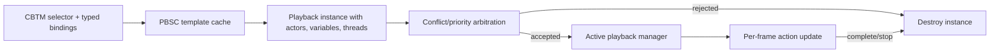

# Playback scheduling, arbitration, and lifetime (2026-09-23, block 3 of 3)

## Confirmed handoff

`SNGL` runtime `0x00467370` gets a cached script template (`0x00402FA0`), constructs a 0x6C-byte legacy playback instance through `0x00404200`/`0x00408790`, binds actors and typed variables, and returns the instance to combat playback action `0x00469550`. If template fetch fails it returns no instance. `0x00469550` calls `0x0139AD30` with the returned instance and a posture/force-related boolean (the exact flag policy remains partly unresolved). This is the concrete bridge from selected asset to the common playback manager.

`0x0139AD30` has two routes. A true flag, or a manager-global permissive flag read by `0x0040AA40`, sends the instance straight to `0x00401C90`. Otherwise it gathers the new instance's marked actors (`0x0139AE60`), compares against marked actors of already active scripts (`0x0139AF80`), and arbitrates conflicts using an instance integer at `+0x68` and a random tie-break. If the new instance loses, it is destroyed/freed and the function returns false; otherwise conflicting active scripts are removed (`0x00401D90`) and the new instance is appended by `0x00401C90`. The **existence and shape** of this priority/conflict policy are confirmed by code. The exact meaning and numeric range of `+0x68`, all actor-marking flags, and the tied-priority probability should not yet be treated as a public behavior specification.

`0x00401C90` appends the instance pointer to the manager's active vector `DAT_01907E78..DAT_01907E7C`. It does not serialize the pointer or transmit it. The manager therefore becomes responsible for cleanup on successful insertion; the losing path explicitly destroys the uninserted instance. This is an x86 ownership pattern, **not** a 64-bit ABI to copy.

## Per-frame retirement

Ground scene update `0x0051AF10` calls manager update `0x00401AB0`. That function snapshots/iterates the active-script vector, calls instance update `0x004078C0` with frame delta, and collects instances whose update returns false. It then removes each completed pointer from the active vector and calls `0x00407620` plus `0x00407560` to destroy/free it. An explicit removal route `0x00401D90` performs the same instance destruction/free sequence after finding a pointer in the active vector.

The instance update `0x004078C0` maintains, per thread, a current action index and accumulated elapsed time. It invokes each action's virtual `+0x10` update with frame delta and script context. A continuing action increments elapsed time and compares it with its virtual `+0x18` duration-like result; completed/expired actions advance to the next action, potentially processing multiple actions in one frame. It reports active while at least one thread remains in progress. An instance stop flag at `+0x64` causes an immediate non-continuing result. Exact time units and every action's virtual contracts remain action-specific.

`0x00407620` releases actor references, destroys per-thread runtime actions, releases the retained script template (`0x004043F0` refcount path), tears down typed variable maps and thread vectors; `0x00407560` returns the instance allocation to its memory pool. `0x004043F0` decrements a template reference count and only tears the template down when it reaches zero. A replacement should make these lifetimes explicit with safe handles/refcounts and cancellation, not preserve the old 32-bit pointer layout.

## Replacement architecture boundary

The new client can retain this conceptual separation while using x64-safe entity handles, typed variable values, explicit ownership and deterministic test seams for random arbitration. The first headless networking milestone still should not instantiate combat playback. No executable, TRE, server source, build, or commit was changed.
