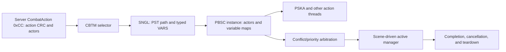

# Three-block combat playback analysis session (2026-09-23)

## Scope

Original executable only: `C:\Stardust-DEV\Stardust.exe` (SHA-256 `E782BF1C49B3DA730F66B54BC558947C46493F7133F672EED1D8E0C56A6B6150`), effective assets under its configured `swgemu_live.cfg` TRE overlay, and current Stardust server source for context. Read-only Ghidra pseudocode is reconstructed, not original source. No Godot/build work, runtime packet interception, protection bypass, executable edit, TRE edit, commit, or push was performed.

## Completed blocks

1. **Typed manager bindings.** `SNGL/VARS` registers and parses `STRN`, `FLOT`, and `INT ` fillers; each stores a four-byte tag and typed value. The effective `CBTM/0002` has 7,418 binding instances across 31 type/tag combinations. The selected `SNGL` applies them to a playback instance before combat-context variables. Checkpoint: `ANALYSIS_CHECKPOINT_2026-09-23_COMBAT_PLAYBACK_VARIABLE_BINDINGS.md`.
2. **Selected script consumption and asset dependencies.** `fire_single` binds `TCAA=fire_single`; `fire_projectiles.pst` declares `TCAA`, and `PSKA/0002` reads it to start skeletal animation. Reaction scripts consume `CAMD`/`CARA` variants. The lightning script encodes appearance, sound, hardpoint and numeric tag dependencies, though the `ULAT` action's exact runtime semantics remain open. Checkpoint: `ANALYSIS_CHECKPOINT_2026-09-23_COMBAT_PST_VARIABLE_CONSUMPTION.md`.
3. **Scheduler and lifetime.** A selected script instance enters actor-conflict/priority arbitration at `0x0139AD30`, then manager vector insertion `0x00401C90` if accepted. Scene update calls manager alter `0x00401AB0`; instance alter `0x004078C0` advances thread/action indices and elapsed time. Completion or conflict removal destroys actions, actor references, maps and template references, then frees the instance. Checkpoint: `ANALYSIS_CHECKPOINT_2026-09-23_PLAYBACK_SCHEDULER_LIFETIME.md`.

## Cross-block model

This is a behavioral/data model for a future x64 implementation. Do not copy the original 32-bit pointer-containing object layouts. The first headless networking proof of concept remains independent of combat playback.

## Open follow-ups

- Decode `FISU`, `ULAT` and other effective action families' variable use; tags in their `INFO` chunks are not enough to establish all side effects.
- Resolve arbitration priority `+0x68`, actor-marking policy and exact tie probability with fixtures or a permitted runtime trace.
- Preserve unsupported-looking but effective-corpus-forward `PSKA/0003` and `FIPL`/`PPRL` files as typed unknowns. They are outside the 24-path combat-manager reference set, not proven globally unreachable.
- Maintain the original-asset requirement: paths, tags and scripts remain data inputs to any Godot or custom-engine client.

Validation after the three blocks: **510 Markdown files; zero broken links; 2,281 unique provisional addresses, zero duplicates; 345 packet rows**. The previous project-wide rough estimate (90% comprehensive / 96% implementation-grade) is not recalculated from these three localized blocks; no new numerical percentage is asserted.
